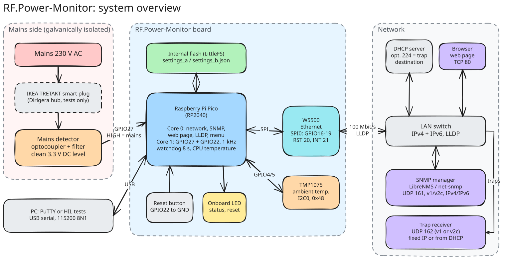
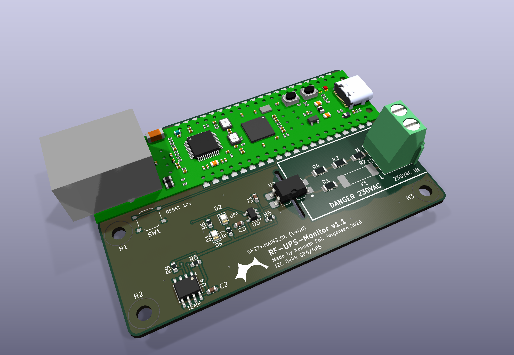
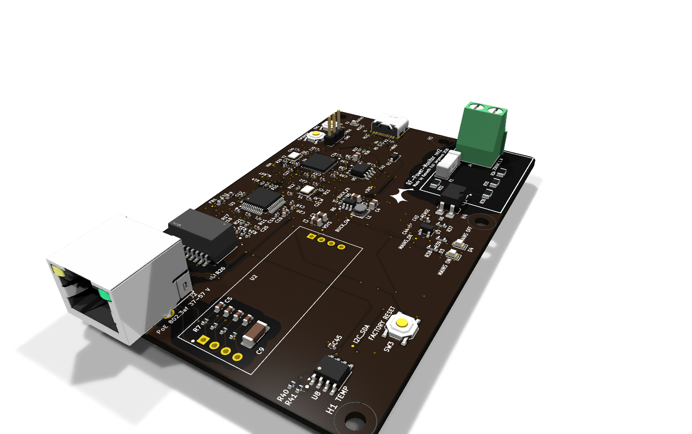
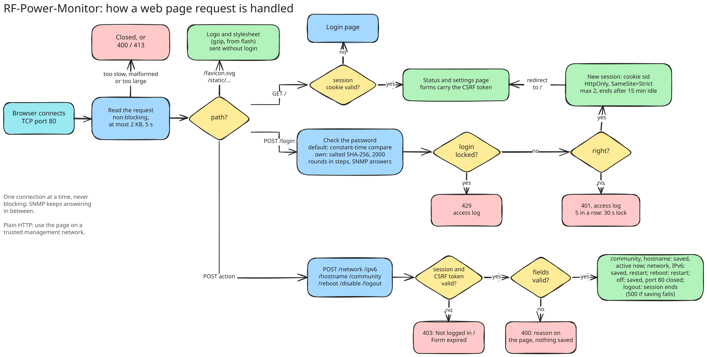
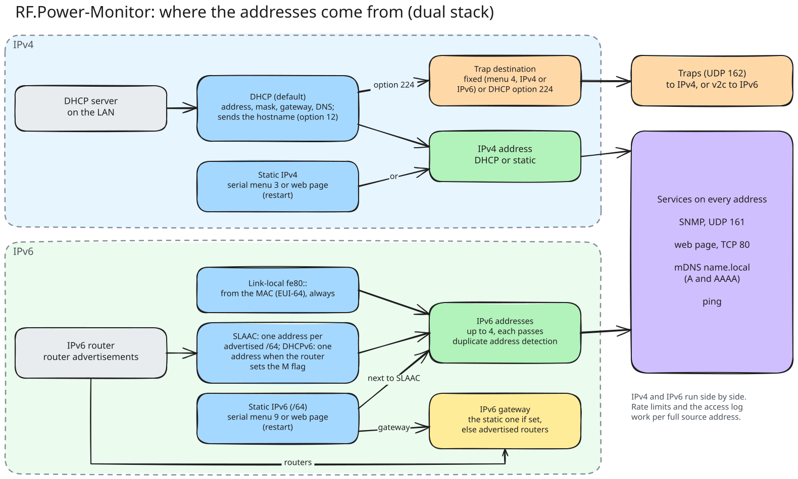
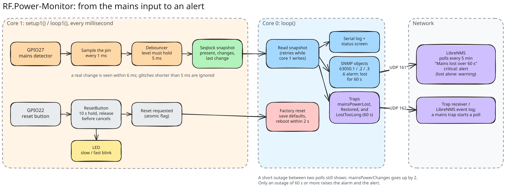
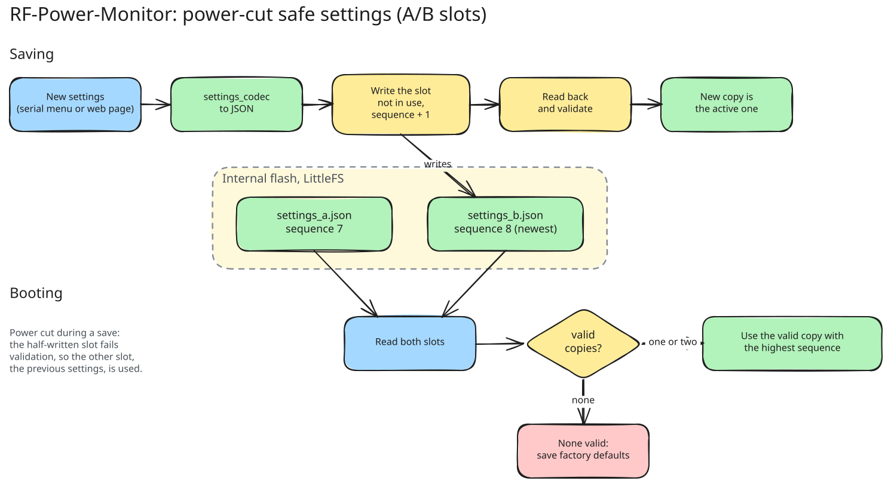
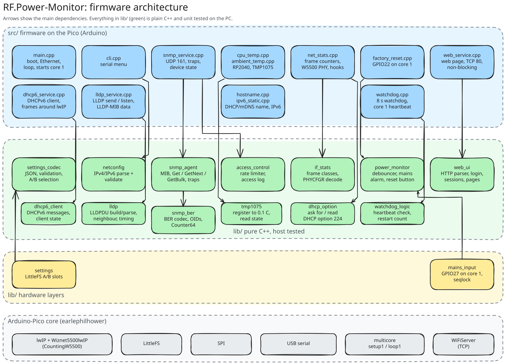
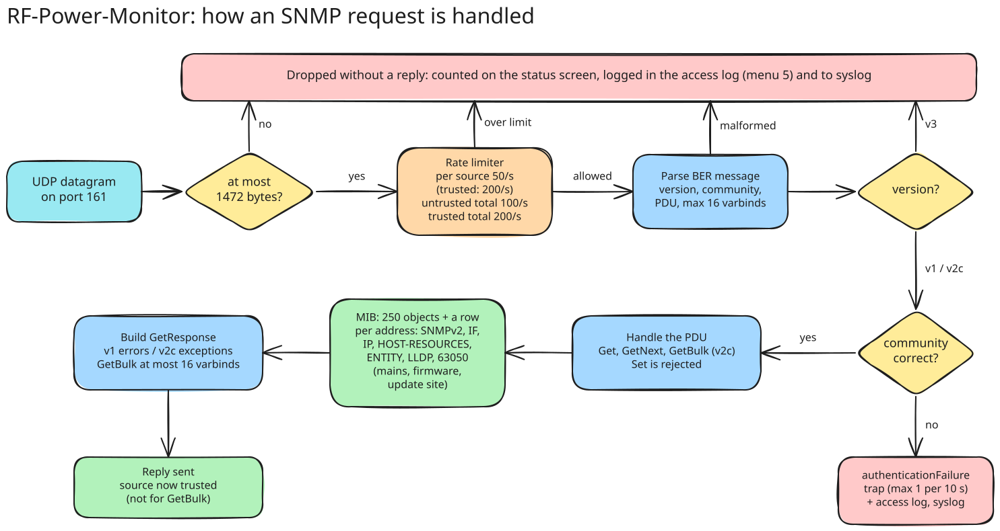

# RF-Power-Monitor

A mains power monitor built on a Raspberry Pi Pico with a W5500 Ethernet module. It reports whether mains power is present over SNMP v1 and v2c, including traps, together with standard interface statistics (IF-MIB), the CPU temperature and the ambient temperature (TMP1075 on the carrier board), so it can be monitored by LibreNMS or any other SNMP manager. It is configured through a menu on the USB serial port.

Current version: **3.6.0** (see [CHANGELOG.md](CHANGELOG.md)).

## Overview



- **Mains side:** an isolated detector (optocoupler with filtering) turns mains presence into a clean 3.3 V level on GPIO27. In the test setup an IKEA smart plug in front of it lets the tests switch mains off and on.
- **Board:** the Pico's core 1 samples GPIO27 and the reset button (GPIO22) every millisecond; core 0 runs the network, the SNMP agent and the serial menu. Settings live in the Pico's flash in two copies, and the W5500 provides 10/100 Ethernet over SPI.
- **Network:** the device gets its address by DHCP (or a static IP), is reachable as `RF-Power-XXXXXX.local` (mDNS; XXXXXX = the last 6 hex digits of its MAC), answers SNMP v1/v2c on UDP 161 for LibreNMS or net-snmp, sends traps on UDP 162, and serves a configuration web page with login on TCP 80 ([Web page](#web-page)). It sets its clock by NTP and sends its events to a syslog server, when the network has them ([Time and syslog](#time-and-syslog)).
- **PC:** the USB serial port carries the configuration menu and the hardware-in-the-loop tests.

More diagrams (firmware architecture, SNMP request flow, mains flow, settings, tests, update site) are in [docs/diagrams/](docs/diagrams/README.md).

## Status

| Feature | State |
|---|---|
| Ethernet with DHCP (default) or static IP | Working |
| Serial menu for network configuration | Working |
| Settings stored in flash, power-cut safe | Working |
| Factory reset button (GPIO22, 10 s hold, non-blocking, LED feedback) | Working, tested with the real button (SW1 on the carrier) |
| Mains power monitoring on GPIO27 (core 1, debounced) | Working, verified with real mains loss/restore (automated with a smart plug) |
| SNMP v1 and v2c agent (Get, GetNext, GetBulk, walk, bulkwalk) | Working, tested with net-snmp |
| SNMP traps in v1 or v2c (coldStart, authenticationFailure, mainsPowerLost/Restored, mainsPowerLostTooLong) | Working, mains traps verified with real mains |
| SNMP rate limiting and access log | Working |
| Web page with login: status, DHCP/static IP, SNMP community, hostname, contact and location, restart | Working |
| Hostname for SNMP sysName, DHCP and mDNS (`name.local`) | Working |
| Web interface can be turned off (serial menu or the page itself) | Working |
| IPv6 (dual stack): SNMP, web page and mDNS over IPv6, SLAAC, per-address rate limiting | Working |
| Static IPv6 address and gateway (serial menu or web page), next to SLAAC | Working |
| LLDP: the switch lists the device as a neighbour; status screen and web page show the switch and port | Working |
| SNMP trap destination from DHCP option 224 | Working, tested with Kea 2.2.0; in your network once the DHCP server has option 224 |
| Interface statistics (IF-MIB ifTable/ifXTable, 64-bit counters) | Working, counted by the firmware |
| CPU temperature (RP2040 internal sensor) | Working |
| Ambient temperature (TMP1075 on the carrier board, I2C) | Working |
| Standard MIBs: SNMPv2-MIB complete, HOST-RESOURCES-MIB (CPU load per core, RAM, LittleFS), ENTITY-MIB (inventory), IP-MIB addresses, MIB-II ip/icmp/tcp/udp counters | Working (3.1.0) |
| LibreNMS OS definition (mains state, temperature, change counter, CPU, memory, storage, addresses, inventory) | Working, tested with LibreNMS 26.10.2 |
| Update site ([update-server/](update-server/README.md), Docker): devices check in every 30 minutes; firmware updates for the devices you tick; check-ins authenticated with a shared key; URL by DHCP option 225 | Working (3.4.0), HIL-tested end to end |
| SNMP objects for the update site check-ins (updateSite group), LibreNMS sensors | Working (3.6.0) |
| Time from NTP (DHCP option 42, DHCPv6 option 31 or a typed server), shown as Danish local time; SNMP hrSystemDate | Working (3.6.0) |
| Syslog (RFC 5424 over UDP): mains, restarts, firmware updates, logins, rejected SNMP requests, settings, network, LLDP and update site events; server typed or from DHCP option 7 | Working (3.6.0), tested with LibreNMS's syslog receiver |

See [TODO.md](TODO.md) for the detailed plan.

## Documentation

| Document | Contents |
|---|---|
| [docs/SETUP_MANUAL.md](docs/SETUP_MANUAL.md) | **Installing a device**: safety, assembly, first configuration, LibreNMS, proving the alarm works, checklist |
| [docs/USER_MANUAL.md](docs/USER_MANUAL.md) | **Daily use**: LEDs, web page, what to do on an alarm, changing settings, the serial menu (every option and status line), factory reset, firmware update, troubleshooting |
| This README | Hardware, wiring, serial menu, web page, network, time and syslog, IPv6, mains monitoring, factory reset, settings, building, SNMP overview, troubleshooting |
| [docs/MIB.md](docs/MIB.md) | Every SNMP object (SNMPv2-MIB, IF-MIB, IP/ICMP/TCP/UDP, HOST-RESOURCES-MIB, ENTITY-MIB, LLDP-MIB, RF-POWER-MONITOR-MIB), traps, v1/v2c differences, rate limiting, errors, limits |
| [docs/LIBRENMS.md](docs/LIBRENMS.md) | Monitoring the device with LibreNMS: install, sensors, alerts, traps, syslog, Docker test setup |
| [docs/TESTING.md](docs/TESTING.md) | Test layers, how to run them, automated mains tests with a smart plug, what each suite covers |
| [CHANGELOG.md](CHANGELOG.md) | What changed in each version |
| [hardware/pico-poe-mains-carrier/](hardware/pico-poe-mains-carrier/README.md) | Carrier PCB rev 1.1 (KiCad 10): circuit, isolation, mounting, fab files for JLCPCB, 3D models |
| [hardware/rf-power-monitor-rev2/](hardware/rf-power-monitor-rev2/README.md) | Rev 2 board, RP2040 and W5500 on the board (designed, not built yet): differences from rev 1, pins, isolation, known limits, fab files |
| [docs/diagrams/](docs/diagrams/README.md) | Excalidraw diagrams (editable) of the system, firmware, SNMP, mains flow, settings, tests and the update site |
| [.clinerules](.clinerules) | Project and test rules |

## Hardware

- Raspberry Pi Pico (RP2040) with a W5500 Ethernet module on SPI0, or the WIZnet **W5500-EVB-Pico-PoE**, which has both on one board (same pins) and is powered over PoE
- Mains detection circuit on GPIO27 (must be galvanically isolated, 3.3 V max)
- Factory reset push button from GPIO22 to GND
- USB cable for flashing and the serial menu (and for power without PoE)

### Carrier board



[hardware/pico-poe-mains-carrier/](hardware/pico-poe-mains-carrier/README.md) is a 2-layer carrier PCB (KiCad 10, 80 x 51.5 mm) for the W5500-EVB-Pico-PoE; the module is soldered flat by its castellated edges or plugged into two 1x20 female headers. It carries the isolated mains detector: 230 VAC on a screw terminal, a T 1 A fuse, four 68 k 200 V resistors, an LTV-814S AC optocoupler (5 kVrms), an RC that bridges the zero crossings and a 74LVC1G14 Schmitt inverter driving GPIO27 (HIGH = mains present) and two LEDs (green = mains on, red = off, without firmware). It also has a TMP1075 temperature sensor on I2C0 and the factory reset button on GPIO22. Mains copper keeps at least 6.5 mm clearance and 6.4 mm creepage to the low-voltage side, enforced as DRC rules, with a slot under the optocoupler. Gerbers, BOM and placement files for JLCPCB, the schematic PDF and STEP/GLB models are in [hardware/pico-poe-mains-carrier/fab/](hardware/pico-poe-mains-carrier/fab/README.md) and `3d/`; `tools/generate.py` generates the whole KiCad project.

How the carrier and the firmware fit together:

| | Carrier | Firmware |
|---|---|---|
| Mains detection | MAINS_OK on GP27, HIGH = present | GPIO27, HIGH = present: matches |
| W5500 | On the module, GP16-GP21 | `include/pins.h` GP16-GP21: matches |
| Power | PoE through the module, 3V3(OUT) feeds the carrier | No dependency |
| Temperature | TMP1075 on I2C0 (GP4 SDA, GP5 SCL, address 0x48) | `ambientTemperature` (63050.5), read every 2 s; absent without the carrier |
| Factory reset button | SW1 from GP22 to GND, below the module (board v1.1) | Reads GPIO22 with the internal pull-up, hold 10 s: matches |
| Mains loss timing | The RC holds the signal about 30-50 ms after mains is lost (bridges zero crossings) | The firmware sees the loss that much later, within the 80 ms `.clinerules` allows from mains to detection |

### Rev 2 board (designed, not built yet)



[hardware/rf-power-monitor-rev2/](hardware/rf-power-monitor-rev2/README.md) is a single 2-layer board (100 x 64 mm, KiCad 10, designed with Adom AI Flow) that takes over everything from the W5500-EVB-Pico-PoE except the PoE stage: RP2040 with 2 MB flash (Pico core), W5500 with magnetics and RJ45, a TLV62569 3.3 V buck and USB-C. PoE stays the plug-in WIZnet WIZPoE-P1 module. The mains detector, TMP1075 and factory reset button are the rev 1 circuits, and the pin map is the same, so the firmware runs unchanged. JLCPCB fab and assembly files are in `out/fab/`. No rev 2 board has been built yet; its README lists the open risks, such as the WIZPoE-P1's 150 mA minimum load.

### Pin configuration

All assignments are in [include/pins.h](include/pins.h).

| Pin | Function | Notes |
|---|---|---|
| GPIO16 | W5500 MISO | SPI0 RX |
| GPIO17 | W5500 CS | |
| GPIO18 | W5500 SCK | |
| GPIO19 | W5500 MOSI | SPI0 TX |
| GPIO20 | W5500 RST | Pulsed low at boot |
| GPIO21 | W5500 INT | Interrupt-driven receive |
| GPIO4 / GPIO5 | I2C0 SDA / SCL | TMP1075 on the carrier board, address 0x48 (ambient temperature) |
| GPIO22 | Factory reset | Active low, internal pull-up |
| GPIO27 | Mains power detection | HIGH = power present, internal pull-down |
| LED | Onboard LED | Status / reset feedback |

## Serial menu

Connect to the Pico's USB serial port (`COM16` here) at **115200 baud, 8N1**, with PuTTY or any terminal. The menu appears right after boot, without waiting for the network; a `Network up after ... ms` message follows when the address is obtained. Press `?` and Enter to show the menu again.

```
=== RF-Power-Monitor Menu ===
1. Show status
2. Use DHCP
3. Set static IP
4. SNMP settings
5. Access log
6. Web password
7. New default web password
8. Web interface on/off
9. Static IPv6
10. Update server
11. Time and syslog
?. Show this menu
>
```

**1. Show status** prints the mains power state and mains alarm, the CPU and ambient temperature (`no sensor` without the TMP1075), the Ethernet link speed, traffic and drop counters, the SNMP counters and settings (community, sysName, sysContact, sysLocation), the switch and port the device is plugged into (LLDP), the web interface, core 0 stack headroom, the CPU load of both cores (last minute), RAM and LittleFS use, the serial number (the flash chip's unique ID), the last restart cause and watchdog restarts, the time (NTP) and the syslog server, the configured network mode, the stored static settings, the DHCPv6 state, and the live interface: state, MAC, IP, subnet, gateway and DNS.

```
> 1

Mains power: present (22 changes, last change 1053 s ago)
Mains alarm: none
SNMP: 802 packets, 802 responses (get 437, getnext 0, set 0), bad community 0, bad version 0, malformed 0
SNMP v2c: 792 requests, 365 getbulk
CPU temperature: 40.4 C
Ambient temperature: 27.1 C
Ethernet: link up, 100 Mbit/s, in 184054263 bytes / 1351415 packets, out 149671 bytes / 1002 packets
Ethernet drops: 0 discarded (no buffer), 0 errors, 211829 unknown protocol, 0 send errors
SNMP security: 0 rate limited, 0 access log events
SNMP community: "public"
sysName: "RF-Power-4EA22C"
sysContact: ""
sysLocation: ""
Trap destination: "" (4 sent, 0 failed)
Trap destination source: fixed (menu option 4)
Trap version: v2c
Hostname: RF-Power-4EA22C (DHCP, mDNS RF-Power-4EA22C.local)
Switch: core-sw1, port ge-0/0/9.0 (10.10.0.2)
Web interface: on (TCP port 80)
Web login: user admin, default password "k7wqz3mtd9" (change with option 6)
Core 0 stack: 6272 bytes never used
CPU load: core 0 0 %, core 1 1 % (last minute)
RAM used: 133444 of 262144 bytes
LittleFS used: 32768 of 262144 bytes
Serial number: E6641CB2CF4CA22C
Last restart: reboot (0 watchdog restarts since power-on)
Time: 2026-11-07 19:42:10 CET (NTP pool.ntp.org, synced 3 min ago)
Syslog: 10.10.6.65:514 (typed), 12 sent, 0 waiting
Mode: DHCP
Stored static IP: 10.10.6.249 / 255.255.0.0, gateway 10.10.0.1
Stored static IPv6: fd16:d833:4f0e:3ece::249/64, gateway from router advertisements
DHCPv6: off (no router asked for it)
Live interface:
State: connected
MAC: 1E:B2:CF:4E:A2:2C
IP: 10.10.6.111
Subnet: 255.255.0.0
Gateway: 10.10.0.1
IPv6: FE80::1CB2:CFFF:FE4E:A22C
IPv6: FD16:D833:4F0E:3ECE::249 (static)
IPv6: FD16:D833:4F0E:3ECE:1CB2:CFFF:FE4E:A22C
IPv6 gateway: from router advertisements
DNS: 10.10.0.1
```

"Unknown protocol" counts frames the device receives but does not use (e.g. spanning tree); on a busy LAN it grows steadily, which is normal.

The interface state line is one of:

| State | Meaning |
|---|---|
| `connected` | Address assigned, device reachable |
| `link up, waiting for DHCP lease` | Cable OK, no DHCP answer yet (keeps retrying) |
| `no Ethernet link, check cable` | No link on the W5500 port |
| `W5500 not detected, check wiring` | The Ethernet module did not respond at boot |

**2. Use DHCP** switches to DHCP after you confirm with `y`.

**3. Set static IP** asks for the IP address, subnet mask and gateway in turn. The value in brackets is the current one; press Enter to keep it.

```
> 3
Press Enter to keep the value in brackets.
IP address [192.168.1.100]: 10.10.6.250
Subnet mask [255.255.255.0]: 255.255.0.0
Gateway [192.168.1.1]: 10.10.0.1

New mode: Static 10.10.6.250 / 255.255.0.0, gateway 10.10.0.1
Save and reboot? (y/n): y
Settings saved. Rebooting...
```

Every value is checked before it is accepted, and a rejected value is asked for again:
- addresses must be four numbers 0-255 (`10.10.6.250`)
- the subnet mask must be contiguous (`255.255.252.0` is fine, `255.0.255.0` is not)
- the IP must not be the network or broadcast address of the subnet
- the gateway must be in the same subnet and differ from the IP

Nothing changes until you answer `y`. Changes are saved to flash and the device reboots to apply them. Answer `n` to cancel.

**4. SNMP settings** asks for the community string, the hostname (which is also the SNMP sysName, see [Hostname](#hostname)), sysContact, sysLocation and the trap destination in turn. Press Enter to keep the value in brackets, or type `-` to clear a value (for the trap destination: turn traps off).

```
> 4
Press Enter to keep the value in brackets, '-' to clear it.
Community [public]: s3cret
Hostname (sysName) [RF-Power-4EA22C]: ups-rack4
sysContact []: ops@example.com
sysLocation []: Server room, rack 4
Trap destination IP or dhcp []: 10.10.6.65
Trap version (1/2c) [2c]:

New SNMP settings: community "s3cret", sysName "ups-rack4", sysContact "ops@example.com", sysLocation "Server room, rack 4", trap destination "10.10.6.65", trap version v2c
Save? (y/n): y
SNMP settings saved and active
```

- Community: 1-31 printable ASCII characters. After saving, requests with the old community get no answer.
- Hostname (sysName): 1-32 letters, digits and `-`, not starting or ending with `-`; `-` does not clear it. Active immediately for DHCP and mDNS too.
- sysContact, sysLocation: 0-63 printable ASCII characters.
- Trap destination: an IPv4 or IPv6 address that receives traps on UDP 162, `-` for no traps, or `dhcp` to take it from DHCP option 224 (see [docs/MIB.md](docs/MIB.md#trap-destination-from-dhcp)). Choosing `dhcp` keeps the fixed address for switching back. An IPv6 destination must be a global or ULA address (not link-local) and is stored in its short form (`2001:db8::162`).
- Trap version: `1` (SNMPv1 Trap-PDU) or `2c` (SNMPv2-Trap, default). An IPv6 destination needs `2c`: a v1 trap carries the device's address in an IPv4-only field, so the menu refuses `1` with an IPv6 destination.
- Saved to flash and active immediately, no reboot. A factory reset restores `public`, the default name `RF-Power-<MAC tail>`, empty contact and location, no trap destination and v2c traps.

**5. Access log** lists the most recent rejected SNMP requests and failed web logins, newest first: wrong community, SNMPv3, malformed packets, rate-limited sources, SetRequests, `web login failed` and `web locked out`. A repeat of the newest entry (same source and event) is counted on that line:

```
Access log: 3 entries, 128 events since boot
  10.10.6.65      rate limited   x104    last 2 s ago
  10.10.6.65      bad version    x1      last 40 s ago
  10.10.6.80      bad community  x23     last 61 s ago
```

Each new entry is also printed on the serial port when it happens (`SNMP access: bad community from 10.10.6.80`) and sent to the syslog server (option 11). Once the device has the time from NTP, each line also shows when it was, in local time: `last 2 s ago (2026-11-07 19:42:08 CET)`.

**6. Web password** sets the password for the web page (see [Web page](#web-page)), or `-` returns to the device default password. The password is asked twice and shown as `*` while typing.

**7. New default web password** replaces the device default password with a new random one after you confirm with `y`, and shows it. Use it if the default password became known to someone else: the old one stops working at once (browsers logged in with it are logged out), and the new one is kept across restarts. An own password set with option 6 stays in use. A board set up with the bench tool has its default password printed on its label and locked: option 7 then refuses (`... locked because it is printed on the device label`). Unlock it at the bench with the hidden command `pwunlock` and print a new label afterwards (see [Bench setup of a new board](#bench-setup-of-a-new-board)). The lock, like the password, survives a factory reset and firmware updates. Firmware older than 3.5.0 (after a rollback) does not know the lock; if its option 7 is used, 3.5.0 notices at the next start (the two password copies differ) and reports `Default web password LOST: label is wrong, relabel at the bench`.

**8. Web interface on/off** switches the web page on or off after you confirm with `y`. Off closes TCP port 80, logs every browser out and stops announcing the page over mDNS; SNMP and the serial menu are not affected. The setting is kept across restarts; a factory reset turns the web interface on again. Turning it on takes effect at once; the status screen shows `Web interface: on (TCP port 80)`.

**9. Static IPv6** asks for a static IPv6 address and an optional IPv6 gateway. Enter keeps the value in brackets, `-` removes it. The address is always a /64 and is added next to the link-local and SLAAC addresses; it is independent of DHCP/static IPv4.

**10. Update server** asks for the update site's URL (`http://host[:port][/path]`, `dhcp` for DHCP option 225, or `none`) and the shared key from the site (64 hex characters, typed as `*`, never shown back; `clear` removes it). The device then checks in every 30 minutes and installs the releases the site assigns to it (see [update-server/README.md](update-server/README.md) and the user manual). A factory reset removes the URL and key, or restores the ones the bench tool set (hidden command `updatedefault`, see [Bench setup of a new board](#bench-setup-of-a-new-board)).

```
> 9
The address is used as a /64 next to the automatic (SLAAC) address.
Press Enter to keep the value in brackets.
Static IPv6 address, '-' for none []: fd16:d833:4f0e:3ece::249
IPv6 gateway, '-' for routers that announce themselves []:

New static IPv6: fd16:d833:4f0e:3ece::249/64, gateway from router advertisements
Save and reboot? (y/n): y
Settings saved. Rebooting...
```

- Address: a global (`2001:db8:...`) or ULA (`fd..`) unicast address, written without `/64`; not link-local (`fe80::`, made automatically), multicast, `::1`, IPv4-mapped, or with an all-zero interface id (`prefix::`). It is stored in the short form (`FD16:0:0:0:0:0:0:249` becomes `fd16::249`).
- Gateway: optional. Empty: the device uses the routers that announce themselves (router advertisements). Set: every off-link IPv6 destination goes through it; it must be link-local (`fe80::1`, usual for routers) or in the address's /64.
- Saved to flash; the device reboots to apply it. A factory reset removes it.

If you lock yourself out with a wrong static address, use the serial menu to switch back to DHCP, or do a factory reset.

**11. Time and syslog** asks for the NTP server and the syslog server (see [Time and syslog](#time-and-syslog)). Enter keeps the value in brackets, `none` or `-` turns it off. A wrong value is refused with the reason and asked for again. Saved and active at once, no restart.

```
> 11
NTP server: address, name, dhcp or none [dhcp]: pool.ntp.org
Syslog server: address[:port], dhcp or none [dhcp]: 10.10.6.65
Time and syslog settings saved and active
Time: not synced (NTP pool.ntp.org)
Syslog: 10.10.6.65:514 (typed), 0 sent, 1 waiting
```

- NTP server: an IPv4 or IPv6 address, a DNS name (`pool.ntp.org`), `dhcp` (DHCP option 42, or DHCPv6 option 31) or `none`.
- Syslog server: an IPv4 address with an optional port (`10.10.6.65:5140`), an IPv6 address (`2001:db8::514`, or `[2001:db8::514]:5140` with a port), `dhcp` (DHCP option 7) or `none`. Port 514 unless given. No DNS names, and no link-local IPv6 (`fe80::`) for either server.
- A factory reset sets both back to `dhcp`.

## Web page

The device serves a small configuration page on **http://&lt;device IP&gt;/** (port 80): log in, see the status, change the network settings (IPv4 and static IPv6), the hostname, the SNMP community and the NTP and syslog servers, restart the device, or turn the page off. It is also reachable as **http://RF-Power-XXXXXX.local/** (XXXXXX = the last 6 hex digits of the MAC; mDNS, see [Hostname](#hostname)) and over IPv6 as **http://[&lt;IPv6 address&gt;]/**. Everything on the page can also be done in the serial menu.

- **Login:** user `admin`. Until you set your own password, the password is the device's **default password**: 10 random characters generated on first boot, different for every device, and shown only on the serial status screen (menu option 1): `Web login: user admin, default password "k7wqz3mtd9"`. A factory reset does not change it; menu option 7 replaces it with a new random one, except on a board set up with the bench tool, where it is printed on the label and locked.
- **Own password:** serial menu option 6 sets one (8-32 characters, no spaces; typed characters are shown as `*`), or `-` goes back to the device default. Changing it logs every browser out. The password is stored as a salted SHA-256 hash (2000 rounds), never as text; checking it takes about half a second, done in small steps so SNMP keeps answering meanwhile. It can only be changed from the serial menu, so someone who learns it cannot lock you out.
- **Status:** mains power (green or red badge) and change count, mains alarm (none / lost over 60 s), uptime, time (NTP) and syslog server (the same text as on the status screen), CPU and ambient temperature, Ethernet link, the switch and port (LLDP), hostname and `.local` name, IP address, IPv6 address and link-local address (when the device has them), MAC address, network mode, static IPv6 address (when set), firmware version (top bar). With DHCP the Network card's boxes show the address, subnet mask and gateway the DHCP server gave (and the DNS server below them); choosing Static and saving keeps that address.
- **Device name:** the hostname (also SNMP sysName and mDNS name), sysContact and sysLocation (0-63 printable characters each, may be empty), active immediately. A page still open from older firmware, without those two fields, leaves them as they are.
- **Network:** DHCP or static IP (address, mask and gateway are checked as in the serial menu). Saving restarts the device; the page tells you the new address.
- **IPv6:** static IPv6 address and gateway, checked as in the serial menu (option 9); empty fields remove them. Saving restarts the device.
- **SNMP community:** active immediately, no restart.
- **Time and syslog:** the NTP server and the syslog server, the same values as menu option 11; active immediately, no restart.
- **Restart device** and **Log out** buttons.
- **Web interface: Turn off…** asks for confirmation, then turns the web page off. Only serial menu option 8 (or a factory reset) turns it on again.

The page carries the RF logo (`logo/RF-canopy-RGB-Orange.svg`) in the top bar and on the login card, and as the browser tab icon (`/favicon.svg`).

The page is styled with [Bootstrap](https://getbootstrap.com/) 5.3.3, which is built into the firmware: the device serves its CSS from flash (31 KB, gzip-compressed, cached by the browser for a year), so the page looks the same on a management network without internet access. It works on phones too. `scripts/embed_bootstrap.py` downloads a pinned version, checks it against Bootstrap's official integrity hash and regenerates `lib/web_ui/src/bootstrap_css.cpp`.

Security:
- Five wrong logins in a row lock the login for 30 seconds, from any address. Failed logins and lockouts appear in the access log (menu option 5) as `web login failed` / `web locked out`.
- A session ends after 15 minutes without a request, on Log out, after a restart, or when the password changes. At most two browsers are logged in at once.
- The session cookie is `HttpOnly` and `SameSite=Strict`, every form carries a per-session token (CSRF protection), and the page sends a strict Content-Security-Policy (no scripts at all) and forbids framing.
- **Plain HTTP:** the password and the session cookie cross the network unencrypted, like the SNMP community. Use the page on a trusted management network.
- Settings changed on the page are saved to flash like those from the serial menu, and are written to the serial log (`Web: network settings saved ...`).
- The server handles one connection at a time without ever blocking: requests are read as they arrive (at most 2 KB), responses are written as fast as the network takes them, a request that has not arrived within 5 seconds is dropped, and a response not sent within 10 seconds of connecting is cut off. SNMP keeps answering in between.



Pages and forms, for scripts (e.g. `curl` with a cookie jar). Every POST except `/login` needs the session cookie `sid` and the form field `csrf` with the token from the page (`name="csrf" value="..."`); forms are `application/x-www-form-urlencoded`.

| Path | Method | Fields | Does |
|---|---|---|---|
| `/` | GET | | Login form, or the status and settings page when logged in |
| `/login` | POST | `user`, `password` | Logs in; sets the `sid` cookie and redirects to `/` |
| `/logout` | POST | | Ends the session |
| `/network` | POST | `mode` (`dhcp` or `static`), `ip`, `mask`, `gateway` | Saves IPv4 settings and restarts |
| `/ipv6` | POST | `ipv6`, `ipv6gw` (empty = none) | Saves the static IPv6 address and gateway and restarts |
| `/hostname` | POST | `hostname` | Saves the hostname (sysName, DHCP, mDNS), active immediately |
| `/community` | POST | `community` | Saves the SNMP community, active immediately |
| `/timelog` | POST | `ntp`, `syslog` (as in menu option 11) | Saves the NTP and syslog servers, active immediately |
| `/reboot` | POST | | Restarts the device |
| `/disable` | POST | `confirm=yes` (without it: the confirmation page) | Turns the web interface off |
| `/favicon.svg` | GET | | The logo, no login |
| `/static/bootstrap-5.3.3.min.css` | GET | | The stylesheet (gzip), no login |

Responses: `400` with the reason on the page for an invalid value (nothing is saved), `403` without a valid session or CSRF token, `401` for a wrong user or password, `429` while logins are locked, `413` for a request over 2 KB, `404`/`405` for an unknown path or wrong method, `500` if saving to flash fails (nothing changed).

## Network

- **DHCP** is the default. The lease is requested in the background, so boot and the menu never wait for it. If no DHCP server answers, the device keeps retrying indefinitely and does not fall back to another address (to avoid IP conflicts). Lease renewal is automatic, and the serial log reports when the address is obtained, changes or is lost.
- **Static IP** is set through the serial menu.
- The MAC address is derived from the Pico's unique chip ID, so it is stable across reboots. Reserve it in your DHCP server for a fixed address.
- Networking uses the Arduino-Pico core's lwIP driver for the W5500 (`Wiznet5500lwIP`).

### LLDP

The device announces itself with LLDP (IEEE 802.1AB) every 30 s, 1 s after the Ethernet link comes up and about 1 s after its address or hostname changes, so the switch lists it as a neighbour (`show lldp neighbors` on Junos). It sends its MAC as chassis and port ID, the hostname as system name, the sysDescr text (with the firmware version) as system description, `W5500 10/100 Ethernet` as port description, "station only" as capability, and its IPv4 address and global IPv6 address (when it has them) as management addresses, with a time to live of 120 s. There is no setting; LLDP is always on.

It also reads the LLDP frames the switch sends and shows the switch and the port it is plugged into: `Switch: r169, port ge-0/0/9.0` on the status screen (with the switch's management address in brackets when the switch sends one), and a "Switch" row on the web page. Junos sends the port as a number (its ifIndex) and the interface name as port description; the device shows the name. Without LLDP from the switch it shows `none seen`; the switch is forgotten when its time to live runs out or the link goes down. LLDP frames count as received multicast frames, not as unknown protocol. The same switch and port are in SNMP (LLDP-MIB `lldpRemTable`, see [docs/MIB.md](docs/MIB.md#switch-and-port-lldp-mib)), which LibreNMS shows on the device's Neighbours tab ([docs/LIBRENMS.md](docs/LIBRENMS.md#switch-and-port-lldp)).

## Time and syslog

**Time.** The device sets its clock from an NTP server (lwIP's SNTP client) and asks again every 15 minutes. The server comes from DHCP option 42, from DHCPv6 option 31 (through lwIP's stateless DHCPv6, so only on networks whose router advertisement sets the O flag), or is typed in menu option 11 or on the web page: an IPv4 or IPv6 address or a DNS name such as `pool.ntp.org`. The default, also after a factory reset, is `dhcp`. There is no built-in server: with `dhcp` and none offered the device has no time, and it never contacts the internet unless you tell it to. Until the first answer the device works as before, on its uptime.

Times are shown in Danish local time (CET, and CEST in summer by the EU rule, switched automatically): on the status screen (`Time: 2026-11-07 19:42:10 CET (NTP pool.ntp.org, synced 3 min ago)`, or `Time: not synced (NTP DHCP, none offered)` and `(NTP off)`), in the web page's "Time" row and in the access log (option 5). Over SNMP the device serves `hrSystemDate` (HOST-RESOURCES-MIB, `1.3.6.1.2.1.25.1.2.0`) once it has the time ([docs/MIB.md](docs/MIB.md#host-resources-host-resources-mib-and-inventory-entity-mib)).

**Syslog.** The device sends what happens to a syslog server: RFC 5424 over UDP, facility daemon, APP-NAME `rfpower`, its hostname as HOSTNAME, the time in UTC with milliseconds. The server is typed (an address, port 514 unless given; no DNS names), comes from DHCP option 7 (the first address in it), or is `none`; the default, also after a factory reset, is `dhcp`. The status screen shows `Syslog: 10.10.6.65:514 (typed), 12 sent, 0 waiting` (or `(from DHCP)`, `off`, `DHCP, none offered (N waiting)`), the web page a "Syslog" row.

| MSGID | Event | Severity |
|---|---|---|
| `MAINS` | Mains lost / restored / lost over 60 s (the mains alarm) | warning / notice / critical |
| `BOOT` | Start, with the restart cause, the slot and the boot program's reason | notice |
| `FIRMWARE` | Update kept / rolled back or fallback, sent after the restart that reports it | notice / error |
| `WEB` | Admin login / failed logins and lockouts | notice / warning |
| `SNMP` | Bad community, bad version, malformed, rate limited, set rejected (from the access log) | warning |
| `SETTINGS` | A change from the web page or the serial menu: what changed, never passwords, keys or the community's value | notice |
| `NETWORK` | Link up, IPv4 address obtained / link down, IPv4 address lost | notice / warning |
| `LLDP` | Switch or port changed / switch no longer seen | notice / warning |
| `UPDATE` | Update site check-ins failing / working again | warning / notice |

Ordinary SNMP polls are not logged. Events wait in a queue of 16 until there is a network, a server and the time from NTP, and are then dated from when they happened. When the queue is full the oldest goes, and a line `N events dropped (queue full)` follows. If the device has no time 2 minutes after the server is known, the waiting events go out undated, with `[uptime N s]` in the text. Access log events are limited to 5 a minute; the rest are counted and reported once a minute (`N more access events not sent`). Before a planned restart (network or IPv6 settings saved, restart from the web page) the queue is sent at once.

DHCP server examples for the two options (here the syslog server is 10.10.6.65 and the NTP server the router, 10.10.0.1):

- ISC dhcpd: `option log-servers 10.10.6.65;` and `option ntp-servers 10.10.0.1;`
- dnsmasq: `dhcp-option=7,10.10.6.65` and `dhcp-option=42,10.10.0.1`

LibreNMS can receive and show the messages: see [docs/LIBRENMS.md](docs/LIBRENMS.md#syslog).

## Hostname

The device has one name, the **hostname**, used in three places. By default it is `RF-Power-` and the last 6 hex digits of the device's MAC address (`RF-Power-4EA22C` for MAC `1E:B2:CF:4E:A2:2C`), so every device on a LAN has its own name; enter `-` for it in menu option 4 to go back to it. Devices updated from firmware before 3.2.0 that still had the old default `rf-power-monitor` switch to it as well. The name is used in three places:

- **SNMP sysName**: LibreNMS and other managers show it as the device name.
- **DHCP**: sent to the DHCP server with every request (option 12), so the lease list of your router shows the name.
- **mDNS**: the device answers as **`<hostname>.local`**, so `http://RF-Power-4EA22C.local/` and `snmpwalk -v2c -c public RF-Power-4EA22C.local` (with your device's name) work without knowing the IP address (Windows 10 and later, macOS, Linux with Avahi; not from inside WSL with its default NAT networking, where mDNS from the LAN does not arrive). The web page is also announced as an `_http._tcp` service.

Set it with menu option 4 (first question after the community) or on the web page. It must be 1-32 letters, digits and `-`, not starting or ending with `-`. A change applies immediately: mDNS announces the new name and the DHCP lease is renewed with it; no restart.

A sysName set with older firmware may contain spaces or other characters; it is kept as it is, and the device uses a cleaned-up version for DHCP and mDNS (`Server room UPS` becomes `Server-room-UPS`). The status screen shows the name in use: `Hostname: RF-Power-4EA22C (DHCP, mDNS RF-Power-4EA22C.local)`.

## IPv6

The device runs IPv4 and IPv6 side by side (dual stack):




- **Addresses:** a link-local address (`fe80::`, from the MAC as EUI-64) always, a global or ULA address from the router's advertisement (SLAAC) when the LAN has an IPv6 router, and optionally a static address (below). The status screen lists them (`IPv6: FD16:D833:4F0E:3ECE:1CB2:CFFF:FE4E:A22C`), the web page shows them in the status table.
- **Static address:** serial menu option 9 or the web page set one static IPv6 address (always /64) and an optional gateway. It is added next to SLAAC, not instead of it, and goes through duplicate address detection: if another host already uses it, the status screen says `(DUPLICATE: another host uses it, not in use)`. With a gateway set, all off-link IPv6 traffic goes through it (it overrides routers from advertisements); without one, the advertised routers are used. Takes effect after the restart that saving triggers.
- **SNMP** answers over IPv6 on UDP 161 like over IPv4 (replies up to 1452 bytes, one Ethernet frame: the device does not fragment IPv6 packets), e.g. `snmpget -v2c -c public udp6:[fd16:d833:4f0e:3ece:1cb2:cfff:fe4e:a22c] 1.3.6.1.2.1.1.1.0`. LibreNMS polls it over IPv6 when added with transport `udp6` (tested with LibreNMS 26.9.1, see [docs/LIBRENMS.md](docs/LIBRENMS.md#ipv6)).
- **Web page:** `http://[<IPv6 address>]/`; **mDNS:** `RF-Power-XXXXXX.local` resolves to the IPv6 address too.
- **Rate limiting and access log:** per full source address, as for IPv4; the access log shows the address (`fd16:d833:4f0e:3ece:9000:9aaa:490a:3189`). Not per /64: on a LAN every host shares one /64, and a manager's trust must not pass to its neighbours. A host that rotates through many IPv6 addresses is held by the shared limit for untrusted sources, like faked IPv4 addresses.
- **Traps** can go to an IPv6 destination (menu option 4), as v2c only. `snmpTrapAddress.0` in the trap still holds the device's IPv4 address, and is left out while it has none.
- **DHCPv6 address:** when a router advertisement carries the M flag ("take addresses from DHCPv6"), the device asks a DHCPv6 server for one address (stateful DHCPv6, RFC 8415) and uses it next to the others, after duplicate address detection. It renews and rebinds the lease on the server's timers, removes the address when the lease runs out, and declines an address another host already uses. If the server moves it to another address, the old one stays (deprecated) until its lease ends. When the Ethernet link comes back up (the cable may now be on another network) it sends a Confirm and drops the address if the server says it is not on this link. A server's SOL_MAX_RT option sets how often it looks for a server. Its client id is DUID-LL from the MAC (`00:03:00:01:1e:b2:cf:4e:a2:2c`), stable across restarts without storing anything, and it sends its hostname (Client FQDN, option 39) so the server can register it in DNS. There is no setting: on networks without the M flag (most) nothing happens. The status screen shows `DHCPv6: bound, fd54::d600:1 (valid 87 s), ...` and marks the address `(dhcpv6)`; the web page has an "IPv6 (DHCPv6)" row. If all four IPv6 address slots are taken (link-local, SLAAC, static and one more), the DHCPv6 address is not added and the status screen and web page say so; no address is ever evicted. The DHCPv6 address takes the highest free slot, so a router advertisement for the same prefix keeps updating the SLAAC address and not this one.
- **Still IPv4 only:** DHCP option 224, and the IP and IF tables in the MIB stay as they are.

Turning IPv6 off needs a firmware build without `PIO_FRAMEWORK_ARDUINO_ENABLE_IPV6` in `platformio.ini`.

## Mains power monitoring



GPIO27 reads the mains detection circuit: HIGH = mains present, LOW = mains lost. The internal pull-down is enabled, so a disconnected input reads as "lost" rather than floating.

- Core 1 samples the pin every millisecond and only accepts a new level once it has held for 5 ms, so short glitches and contact bounce are ignored. A real change is detected within 6 ms of the pin changing (requirement: 10 ms). With the carrier board, a mains loss reaches the pin 30-50 ms late, so the whole path stays within the 80 ms required from mains to detection.
- Core 0 (network, menu, SNMP) reads the state through a sequence lock, so it never sees a half-updated value and core 1 never waits.
- Every change is logged on the serial port, e.g. `Mains power LOST at 123456 ms`, and the status screen shows the state, the number of changes and the time since the last one:

```
Mains power: present (2 changes, last change 37 s ago)
```

The input must be a clean DC level from an isolated circuit (optocoupler with filtering). An unfiltered optocoupler on AC toggles at 100 Hz and would be read as constant power loss and restore; `pio test -e pico -f embedded/test_mains_input -v` prints the raw toggle rate to check this. On the current hardware it reads 0 toggles/s.

## Watchdog

The RP2040's hardware watchdog restarts the device if the firmware hangs. Core 0 feeds it from its main loop, but only while core 1 (mains sampling, reset button) shows it is alive, so a hang on either core restarts the device: core 0 within 8 s, core 1 within about 9 s. It is armed at the end of start-up.

After the restart the device sends a coldStart trap as after any start, and the boot log and status screen show why it started: `Last restart: watchdog (1 watchdog restarts since power-on)`. Other causes are `power-on`, `reset pin` and `reboot` (menu, web page, factory reset, flashing). The count is kept in RAM, so it survives restarts and starts over when power is removed.

## Factory reset

1. Press and hold the button on GPIO22. The onboard LED blinks slowly (2 Hz) while it is held, and the serial log prints `Factory reset button pressed`.
2. After 10 seconds the LED blinks fast, and the log prints `Factory reset after 10000 ms hold`. You can release the button.
3. Settings return to defaults: DHCP on (stored static IP back to `192.168.1.100`), no static IPv6 address, community `public`, sysName not set (the device uses `RF-Power-<MAC tail>`), empty sysContact and sysLocation, no trap destination (fixed), the web interface on, and the web page back on the device default password (the default password itself stays the same). The update server (option 10) goes back to the URL and key the bench tool set (see [Bench setup of a new board](#bench-setup-of-a-new-board)), or off on a board without them. The NTP and syslog servers (option 11) go back to `dhcp`.
4. The device reboots, well within 2 seconds of the trigger.

Releasing the button earlier cancels the reset (`released after ... ms, no reset`). The device keeps working normally while the button is held: SNMP answers, the menu responds and mains monitoring continues. A button held down while the device starts is ignored until it has been released once, so a stuck button cannot cause a reset loop.

## Settings storage



Settings are stored as JSON on the Pico's internal flash (LittleFS) in two copies, `data/settings_a.json` and `data/settings_b.json`:

```json
{"community":"public","dhcpEnabled":true,"staticIP":"192.168.1.100",
 "subnetMask":"255.255.255.0","gateway":"192.168.1.1","ipv6Address":"","ipv6Gateway":"",
 "sysName":"","sysContact":"","sysLocation":"","trapTarget":"",
 "trapVersion":2,"trapFromDhcp":false,"webEnabled":true,"webPassword":"","version":1,"sequence":7}
```

| Field | Meaning |
|---|---|
| `community` | SNMP community string, 1-31 printable characters |
| `sysName` | Hostname and SNMP sysName (new values: a valid hostname; older free text still loads); optional, default empty (the device then uses `RF-Power-<MAC tail>`; `rf-power-monitor` from older firmware counts as empty` |
| `sysContact`, `sysLocation` | SNMP system group text, 0-63 printable characters; optional, default empty |
| `trapTarget` | IPv4 or IPv6 address that receives traps, empty = no traps; IPv6 only with `trapVersion` 2 (unless `trapFromDhcp`); optional. Firmware before 2.6.0 rejects a file with an IPv6 address here and uses the other copy or defaults |
| `trapVersion` | `1` = SNMPv1 Trap-PDU, `2` = SNMPv2-Trap (default); optional |
| `trapFromDhcp` | `true` = trap destination from DHCP option 224 (`trapTarget` is kept for switching back); optional, default `false` |
| `webEnabled` | `false` = web interface off; optional, default `true` |
| `webPassword` | Salted SHA-256 hash of the web password (`<salt>$<hash>`), empty = device default password; optional |
| `dhcpEnabled` | `true` = DHCP, `false` = use the static fields |
| `staticIP`, `subnetMask`, `gateway` | Static configuration, validated when DHCP is off |
| `ipv6Address`, `ipv6Gateway` | Static IPv6 address (/64) and gateway, short form, empty = none; independent of `dhcpEnabled`; optional |
| `version` | Layout version, currently 1 |
| `sequence` | Save counter |

Each save writes the copy that is **not** in use, with `sequence` one higher, and reads it back to check it. At boot the valid copy with the highest `sequence` is used. If the device loses power during a save, the half-written copy fails validation and the previous one is loaded, so settings are never lost. If neither copy is valid, factory defaults are saved.

Files from older firmware (without `sequence`, with an `active_file` pointer) are still loaded, and the pointer file is removed.

The update server (option 10) and the NTP and syslog servers (option 11) have their own pairs of files, saved the same way: `data/update_a.json` / `data/update_b.json` and `data/timelog_a.json` / `data/timelog_b.json` (`{"version":1,"sequence":3,"ntpMode":"typed","ntp":"pool.ntp.org","syslogMode":"dhcp","syslog":""}`). They leave the main settings file unchanged, so a rollback to older firmware (3.5.1 for the time and syslog settings) keeps its settings.

The project's `data/` folder is **not** needed: the firmware creates its settings on first boot. Uploading it (`pio run -t uploadfs`) replaces the whole flash filesystem and erases the device's settings.

## Bench setup of a new board

`tools/bench_provision.py` sets up a new board in one run: it flashes the first firmware, reads the device, locks its default web password and makes its label. Install its Python packages once: `python -m pip install -r tools/requirements-bench.txt` (pyserial, Pillow, segno).

1. Build the release files with the field key: `python tools/fw_release.py --field`.
2. Run `python tools/bench_provision.py`, then hold BOOTSEL and plug in the board. The script takes the newest `release/rf-power-monitor-<version>-usb.uf2` (or `--uf2 FILE`), refuses a `firmware.uf2` and anything signed with the development key, checks the file's signature with the boot program's own check, copies it to the `RPI-RP2` drive and waits for the board's serial port (one board at a time).
3. It reads the hostname (`RF-Power-<last 6 MAC digits>`), MAC, serial number, firmware version and default web password (hidden menu command `benchinfo`), checks them and locks the password (`pwlock`), so menu option 7 cannot make the label wrong.
4. With `secret/bench.ini` (gitignored; `--settings` names another file) it also sets the update site: menu option 10 gets the file's URL and key, and the hidden command `updatedefault` keeps them as the board's bench default, which a factory reset restores. The status screen then shows `Update server default: <url>, key set (a factory reset restores it)`. Without the file the update server is left off. The file:

   ```ini
   [update]
   url = http://10.132.0.45:8074
   key = <the site's 64 hex character shared key>
   ```

5. It writes, in `bench/` (gitignored): `<hostname>.png` to print, `<hostname>-preview.png`, and a row in `devices.csv` (with the update server URL, never the key). **`devices.csv` holds the default web passwords**: keep it safe. The script checks it can write `devices.csv` before it touches the board.
6. Print `<hostname>.png` from the NIIMBOT app on a 40 x 40 mm black label with white ribbon (NIIMBOT M2). The image is black on white because the printer puts ribbon wherever the image is dark; the preview shows the real look, white on black.

The label shows `RF Power Monitor`, the board revision (`--revision`, default `rev 2`), the hostname, MAC, user `admin`, the password, and the serial number, firmware version and date the board was set up, with a QR code (`RFPM;H=<hostname>;M=<MAC>;S=<serial>;FW=<version>`; no password).

- `--no-flash [--port COMx]`: the same for a board that already runs firmware 3.5.0 or later, e.g. after `pwunlock` and option 7, or an older carrier board. A hostname set by hand is kept on the label. The new `devices.csv` row wins over older rows for that board.
- `--reprint <hostname|MAC|serial>`: the label again from the newest `devices.csv` row, without the device.
- `--dev`: accept development-signed firmware, only for testing the tool.

## Building and flashing

Requirements: VS Code with PlatformIO. On Windows you also need the WinUSB driver on the Pico's boot interface, a one-time step with Zadig described in [docs/TESTING.md](docs/TESTING.md#usb-driver-for-flashing).

```powershell
$pio = "$env:USERPROFILE\.platformio\penv\Scripts\pio.exe"
& $pio run -e pico               # build
& $pio run -e pico -t upload     # build and flash (close PuTTY first)
& $pio device monitor            # serial monitor
```

If upload fails, hold BOOTSEL while plugging in the Pico and copy `.pio\build\pico\firmware_full.uf2` to the `RPI-RP2` drive. Use only that file or a release's `-usb.uf2`: the plain `firmware.uf2` has no boot program and the device would not start.

From 3.3.0 the firmware is updated over the network, signed with your key, with automatic rollback: see the [user manual](docs/USER_MANUAL.md#updating-the-firmware), the [setup manual](docs/SETUP_MANUAL.md#firmware-signing-key) for the key and field builds, and `python tools/fw_release.py --field` for the release files.

The PlatformIO platform is pinned to a commit in `platformio.ini`, which fixes Arduino-Pico 5.4.3 (lwIP 2.2.1) and GCC 14.2, so every PC and CI build the same firmware. Newer cores (6.x) use GCC 16 and change stack use: move the pin on purpose, then measure the stacks again and run every test layer.

## Testing

There are three layers: unit tests on the PC, tests on the Pico, and hardware-in-the-loop tests that drive the real serial menu.

```powershell
& $pio test -e native     # PC, no hardware
& $pio test -e pico       # on the Pico (reflash the firmware afterwards)
& "$env:USERPROFILE\.platformio\penv\Scripts\python.exe" -m unittest discover -s test/hil -v
```

Setup, coverage and how to add tests: [docs/TESTING.md](docs/TESTING.md). Rules for test code: [.clinerules](.clinerules).

## Project structure

```
include/pins.h              GPIO assignments
include/version.h           Firmware version (FIRMWARE_VERSION)
include/lwip_hooks.h        lwIP hook: static IPv6 gateway as next hop
src/main.cpp                Boot, Ethernet bring-up, main loop
src/cli.cpp                 Serial menu
src/factory_reset.cpp       Reset button on core 1, reset on core 0
src/web_service.cpp         Web page on TCP 80: non-blocking connection handling, default password
src/stack_watch.cpp         Core 0 stack high-water mark for the status screen
src/host_stats.cpp          CPU load, RAM, LittleFS and serial number for HOST-RESOURCES-MIB / ENTITY-MIB
lib/cpu_load/               One-minute processor load per core (pure, host tested)
src/hostname.cpp            Hostname for DHCP and mDNS (name.local), applied without restart
src/source_key.h            Source address -> rate-limit key (full IPv4 or IPv6 address)
src/ipv6_static.cpp         Static IPv6 address and gateway (lwIP hook in include/lwip_hooks.h)
src/watchdog.cpp            Hardware watchdog (both cores), restart cause and count
src/dhcp6_service.cpp       DHCPv6 address: runs lib/dhcp6_client, frames via the netif hooks
src/lldp_service.cpp        LLDP on the device: sends, reads the switch, LLDP-MIB data
src/time_service.cpp        NTP (lwIP SNTP), local time for the status screen, hrSystemDate
src/syslog_service.cpp      Syslog: event queue, sending over UDP, option 11 settings
src/diag.cpp                Hang diagnosis build (-DRFPOWER_DIAG): crash and panic capture
lib/netconfig/              IPv4/IPv6 parsing, formatting and validation, hostnames (pure C++)
lib/settings_codec/         Settings JSON, validation, A/B selection (pure C++)
lib/settings/               LittleFS storage on top of settings_codec
lib/power_monitor/          Mains input debouncer, 60 s mains alarm, reset button logic (pure C++)
lib/lldp/                   LLDP frames, the one neighbour, send timing (pure C++)
lib/watchdog_logic/         Core 1 heartbeat check, restart record (pure C++)
lib/dhcp6_client/           Stateful DHCPv6 client: messages, frames, RA flags, RFC 8415 timers (pure C++)
lib/tmp1075/                TMP1075 conversion and read state (pure C++)
lib/access_control/         Rate limiter and access log, IPv4 and IPv6 sources (pure C++)
lib/mains_input/            GPIO27 sampler on core 1, seqlock hand-over to core 0
lib/snmp_ber/               ASN.1 BER codec and OIDs for SNMP (pure C++)
lib/snmp_agent/             SNMP v1/v2c messages, MIB, request handling, traps (pure C++)
lib/if_stats/               Ethernet frame counting and W5500 PHY status decoding (pure C++)
lib/web_ui/                 Web page: HTTP parser, login, sessions, pages, SHA-256, logo (pure C++)
lib/dhcp_option/            Ask for and read DHCP options 224, 225 and 7 in Ethernet frames (pure C++)
lib/clock/                  UTC to Danish local time (CET/CEST), DateAndTime (pure C++)
lib/syslog/                 NTP/syslog settings codec, RFC 5424 messages, queue, throttle (pure C++)
src/snmp_service.cpp        UDP port 161, device state for the MIB
src/net_stats.cpp           Counts frames at the lwIP driver, reads the W5500 PHY register
src/cpu_temp.cpp            RP2040 die temperature, averaged
src/ambient_temp.cpp        TMP1075 ambient temperature over I2C0
mibs/                       RF-POWER-MONITOR-MIB
hardware/                   Carrier PCB rev 1.1 for the W5500-EVB-Pico-PoE, rev 2 single board, case (KiCad projects, fab files, 3D, renders)
logo/                       RF logo (SVG), used on the web page and for the LibreNMS icons
librenms/                   LibreNMS OS detection and discovery definitions, RF logo icons, Docker test setup
test/host/                  Host build of the agent for net-snmp checks
test/native/                Unit tests, run on the PC
test/embedded/              Unity tests, run on the Pico
test/hil/                   Python tests over the serial port
boot/                       Boot program: verifies and starts a firmware slot (own build, scripts/build_boot.py)
lib/fw_image/, lib/fw_update/  Slot header and Ed25519 check, boot record and decision, update receiver, trial monitor (pure C++)
lib/monocypher/             Vendored Monocypher (Ed25519, SHA-512)
src/fw_update_service.cpp   Upload to the other slot, trial, rollback, boot record
tools/                      fw_keygen.py, fw_release.py, fw_update.py, fwsign (host signing program)
keys/dev/                   Development signing key (public by design)
scripts/slot_build.py       Links the firmware per slot and builds firmware_full.uf2
scripts/wait_for_port.py    Waits for the USB port after flashing, for pio test
scripts/embed_bootstrap.py  Embeds Bootstrap's CSS (pinned, integrity-checked) in lib/web_ui
scripts/sanitize.sh         Native tests under ASan/UBSan (run in WSL)
scripts/host_agent_check.sh Agent against real net-snmp tools, no hardware (run in WSL)
docs/TESTING.md             Test guide
docs/MIB.md                 SNMP objects, traps, errors, limits
docs/LIBRENMS.md            Adding the device to LibreNMS
docs/diagrams/              Excalidraw diagrams and their SVGs (make_diagrams.py)
CHANGELOG.md                Release history
.github/workflows/tests.yml CI: unit tests, sanitizers, net-snmp check, firmware build
```



Pure libraries have no Arduino or hardware dependency so they can be unit tested on the PC. Hardware and file access stay in thin layers on top.

## SNMP

An SNMP agent runs on UDP port 161 and answers SNMPv1 and SNMPv2c, each request in its own version (SNMPv3 is not supported). The community is `public` by default (menu option 4 changes it, along with sysName, sysContact and sysLocation). It supports Get and GetNext, so `snmpwalk` works, and in v2c GetBulk, so `snmpbulkwalk` works too; everything is read-only.

```
.1.0.8802.1.1.2.1.3.7.1  LLDP-MIB lldpLocPortTable: our port (subtype, MAC, description), row 1
.1.0.8802.1.1.2.1.4.1.1  LLDP-MIB lldpRemTable: the switch, row 0.1.1, only while one is heard
.1.3.6.1.2.1.1          system group
  .1.0  sysDescr        .2.0  sysObjectID     .3.0  sysUpTime
  .4.0  sysContact      .5.0  sysName         .6.0  sysLocation
  .7.0  sysServices
.1.3.6.1.2.1.2          IF-MIB interfaces: ifNumber and ifTable for the Ethernet port (index 1)
.1.3.6.1.2.1.31.1.1     IF-MIB ifXTable: ifName, 64-bit ifHC* counters (v2c only), ifHighSpeed
.1.3.6.1.4.1.63050      RF-POWER-MONITOR-MIB (enterprise 63050)
  .1.0  mainsPowerStatus      INTEGER 1 = present, 0 = lost
  .2.0  mainsPowerChanges     Counter32
  .3.0  mainsPowerLastChange  TimeTicks
  .4.0  cpuTemperature        Integer32, 0.1 degrees Celsius (RP2040 die)
  .5.0  ambientTemperature    Integer32, 0.1 degrees Celsius (TMP1075, only when present)
  .6.0  mainsPowerAlarm       INTEGER 1 = mains lost for 60 s or more, 0 = none
  .7    fwUpdate              firmware slots and the last update (3.3.0)
  .8    updateSite            update site check-ins: result, minutes since a good one, failures in a row (3.6.0)
```

The interface counters are kept by the firmware: every Ethernet frame the W5500 receives or sends is counted (octets, unicast, multicast, broadcast), since the W5500 in MAC-raw mode has no counters of its own. Link state and speed come from the W5500 PHY register. The CPU temperature (`cpuTemperature`) is the RP2040's internal sensor, which reads the chip temperature: a few degrees above the air around it.

To monitor the device with LibreNMS see [docs/LIBRENMS.md](docs/LIBRENMS.md).

```bash
snmpwalk     -v1  -c public 10.10.6.111
snmpbulkwalk -v2c -c public 10.10.6.111
snmpget      -v2c -c public 10.10.6.111 1.3.6.1.4.1.63050.1.0
```

**Traps** go to the trap destination set in menu option 4 (UDP 162), as v2c (default) or v1: `coldStart` at boot, `mainsPowerLost` and `mainsPowerRestored` (with the three mains objects), `mainsPowerLostTooLong` once mains has been gone for 60 s (with `mainsPowerAlarm` as well; alert on this one to ignore short outages), and `authenticationFailure` for a wrong community (at most one per 10 s).



GetBulk replies hold at most 16 objects, so a small request cannot be used to reflect a large reply at a faked source address.

**Security:** each source address may send 50 requests per second on average, with bursts of 100; once it has used the right community, 200 per second with bursts of 400 (whole walks at full speed). Sources that have not shown the right community share a limit of 100 per second, so faked source addresses cannot get around it or starve your managers; managers that use the community share a separate limit of 200 per second. More is dropped and logged. Change the community from `public` (menu option 4): SNMPv1 and v2c have no other authentication. Rejected requests are kept in the access log (menu option 5).

Object details, traps, error behaviour, limits and the MIB file: [docs/MIB.md](docs/MIB.md). The status screen (menu option 1) shows the SNMP counters, rate-limited requests and traps sent.

## Troubleshooting

| Problem | What to check |
|---|---|
| Someone else knows the default web password | Set your own with option 6; option 7 makes a new one unless the password is locked (labelled board: `pwunlock` at the bench, then relabel) |
| Status screen `Default web password LOST: label is wrong` | Both stored copies were damaged, or older firmware replaced a locked password: relabel with `tools/bench_provision.py --no-flash` |
| Web page does not answer at all (connection refused) | The web interface may be off: status screen "Web interface: off", turn it on with menu option 8 |
| Traps go nowhere with trap destination `dhcp` | Status screen "Trap destination source": the DHCP server must have option 224 configured |
| Forgot the web password | Serial menu option 6, enter `-` to go back to the device default password shown on the status screen |
| Web page does not load | Use `http://` (not https); the status screen shows the device IP |
| Web page says "Too many failed logins" | Five wrong passwords in a row lock the login for 30 s; wait and use the password from the status screen (or your own from option 6) |
| Web page says "Form expired" or "Not logged in" | The session ended (15 min idle, restart, password change, or a third browser logged in) or the page was old: reload it and log in again |
| Device restarts after saving on the web page | Network and IPv6 settings need a restart; it is expected. Find the new address on the status screen if it changed |
| Status screen `Time: not synced (NTP DHCP, none offered)` | The DHCP server sends no NTP server (option 42): add it there, or type a server in option 11 |
| No syslog messages arrive | Status screen `Syslog:` line: `off`, `DHCP, none offered` (no DHCP option 7), or messages `waiting` (no network or time yet); the receiving PC's firewall must allow inbound UDP on the port (514 or the one you gave) |
| No traps arrive | Trap destination set (status screen shows it and "N sent"); firewall on the receiving PC must allow inbound UDP 162 |
| A manager gets no answers after polling hard | Rate limit (50/s per source): check menu option 5 for "rate limited" |
| No IP address | Menu option 1 shows the state: cable/link, or no DHCP answer (it keeps retrying) |
| Unreachable after setting static IP | Use the serial menu to check or switch back to DHCP, or factory reset |
| Upload fails with "Access denied" | Close PuTTY or the serial monitor |
| Upload fails with "unable to connect" in BOOTSEL | Install the WinUSB driver with Zadig |
| No serial output | Terminal must set DTR (PuTTY does); reset the board |

## Safety

- The mains detection circuit must be galvanically isolated (optocoupler). The carrier board's isolation (clearance, creepage, slot) is described in its [README](hardware/pico-poe-mains-carrier/README.md#isolation).
- Mains wiring must be done by a qualified person, in a closed enclosure, with the supply fused upstream.
- No GPIO may see more than 3.3 V.
- Ground all modules properly.

## License

MIT

The web page includes Bootstrap's CSS, Copyright 2011-2024 The Bootstrap Authors, MIT license (https://github.com/twbs/bootstrap/blob/main/LICENSE).
