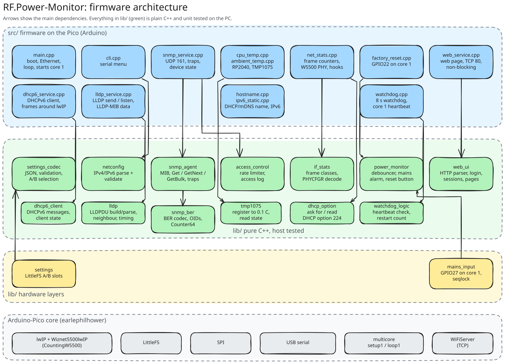

# RF-Power-Monitor: development

Building and flashing the firmware, running the tests, and where the code lives. Project and test rules are in [.clinerules](../.clinerules); the test guide is [TESTING.md](TESTING.md).

## Building and flashing

Requirements: VS Code with PlatformIO. On Windows you also need the WinUSB driver on the Pico's boot interface, a one-time step with Zadig described in [TESTING.md](TESTING.md#usb-driver-for-flashing).

```powershell
$pio = "$env:USERPROFILE\.platformio\penv\Scripts\pio.exe"
& $pio run -e pico               # build
& $pio run -e pico -t upload     # build and flash (close PuTTY first)
& $pio device monitor            # serial monitor
```

If upload fails, hold BOOTSEL while plugging in the Pico and copy `.pio\build\pico\firmware_full.uf2` to the `RPI-RP2` drive. Use only that file or a release's `-usb.uf2`: the plain `firmware.uf2` has no boot program and the device would not start.

From 3.3.0 the firmware is updated over the network, signed with your key, with automatic rollback: see the [user manual](USER_MANUAL.md#updating-the-firmware), the [setup manual](SETUP_MANUAL.md#firmware-signing-key) for the key and field builds, and `python tools/fw_release.py --field` for the release files. A new board is set up at the bench with `tools/bench_provision.py` ([setup manual](SETUP_MANUAL.md#bench-setup-of-a-new-board)).

The PlatformIO platform is pinned to a commit in `platformio.ini`, which fixes Arduino-Pico 5.4.3 (lwIP 2.2.1) and GCC 14.2, so every PC and CI build the same firmware. Newer cores (6.x) use GCC 16 and change stack use: move the pin on purpose, then measure the stacks again and run every test layer.

Upload problems ("Access denied", "unable to connect" in BOOTSEL) are in the user manual's [troubleshooting](USER_MANUAL.md#troubleshooting) table.

## Testing

There are four layers: unit tests on the PC, tests on the Pico, hardware-in-the-loop tests that drive the real serial menu, and tests of the Python tools.

```powershell
& $pio test -e native     # PC, no hardware
& $pio test -e pico       # on the Pico (reflash the firmware afterwards)
& "$env:USERPROFILE\.platformio\penv\Scripts\python.exe" -m unittest discover -s test/hil -v
python -m unittest discover -s test/tools   # release, update and bench tools
```

Setup, coverage and how to add tests: [TESTING.md](TESTING.md). Rules for test code: [.clinerules](../.clinerules).

## Project structure

```
include/pins.h              GPIO assignments
include/version.h           Firmware version (FIRMWARE_VERSION)
include/lwip_hooks.h        lwIP hook: static IPv6 gateway as next hop
src/main.cpp                Boot, Ethernet bring-up, main loop
src/cli.cpp                 Serial menu
src/factory_reset.cpp       Reset button on core 1, reset on core 0
src/web_service.cpp         Web page on TCP 80: non-blocking connection handling, default password
src/stack_watch.cpp         Core 0 stack high-water mark for the status screen
src/host_stats.cpp          CPU load, RAM, LittleFS and serial number for HOST-RESOURCES-MIB / ENTITY-MIB
lib/cpu_load/               One-minute processor load per core (pure, host tested)
src/hostname.cpp            Hostname for DHCP and mDNS (name.local), applied without restart
src/source_key.h            Source address -> rate-limit key (full IPv4 or IPv6 address)
src/ipv6_static.cpp         Static IPv6 address and gateway (lwIP hook in include/lwip_hooks.h)
src/watchdog.cpp            Hardware watchdog (both cores), restart cause and count
src/dhcp6_service.cpp       DHCPv6 address: runs lib/dhcp6_client, frames via the netif hooks
src/lldp_service.cpp        LLDP on the device: sends, reads the switch, LLDP-MIB data
src/time_service.cpp        NTP (lwIP SNTP), local time for the status screen, hrSystemDate
src/syslog_service.cpp      Syslog: event queue, sending over UDP, option 11 settings
src/diag.cpp                Hang diagnosis build (-DRFPOWER_DIAG): crash and panic capture
src/boot_info.cpp           What the boot program left for the firmware (slot, boot reason)
src/http_fetch.cpp          Non-blocking HTTP on lwIP raw TCP, for the update site
src/update_service.cpp      Update site check-ins and downloads into fw_update_service
lib/netconfig/              IPv4/IPv6 parsing, formatting and validation, hostnames (pure C++)
lib/settings_codec/         Settings JSON, validation, A/B selection (pure C++)
lib/settings/               LittleFS storage on top of settings_codec
lib/power_monitor/          Mains input debouncer, 60 s mains alarm, reset button logic (pure C++)
lib/lldp/                   LLDP frames, the one neighbour, send timing (pure C++)
lib/watchdog_logic/         Core 1 heartbeat check, restart record (pure C++)
lib/dhcp6_client/           Stateful DHCPv6 client: messages, frames, RA flags, RFC 8415 timers (pure C++)
lib/tmp1075/                TMP1075 conversion and read state (pure C++)
lib/access_control/         Rate limiter and access log, IPv4 and IPv6 sources (pure C++)
lib/mains_input/            GPIO27 sampler on core 1, seqlock hand-over to core 0
lib/snmp_ber/               ASN.1 BER codec and OIDs for SNMP (pure C++)
lib/snmp_agent/             SNMP v1/v2c messages, MIB, request handling, traps (pure C++)
lib/if_stats/               Ethernet frame counting and W5500 PHY status decoding (pure C++)
lib/web_ui/                 Web page: HTTP parser, login, sessions, pages, SHA-256, logo (pure C++)
lib/dhcp_option/            Ask for and read DHCP options 224, 225 and 7 in Ethernet frames (pure C++)
lib/clock/                  UTC to Danish local time (CET/CEST), DateAndTime (pure C++)
lib/syslog/                 NTP/syslog settings codec, RFC 5424 messages, queue, throttle (pure C++)
lib/update_client/          Update site check-in format and MACs, URL and HTTP parsing, timing, downloads (pure C++)
lib/bench_info/             The benchinfo block for the bench tool (pure C++)
src/snmp_service.cpp        UDP port 161, device state for the MIB
src/net_stats.cpp           Counts frames at the lwIP driver, reads the W5500 PHY register
src/cpu_temp.cpp            RP2040 die temperature, averaged
src/ambient_temp.cpp        TMP1075 ambient temperature over I2C0
mibs/                       RF-POWER-MONITOR-MIB
hardware/                   Carrier PCB rev 1.1 for the W5500-EVB-Pico-PoE, rev 2 single board, case (KiCad projects, fab files, 3D, renders)
logo/                       RF logo (SVG), used on the web page and for the LibreNMS icons
librenms/                   LibreNMS OS detection and discovery definitions, RF logo icons, Docker test setup
test/host/                  Host build of the agent for net-snmp checks
test/native/                Unit tests, run on the PC
test/embedded/              Unity tests, run on the Pico
test/hil/                   Python tests over the serial port
test/tools/                 Tests of the Python tools
boot/                       Boot program: verifies and starts a firmware slot (own build, scripts/build_boot.py)
lib/fw_image/, lib/fw_update/  Slot header and Ed25519 check (own SHA-512, fw_sha512), boot record and decision, update receiver, trial monitor (pure C++)
lib/monocypher/             Vendored Monocypher (Ed25519)
src/fw_update_service.cpp   Upload to the other slot, trial, rollback, boot record
tools/                      fw_keygen.py, fw_release.py, fw_update.py, fwtool.py, fwsign (host signing program), bench_provision.py with bench_device.py, bench_label.py, bench_log.py
update-server/              The update site (Python, Docker): device list, releases, assignments, shared key
keys/dev/                   Development signing key (public by design)
scripts/slot_build.py       Links the firmware per slot and builds firmware_full.uf2
scripts/wait_for_port.py    Waits for the USB port after flashing, for pio test
scripts/embed_bootstrap.py  Embeds Bootstrap's CSS (pinned, integrity-checked) in lib/web_ui
scripts/sanitize.sh         Native tests under ASan/UBSan (run in WSL)
scripts/host_agent_check.sh Agent against real net-snmp tools, no hardware (run in WSL)
docs/USER_MANUAL.md         Daily use: LEDs, web page, serial menu, alarms, updates, troubleshooting
docs/SETUP_MANUAL.md        Installing a device, bench setup, firmware signing key
docs/REFERENCE.md           Network, LLDP, time and syslog, hostname, IPv6, mains, watchdog, reset, settings
docs/HARDWARE.md            Hardware, carrier and rev 2 boards, pins
docs/DEVELOPMENT.md         Building, testing, this list
docs/TESTING.md             Test guide
docs/MIB.md                 SNMP objects, traps, errors, limits
docs/LIBRENMS.md            Adding the device to LibreNMS
docs/diagrams/              Excalidraw diagrams and their SVGs (make_diagrams.py)
CHANGELOG.md                Release history
.github/workflows/tests.yml CI: unit tests, sanitizers, net-snmp check, firmware build
```



Pure libraries have no Arduino or hardware dependency so they can be unit tested on the PC. Hardware and file access stay in thin layers on top.
