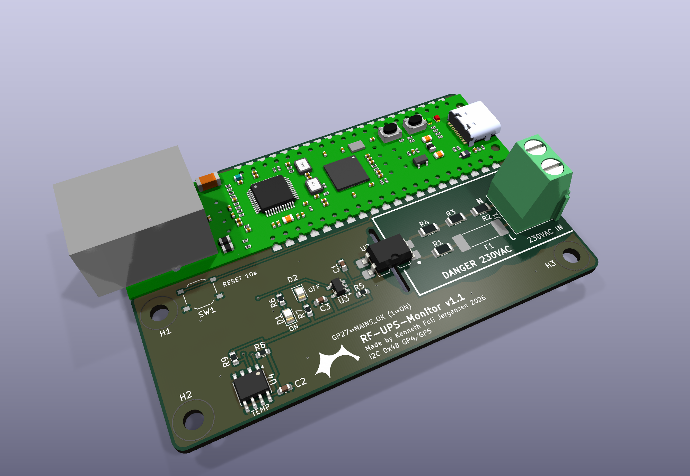
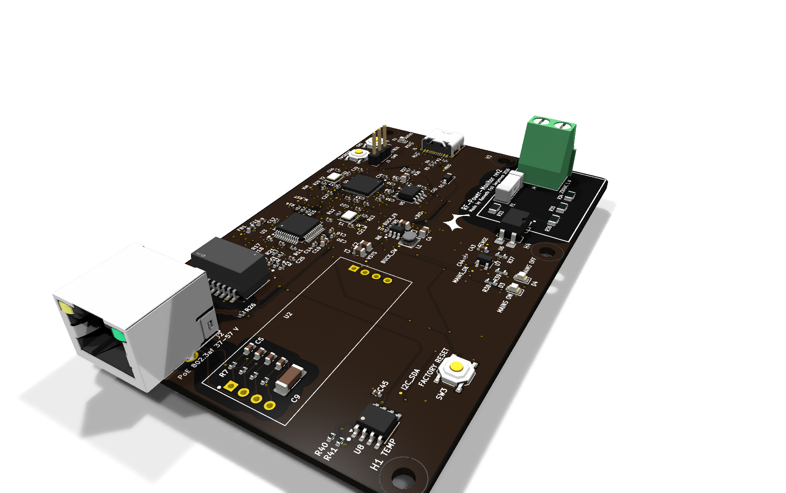

# RF-Power-Monitor: hardware

What the firmware runs on, the carrier board and the rev 2 board, and which pin does what. The boards themselves are documented in their own READMEs: [carrier board rev 1.1](../hardware/pico-poe-mains-carrier/README.md) and [rev 2 board](../hardware/rf-power-monitor-rev2/README.md).

## What you need

- Raspberry Pi Pico (RP2040) with a W5500 Ethernet module on SPI0, or the WIZnet **W5500-EVB-Pico-PoE**, which has both on one board (same pins) and is powered over PoE
- Mains detection circuit on GPIO27 (must be galvanically isolated, 3.3 V max)
- Factory reset push button from GPIO22 to GND
- USB cable for flashing and the serial menu (and for power without PoE)

## Carrier board

[hardware/pico-poe-mains-carrier/](../hardware/pico-poe-mains-carrier/README.md) is a 2-layer carrier PCB (KiCad 10, 80 x 51.5 mm) for the W5500-EVB-Pico-PoE; the module is soldered flat by its castellated edges or plugged into two 1x20 female headers. It carries the isolated mains detector: 230 VAC on a screw terminal, a T 1 A fuse, four 68 k 200 V resistors, an LTV-814S AC optocoupler (5 kVrms), an RC that bridges the zero crossings and a 74LVC1G14 Schmitt inverter driving GPIO27 (HIGH = mains present) and two LEDs (green = mains on, red = off, without firmware). It also has a TMP1075 temperature sensor on I2C0 and the factory reset button on GPIO22. Mains copper keeps at least 6.5 mm clearance and 6.4 mm creepage to the low-voltage side, enforced as DRC rules, with a slot under the optocoupler. Gerbers, BOM and placement files for JLCPCB, the schematic PDF and STEP/GLB models are in [hardware/pico-poe-mains-carrier/fab/](../hardware/pico-poe-mains-carrier/fab/README.md) and `3d/`; `tools/generate.py` generates the whole KiCad project.

How the carrier and the firmware fit together:

| | Carrier | Firmware |
|---|---|---|
| Mains detection | MAINS_OK on GP27, HIGH = present | GPIO27, HIGH = present: matches |
| W5500 | On the module, GP16-GP21 | `include/pins.h` GP16-GP21: matches |
| Power | PoE through the module, 3V3(OUT) feeds the carrier | No dependency |
| Temperature | TMP1075 on I2C0 (GP4 SDA, GP5 SCL, address 0x48) | `ambientTemperature` (63050.5), read every 2 s; absent without the carrier |
| Factory reset button | SW1 from GP22 to GND, below the module (board v1.1) | Reads GPIO22 with the internal pull-up, hold 10 s: matches |
| Mains loss timing | The RC holds the signal about 30-50 ms after mains is lost (bridges zero crossings) | The firmware sees the loss that much later, within the 80 ms [`.clinerules`](../.clinerules) allows from mains to detection |

## Rev 2 board (ordered 2026-11-07, not built yet)

[hardware/rf-power-monitor-rev2/](../hardware/rf-power-monitor-rev2/README.md) is a single 2-layer board (100 x 64 mm, KiCad 10, designed with Adom AI Flow) that takes over everything from the W5500-EVB-Pico-PoE except the PoE stage: RP2040 with 2 MB flash (Pico core), W5500 with magnetics and RJ45, a TLV62569 3.3 V buck and USB-C. PoE stays the plug-in WIZnet WIZPoE-P1 module. The mains detector, TMP1075 and factory reset button are the rev 1 circuits, and the pin map is the same, so the firmware runs unchanged. JLCPCB fab and assembly files are in `out/fab/`. No rev 2 board has been built yet; its README lists the open risks, such as the WIZPoE-P1's 150 mA minimum load.

## Pin configuration

All assignments are in [include/pins.h](../include/pins.h).

| Pin | Function | Notes |
|---|---|---|
| GPIO16 | W5500 MISO | SPI0 RX |
| GPIO17 | W5500 CS | |
| GPIO18 | W5500 SCK | |
| GPIO19 | W5500 MOSI | SPI0 TX |
| GPIO20 | W5500 RST | Pulsed low at boot |
| GPIO21 | W5500 INT | Interrupt-driven receive |
| GPIO4 / GPIO5 | I2C0 SDA / SCL | TMP1075 on the carrier board, address 0x48 (ambient temperature) |
| GPIO22 | Factory reset | Active low, internal pull-up |
| GPIO27 | Mains power detection | HIGH = power present, internal pull-down |
| LED | Onboard LED | Status / reset feedback |

How the firmware reads GPIO27 and GPIO22: [REFERENCE.md](REFERENCE.md#mains-power-monitoring) and [Factory reset](REFERENCE.md#factory-reset). Safety rules for the mains side: [README](../README.md#safety) and the carrier board's [isolation](../hardware/pico-poe-mains-carrier/README.md#isolation).
