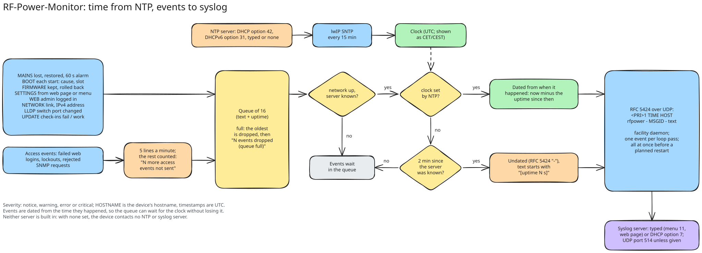
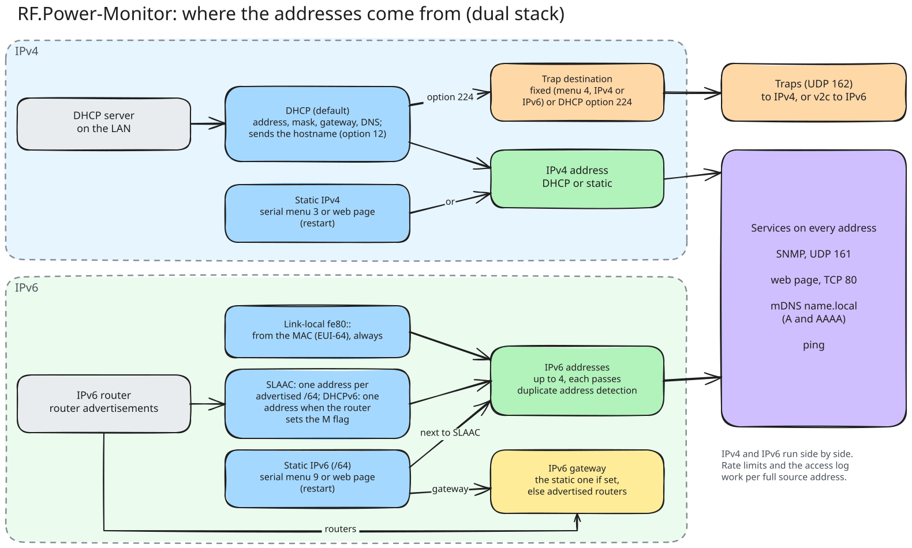
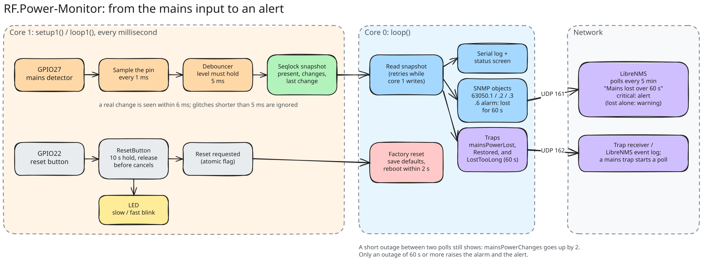
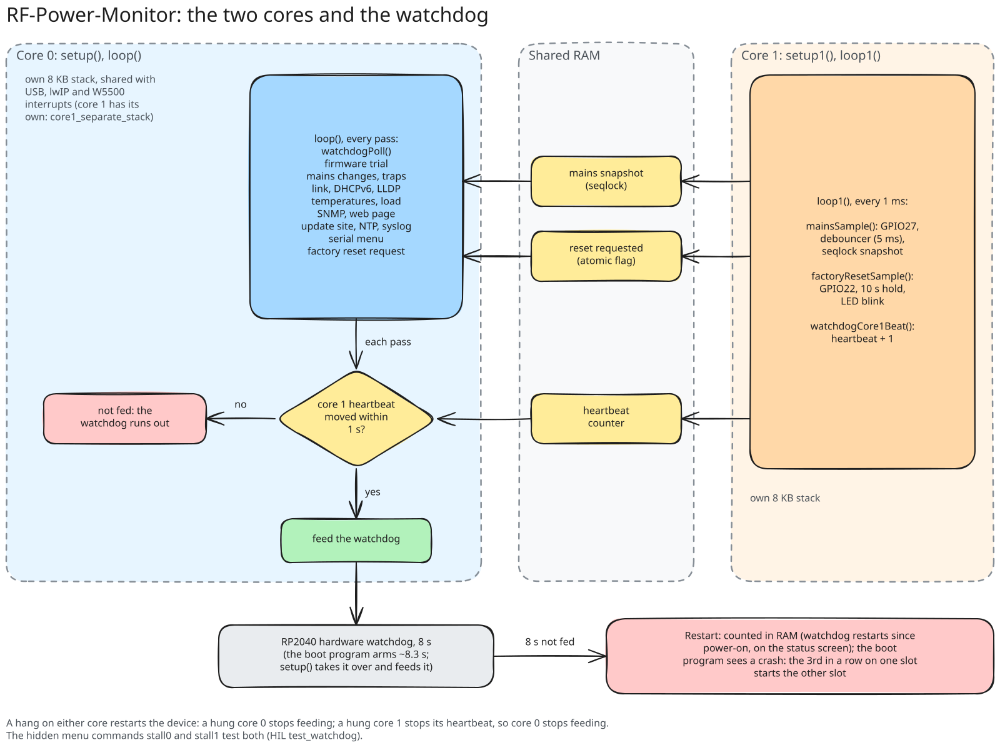
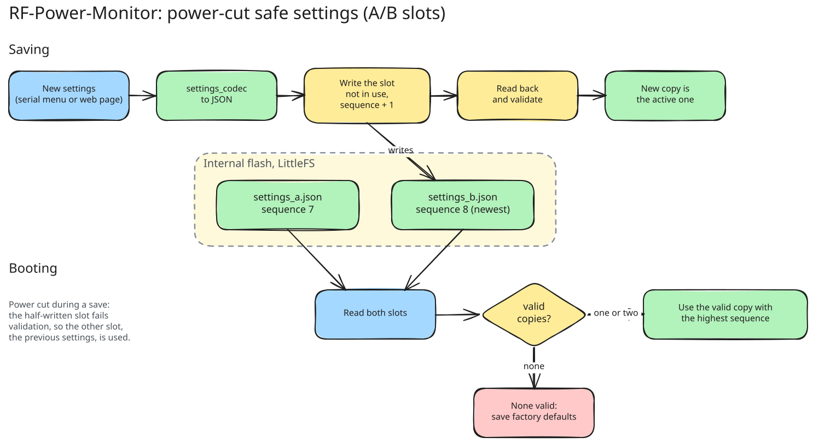

# RF-Power-Monitor: reference

How the device behaves, in detail: the network, its name, IPv6, time and syslog, mains monitoring, the watchdog, the factory reset and how settings are stored. For daily use see the [user manual](USER_MANUAL.md), for installing a device the [setup manual](SETUP_MANUAL.md), and for SNMP the [MIB reference](MIB.md).

Contents:

- [Network](#network) and [LLDP](#lldp)
- [Time and syslog](#time-and-syslog)
- [Hostname](#hostname)
- [IPv6](#ipv6)
- [Mains power monitoring](#mains-power-monitoring)
- [Watchdog](#watchdog)
- [Factory reset](#factory-reset)
- [Settings storage](#settings-storage)

## Network

- **DHCP** is the default. The lease is requested in the background, so boot and the menu never wait for it. If no DHCP server answers, the device keeps retrying indefinitely and does not fall back to another address (to avoid IP conflicts). Lease renewal is automatic, and the serial log reports when the address is obtained, changes or is lost.
- **Static IP** is set through the serial menu (option 3) or the web page.
- The MAC address is derived from the Pico's unique chip ID, so it is stable across reboots. Reserve it in your DHCP server for a fixed address.
- Networking uses the Arduino-Pico core's lwIP driver for the W5500 (`Wiznet5500lwIP`).

### LLDP

The device announces itself with LLDP (IEEE 802.1AB) every 30 s, 1 s after the Ethernet link comes up and about 1 s after its address or hostname changes, so the switch lists it as a neighbour (`show lldp neighbors` on Junos). It sends its MAC as chassis and port ID, the hostname as system name, the sysDescr text (with the firmware version) as system description, `W5500 10/100 Ethernet` as port description, "station only" as capability, and its IPv4 address and global IPv6 address (when it has them) as management addresses, with a time to live of 120 s. There is no setting; LLDP is always on.

It also reads the LLDP frames the switch sends and shows the switch and the port it is plugged into: `Switch: r169, port ge-0/0/9.0` on the status screen (with the switch's management address in brackets when the switch sends one), and a "Switch" row on the web page. Junos sends the port as a number (its ifIndex) and the interface name as port description; the device shows the name. Without LLDP from the switch it shows `none seen`; the switch is forgotten when its time to live runs out or the link goes down. LLDP frames count as received multicast frames, not as unknown protocol. The same switch and port are in SNMP (LLDP-MIB `lldpRemTable`, see [MIB.md](MIB.md#switch-and-port-lldp-mib)), which LibreNMS shows on the device's Neighbours tab ([LIBRENMS.md](LIBRENMS.md#switch-and-port-lldp)).

## Time and syslog



**Time.** The device sets its clock from an NTP server (lwIP's SNTP client) and asks again every 15 minutes. The server comes from DHCP option 42, from DHCPv6 option 31 (SNTP servers: lwIP's stateless DHCPv6 asks for it when the router advertisement sets the O flag, and since 3.6.1 the device's own DHCPv6 address client asks for it too, so a network with only the M flag gives it as well; whichever of DHCP and DHCPv6 answered last is used), or is typed in menu option 11 or on the web page: an IPv4 or IPv6 address or a DNS name such as `pool.ntp.org`. The default, also after a factory reset, is `dhcp`. There is no built-in server: with `dhcp` and none offered the device has no time, and it never contacts the internet unless you tell it to. Until the first answer the device works as before, on its uptime.

Times are shown in Danish local time (CET, and CEST in summer by the EU rule, switched automatically): on the status screen (`Time: 2026-11-07 19:42:10 CET (NTP pool.ntp.org, synced 3 min ago)`, or `Time: not synced (NTP DHCP, none offered)` and `(NTP off)`), in the web page's "Time" row and in the access log (option 5). Over SNMP the device serves `hrSystemDate` (HOST-RESOURCES-MIB, `1.3.6.1.2.1.25.1.2.0`) once it has the time ([MIB.md](MIB.md#host-resources-host-resources-mib-and-inventory-entity-mib)).

**Syslog.** The device sends what happens to a syslog server: RFC 5424 over UDP, facility daemon, APP-NAME `rfpower`, its hostname as HOSTNAME, the time in UTC with milliseconds. The server is typed (an address, port 514 unless given; no DNS names), comes from DHCP option 7 (the first address in it), or is `none`; the default, also after a factory reset, is `dhcp`. Link-local IPv6 addresses (`fe80::`) are refused for both servers: the setting cannot carry the interface they need. The status screen shows `Syslog: 10.10.6.65:514 (typed), 12 sent, 0 waiting` (or `(from DHCP)`, `off`, `DHCP, none offered (N waiting)`), the web page a "Syslog" row.

| MSGID | Event | Severity |
|---|---|---|
| `MAINS` | Mains lost / restored / lost over 60 s (the mains alarm) | warning / notice / critical |
| `BOOT` | Start, with the restart cause, the slot and the boot program's reason | notice |
| `FIRMWARE` | Update kept / rolled back or fallback, sent after the restart that reports it | notice / error |
| `WEB` | Admin login / failed logins, lockouts and refused uploads (from the access log) | notice / warning |
| `SNMP` | Bad community, bad version, malformed, rate limited, set rejected (from the access log) | warning |
| `SETTINGS` | A change from the web page or the serial menu: what changed, never passwords, keys or the community's value | notice |
| `NETWORK` | Link up, IPv4 address obtained / link down, IPv4 address lost | notice / warning |
| `LLDP` | Switch or port changed / switch no longer seen | notice / warning |
| `UPDATE` | Update site check-ins failing / working again | warning / notice |

Ordinary SNMP polls are not logged. Events wait in a queue of 16 until there is a network, a server and the time from NTP, and are then dated from when they happened. When the queue is full the oldest goes, and a line `N events dropped (queue full)` follows. If the device has no time 2 minutes after the server is known, the waiting events go out undated, with `[uptime N s]` in the text. Access log events (SNMP and WEB together) are limited to 5 a minute; the rest are counted and reported once a minute, one line per MSGID (`N more access events not sent`). Before a planned restart (network or IPv6 settings saved, restart from the web page) the queue is sent at once.

DHCP server examples for the two options (here the syslog server is 10.10.6.65 and the NTP server the router, 10.10.0.1):

- ISC dhcpd: `option log-servers 10.10.6.65;` and `option ntp-servers 10.10.0.1;`
- dnsmasq: `dhcp-option=7,10.10.6.65` and `dhcp-option=42,10.10.0.1`

LibreNMS can receive and show the messages: see [LIBRENMS.md](LIBRENMS.md#syslog).

## Hostname

The device has one name, the **hostname**. By default it is `RF-Power-` and the last 6 hex digits of the device's MAC address (`RF-Power-4EA22C` for MAC `1E:B2:CF:4E:A2:2C`), so every device on a LAN has its own name; enter `-` for it in menu option 4 to go back to it. Devices updated from firmware before 3.2.0 that still had the old default `rf-power-monitor` switch to it as well. The name is used in three places:

- **SNMP sysName**: LibreNMS and other managers show it as the device name.
- **DHCP**: sent to the DHCP server with every request (option 12), so the lease list of your router shows the name.
- **mDNS**: the device answers as **`<hostname>.local`**, so `http://RF-Power-4EA22C.local/` and `snmpwalk -v2c -c public RF-Power-4EA22C.local` (with your device's name) work without knowing the IP address (Windows 10 and later, macOS, Linux with Avahi; not from inside WSL with its default NAT networking, where mDNS from the LAN does not arrive). The web page is also announced as an `_http._tcp` service.

Set it with menu option 4 (first question after the community) or on the web page. It must be 1-32 letters, digits and `-`, not starting or ending with `-`. A change applies immediately: mDNS announces the new name and the DHCP lease is renewed with it; no restart.

A sysName set with older firmware may contain spaces or other characters; it is kept as it is, and the device uses a cleaned-up version for DHCP and mDNS (`Server room UPS` becomes `Server-room-UPS`). The status screen shows the name in use: `Hostname: RF-Power-4EA22C (DHCP, mDNS RF-Power-4EA22C.local)`.

## IPv6

The device runs IPv4 and IPv6 side by side (dual stack):



- **Addresses:** a link-local address (`fe80::`, from the MAC as EUI-64) always, a global or ULA address from the router's advertisement (SLAAC) when the LAN has an IPv6 router, and optionally a static address (below). The status screen lists them (`IPv6: FD16:D833:4F0E:3ECE:1CB2:CFFF:FE4E:A22C`), the web page shows them in the status table.
- **Static address:** serial menu option 9 or the web page set one static IPv6 address (always /64) and an optional gateway. It is added next to SLAAC, not instead of it, and goes through duplicate address detection: if another host already uses it, the status screen says `(DUPLICATE: another host uses it, not in use)`. With a gateway set, all off-link IPv6 traffic goes through it (it overrides routers from advertisements); without one, the advertised routers are used. Takes effect after the restart that saving triggers.
- **SNMP** answers over IPv6 on UDP 161 like over IPv4 (replies up to 1452 bytes, one Ethernet frame: the device does not fragment IPv6 packets), e.g. `snmpget -v2c -c public udp6:[fd16:d833:4f0e:3ece:1cb2:cfff:fe4e:a22c] 1.3.6.1.2.1.1.1.0`. LibreNMS polls it over IPv6 when added with transport `udp6` (tested with LibreNMS 26.9.1, see [LIBRENMS.md](LIBRENMS.md#ipv6)).
- **Web page:** `http://[<IPv6 address>]/`; **mDNS:** `RF-Power-XXXXXX.local` resolves to the IPv6 address too.
- **Rate limiting and access log:** per full source address, as for IPv4; the access log shows the address (`fd16:d833:4f0e:3ece:9000:9aaa:490a:3189`). Not per /64: on a LAN every host shares one /64, and a manager's trust must not pass to its neighbours. A host that rotates through many IPv6 addresses is held by the shared limit for untrusted sources, like faked IPv4 addresses.
- **Traps** can go to an IPv6 destination (menu option 4), as v2c only. `snmpTrapAddress.0` in the trap still holds the device's IPv4 address, and is left out while it has none.
- **DHCPv6 address:** when a router advertisement carries the M flag ("take addresses from DHCPv6"), the device asks a DHCPv6 server for one address (stateful DHCPv6, RFC 8415) and uses it next to the others, after duplicate address detection. It renews and rebinds the lease on the server's timers, removes the address when the lease runs out, and declines an address another host already uses. If the server moves it to another address, the old one stays (deprecated) until its lease ends. When the Ethernet link comes back up (the cable may now be on another network) it sends a Confirm and drops the address if the server says it is not on this link. A server's SOL_MAX_RT option sets how often it looks for a server. Its client id is DUID-LL from the MAC (`00:03:00:01:1e:b2:cf:4e:a2:2c`), stable across restarts without storing anything, and it sends its hostname (Client FQDN, option 39) so the server can register it in DNS. There is no setting: on networks without the M flag (most) nothing happens. The status screen shows `DHCPv6: bound, fd54::d600:1 (valid 87 s), ...` and marks the address `(dhcpv6)`; the web page has an "IPv6 (DHCPv6)" row. If all four IPv6 address slots are taken (link-local, SLAAC, static and one more), the DHCPv6 address is not added and the status screen and web page say so; no address is ever evicted. The DHCPv6 address takes the highest free slot, so a router advertisement for the same prefix keeps updating the SLAAC address and not this one.
- **Still IPv4 only:** DHCP option 224, and the IP and IF tables in the MIB stay as they are.

Turning IPv6 off needs a firmware build without `PIO_FRAMEWORK_ARDUINO_ENABLE_IPV6` in `platformio.ini`.

## Mains power monitoring



GPIO27 reads the mains detection circuit: HIGH = mains present, LOW = mains lost. The internal pull-down is enabled, so a disconnected input reads as "lost" rather than floating.

- Core 1 samples the pin every millisecond and only accepts a new level once it has held for 5 ms, so short glitches and contact bounce are ignored. A real change is detected within 6 ms of the pin changing (requirement: 10 ms). With the carrier board, a mains loss reaches the pin 30-50 ms late, so the whole path stays within the 80 ms required from mains to detection.
- Core 0 (network, menu, SNMP) reads the state through a sequence lock, so it never sees a half-updated value and core 1 never waits.
- Every change is logged on the serial port, e.g. `Mains power LOST at 123456 ms`, and the status screen shows the state, the number of changes and the time since the last one:

```
Mains power: present (2 changes, last change 37 s ago)
```

The input must be a clean DC level from an isolated circuit (optocoupler with filtering). An unfiltered optocoupler on AC toggles at 100 Hz and would be read as constant power loss and restore; `pio test -e pico -f embedded/test_mains_input -v` prints the raw toggle rate to check this. On the current hardware it reads 0 toggles/s.

## Watchdog



The RP2040's hardware watchdog restarts the device if the firmware hangs. Core 0 feeds it from its main loop, but only while core 1 (mains sampling, reset button) shows it is alive, so a hang on either core restarts the device: core 0 within 8 s, core 1 within about 9 s. It is armed at the end of start-up.

After the restart the device sends a coldStart trap as after any start, and the boot log and status screen show why it started: `Last restart: watchdog (1 watchdog restarts since power-on)`. Other causes are `power-on`, `reset pin` and `reboot` (menu, web page, factory reset, flashing). The count is kept in RAM, so it survives restarts and starts over when power is removed.

## Factory reset

1. Press and hold the button on GPIO22. The onboard LED blinks slowly (2 Hz) while it is held, and the serial log prints `Factory reset button pressed`.
2. After 10 seconds the LED blinks fast, and the log prints `Factory reset after 10000 ms hold`. You can release the button.
3. Settings return to defaults: DHCP on (stored static IP back to `192.168.1.100`), no static IPv6 address, community `public`, sysName not set (the device uses `RF-Power-<MAC tail>`), empty sysContact and sysLocation, no trap destination (fixed), the web interface on, and the web page back on the device default password (the default password itself stays the same). The update server (option 10) goes back to the URL and key the bench tool set (see [Bench setup of a new board](SETUP_MANUAL.md#bench-setup-of-a-new-board)), or off on a board without them. The NTP and syslog servers (option 11) go back to `dhcp`.
4. The device reboots, well within 2 seconds of the trigger.

Releasing the button earlier cancels the reset (`released after ... ms, no reset`). The device keeps working normally while the button is held: SNMP answers, the menu responds and mains monitoring continues. A button held down while the device starts is ignored until it has been released once, so a stuck button cannot cause a reset loop.

## Settings storage



Settings are stored as JSON on the Pico's internal flash (LittleFS) in two copies, `data/settings_a.json` and `data/settings_b.json`:

```json
{"community":"public","dhcpEnabled":true,"staticIP":"192.168.1.100",
 "subnetMask":"255.255.255.0","gateway":"192.168.1.1","ipv6Address":"","ipv6Gateway":"",
 "sysName":"","sysContact":"","sysLocation":"","trapTarget":"",
 "trapVersion":2,"trapFromDhcp":false,"webEnabled":true,"webPassword":"","version":1,"sequence":7}
```

| Field | Meaning |
|---|---|
| `community` | SNMP community string, 1-31 printable characters |
| `sysName` | Hostname and SNMP sysName (new values: a valid hostname; older free text still loads); optional, default empty (the device then uses `RF-Power-<MAC tail>`; `rf-power-monitor` from older firmware counts as empty) |
| `sysContact`, `sysLocation` | SNMP system group text, 0-63 printable characters; optional, default empty |
| `trapTarget` | IPv4 or IPv6 address that receives traps, empty = no traps; IPv6 only with `trapVersion` 2 (unless `trapFromDhcp`); optional. Firmware before 2.6.0 rejects a file with an IPv6 address here and uses the other copy or defaults |
| `trapVersion` | `1` = SNMPv1 Trap-PDU, `2` = SNMPv2-Trap (default); optional |
| `trapFromDhcp` | `true` = trap destination from DHCP option 224 (`trapTarget` is kept for switching back); optional, default `false` |
| `webEnabled` | `false` = web interface off; optional, default `true` |
| `webPassword` | Salted SHA-256 hash of the web password (`<salt>$<hash>`), empty = device default password; optional |
| `dhcpEnabled` | `true` = DHCP, `false` = use the static fields |
| `staticIP`, `subnetMask`, `gateway` | Static configuration, validated when DHCP is off |
| `ipv6Address`, `ipv6Gateway` | Static IPv6 address (/64) and gateway, short form, empty = none; independent of `dhcpEnabled`; optional |
| `version` | Layout version, currently 1 |
| `sequence` | Save counter |

Each save writes the copy that is **not** in use, with `sequence` one higher, and reads it back to check it. At boot the valid copy with the highest `sequence` is used. If the device loses power during a save, the half-written copy fails validation and the previous one is loaded, so settings are never lost. If neither copy is valid, factory defaults are saved.

Files from older firmware (without `sequence`, with an `active_file` pointer) are still loaded, and the pointer file is removed.

The update server (option 10) and the NTP and syslog servers (option 11) have their own pairs of files, saved the same way: `data/update_a.json` / `data/update_b.json` and `data/timelog_a.json` / `data/timelog_b.json` (`{"version":1,"sequence":3,"ntpMode":"typed","ntp":"pool.ntp.org","syslogMode":"dhcp","syslog":""}`). They leave the main settings file unchanged, so a rollback to older firmware (3.5.1 for the time and syslog settings) keeps its settings.

The project's `data/` folder is **not** needed: the firmware creates its settings on first boot. Uploading it (`pio run -t uploadfs`) replaces the whole flash filesystem and erases the device's settings.
