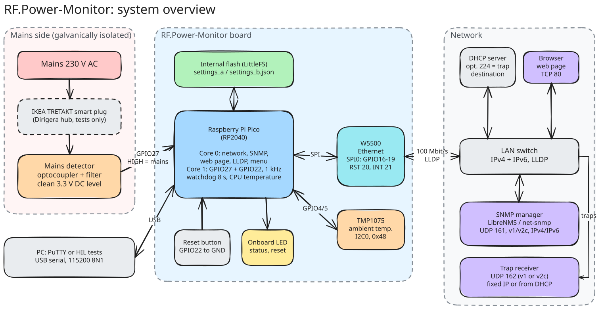
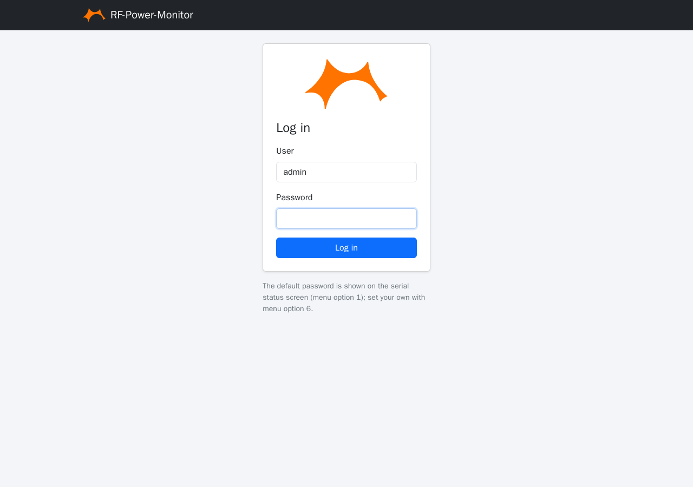
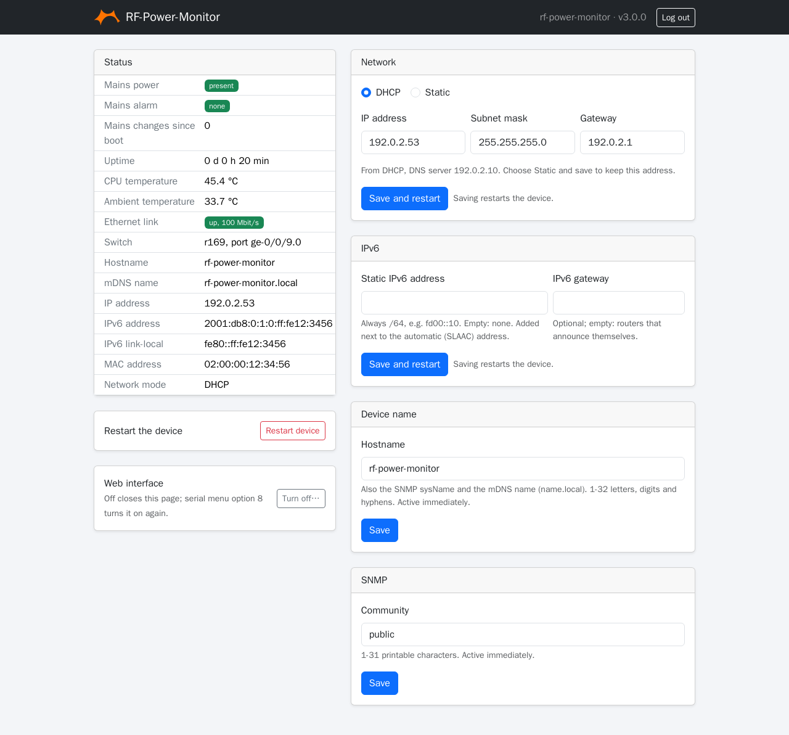
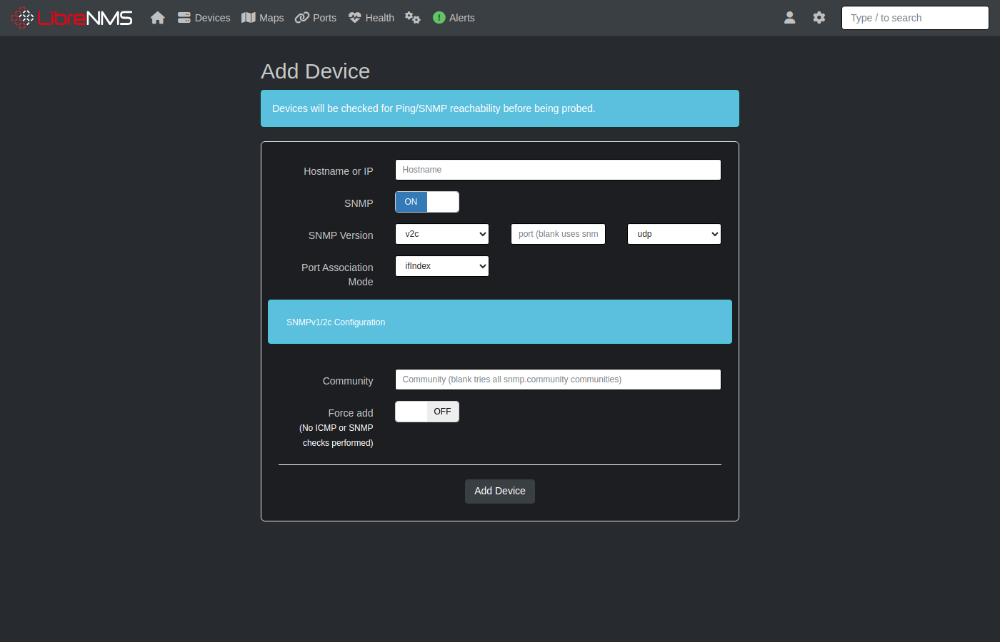
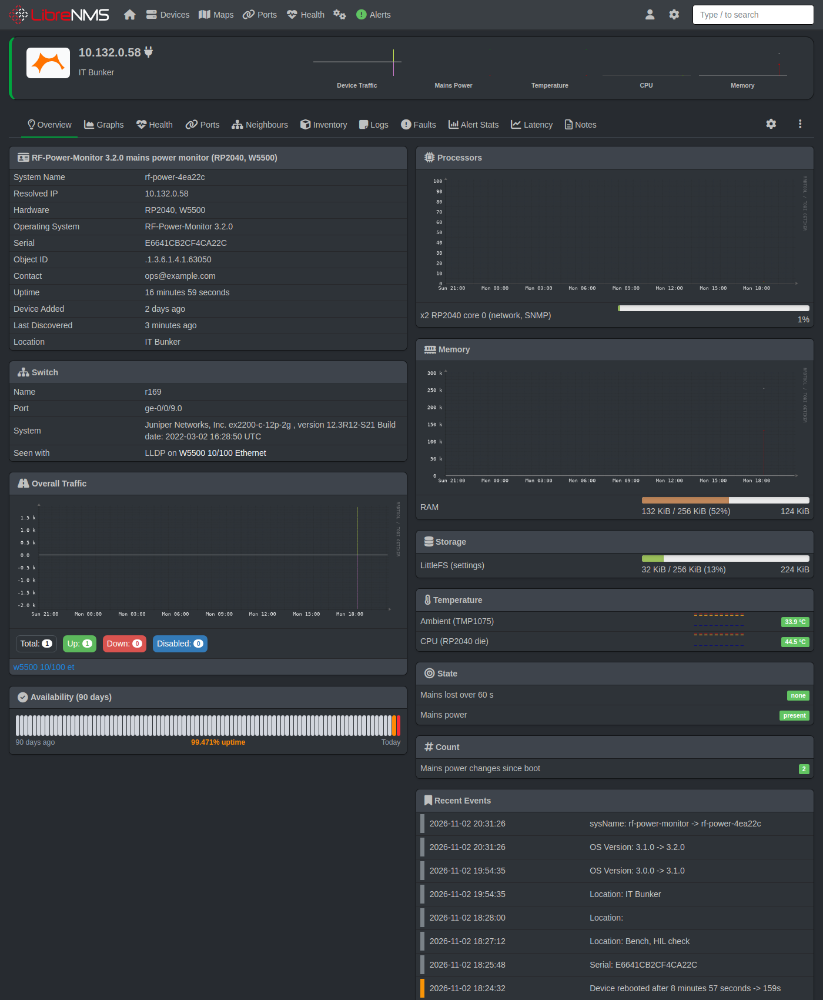
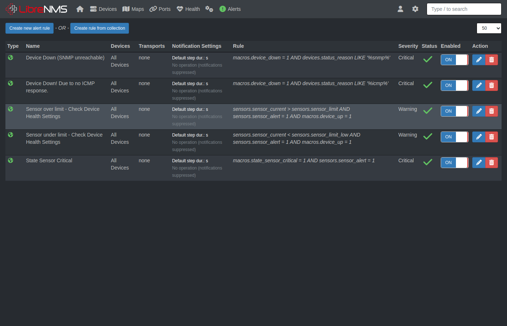
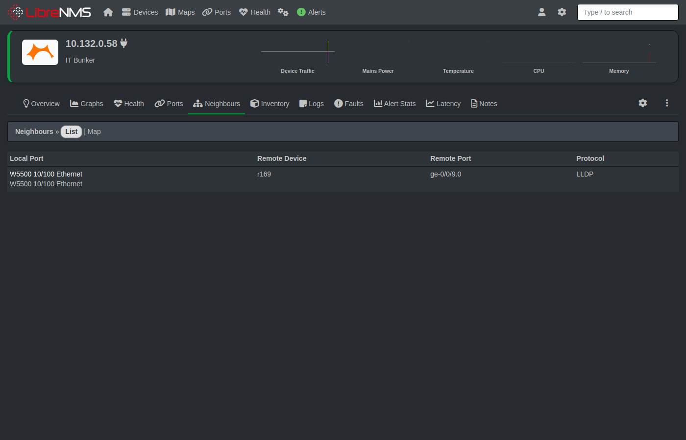

# RF-Power-Monitor: setup manual

This manual takes a new RF-Power-Monitor from the box to a working mains alarm in LibreNMS. It is for the person who installs the device: you know your network (addresses, DHCP, switches), but you do not need to know the code. For daily use afterwards, see the [user manual](USER_MANUAL.md).



## What you need

- The RF-Power-Monitor: a WIZnet **W5500-EVB-Pico-PoE** on the **RF-Power-Monitor carrier board** (mains detector, temperature sensor, factory reset button).
- A **PoE switch port** (802.3af), or a USB power supply if you have no PoE.
- A **USB cable** (USB-C) and a PC with a terminal program such as PuTTY, for the first configuration.
- The **mains supply to watch**, wired to the carrier's screw terminal by a qualified electrician (see Safety).
- A **closed enclosure** for the board.
- **LibreNMS** (or another SNMP manager) on the network, if you want alerts.

## Safety first

The carrier board has a mains side: 230 V AC on the screw terminal J1, the fuse F1 and the optocoupler, inside the area marked "DANGER 230VAC" on the board.

- Mains wiring must be done by a **qualified person**, with the supply **switched off**.
- The board must sit in a **closed enclosure**; nobody may be able to touch the mains side.
- The supply to J1 must be **fused upstream**. F1 on the board (T 1 A) is for faults on the board, it does not replace the upstream fuse.
- Never work on the board while J1 is live. The low-voltage side (module, USB, Ethernet) is galvanically isolated from mains, but only while the board is undamaged and in its enclosure.

## 1. Assemble

1. **Mount the module** on the carrier, either soldered flat by its edges or plugged into two 1x20 female headers. The [carrier board README](../hardware/pico-poe-mains-carrier/README.md#mounting-the-module) shows both ways and which mounting holes to use.
2. **Mount the carrier** in the enclosure with M3 screws.
3. **Wire mains** to J1 (L and N; the wires enter from the same end as the USB port). The device only needs to see whether mains is there; it draws about 1 mA from it.
4. **Connect Ethernet** to the RJ45 on the module, from a PoE port. The board is powered over PoE. Without PoE, power it from the USB port.

Two LEDs on the carrier show mains directly, without the firmware: **green = mains on, red = mains off**. Check them once mains is connected.

## 2. Power on and connect to the serial menu

1. Connect the USB cable to the PC. The module appears as a COM port (Windows Device Manager → Ports).
2. Open PuTTY: **Serial**, that COM port, **115200** baud. (PuTTY sets DTR, which the device needs before it prints.)
3. Press **Enter**, or `?` and Enter. The menu appears:

```
=== RF-Power-Monitor Menu ===
1. Show status
2. Use DHCP
3. Set static IP
4. SNMP settings
5. Access log
6. Web password
7. New default web password
8. Web interface on/off
9. Static IPv6
?. Show this menu
>
```

4. Type `1` and Enter. The **status screen** shows everything the device knows. Look for:
   - `State: connected` and the `IP:` line: the address the device got from DHCP.
   - `Web login: user admin, default password "..."`: the password for the web page. **Write it down.**
   - `Mains power: present`.
   - `Switch: <name>, port <port>`: the switch port the device is plugged into, if the switch speaks LLDP.

The menu is available right after power-on, even before the network is up.

## 3. Network

The device uses **DHCP** by default and keeps retrying until it gets an address. If DHCP is what you want, you are done with this step. Tip: reserve the device's MAC address (status screen `MAC:`) in the DHCP server, so the address stays the same.

For a **static address**, use menu option `3`: it asks for the IP address, subnet mask and gateway, checks each one, and restarts the device after you answer `y`.

```
> 3
Press Enter to keep the value in brackets.
IP address [192.168.1.100]: 10.10.6.250
Subnet mask [255.255.255.0]: 255.255.0.0
Gateway [192.168.1.1]: 10.10.0.1

New mode: Static 10.10.6.250 / 255.255.0.0, gateway 10.10.0.1
Save and reboot? (y/n): y
```

IPv6 works by itself on a network with an IPv6 router (SLAAC, and DHCPv6 if the router asks for it). A fixed IPv6 address can be added with option `9`. See the README's [IPv6 section](../README.md#ipv6).

## 4. Name, SNMP and traps

Menu option `4` asks for these in turn. Press Enter to keep the value in brackets, `-` to clear it.

| Setting | What to enter |
|---|---|
| Community | The SNMP "password" your manager uses. Change it from `public`. |
| Hostname | The device's name, for example `power-serverroom`. It is the SNMP sysName, the name in DHCP, and the mDNS name (`power-serverroom.local`). Letters, digits and `-`. |
| sysContact, sysLocation | Who to call and where the box is. Shown in LibreNMS. Also on the web page (Device name). |
| Trap destination | The address of the LibreNMS server (it receives traps on UDP 162), or `-` for no traps. |
| Trap version | `2c` (recommended). |

```
> 4
Community [public]: s3cret
Hostname (sysName) [rf-power-monitor]: power-serverroom
sysContact []: ops@example.com
sysLocation []: Server room, rack 4
Trap destination IP or dhcp []: 10.10.6.65
Trap version (1/2c) [2c]:
Save? (y/n): y
SNMP settings saved and active
```

These take effect at once; no restart.

## 5. Web page and password

Open **http://&lt;device address&gt;/** (or **http://&lt;hostname&gt;.local/**) in a browser and log in as `admin` with the default password from the status screen.



The page shows the status and lets you change the network, the name and the community, and restart the device. (In the pictures in this manual, the addresses, MAC and community are example values.)



Set your **own web password** with menu option `6` (8 to 32 characters). It can only be set from the serial menu, so someone who learns it cannot lock you out. The page uses plain HTTP: use it on a trusted management network.

If you don't want the web page at all, turn it off with menu option `8`.

## 6. LibreNMS

1. **Install the device definition** on the LibreNMS server (once per server): copy the two definition files, the MIB and the logos as described in [docs/LIBRENMS.md](LIBRENMS.md#install).
2. **Add the device**: Devices → Add Device, the device's address or hostname, SNMP v2c, your community.

   

   LibreNMS detects it as **RF-Power-Monitor** and creates its sensors: *Mains power*, *Mains lost over 60 s*, *CPU* and *Ambient* temperature, and *Mains power changes since boot*. The device page then looks like this:

   

3. **Traps**: set up snmptrapd on the LibreNMS server as described in the LibreNMS documentation; the device's traps then appear in its event log.
4. **Alert**: the standard rule **"State Sensor Critical"** alerts when *Mains lost over 60 s* goes critical, which happens when mains has been gone for 60 s. A shorter outage only shows as a warning and does not alert. Check under Alerts → Alert Rules that the rule exists and is on (ON); add a transport (e-mail, Teams, ...) to it if you want to be notified, not only see the alert in LibreNMS.

   

5. **Neighbours**: if the switch speaks LLDP, the device's Neighbours tab shows the switch and port, and with the RF-Power-Monitor plugin installed (docs/LIBRENMS.md, Install) the Overview page shows them in a **Switch** box. LibreNMS may try to add the switch as a device by itself; to stop that, see [docs/LIBRENMS.md](LIBRENMS.md#switch-and-port-lldp).

   

## 7. Prove it works

Do this once, with the electrician, before you rely on the box:

1. With mains on, the status screen (and the web page) shows `Mains power: present` and `Mains alarm: none`. In LibreNMS, *Mains power* is OK.
2. **Switch mains off** for about **30 seconds**, then on again. The red LED lights, the status screen shows `Mains power: LOST`, then `present` again. LibreNMS logs the traps and shows a warning, but **no alert**.
3. **Switch mains off for 90 seconds.** After 60 s the status screen shows `Mains alarm: lost over 60 s`, the trap *mainsPowerLostTooLong* arrives, and LibreNMS opens the alert within seconds.
4. **Switch mains on.** The alarm clears and the alert recovers.

If something does not behave this way, see Troubleshooting in the [user manual](USER_MANUAL.md#troubleshooting).

## Checklist

- [ ] Mains wired by a qualified person, enclosure closed, supply fused upstream
- [ ] Green/red LEDs follow mains
- [ ] Device has an address (DHCP reservation or static)
- [ ] Community changed from `public`, hostname, contact and location set
- [ ] Trap destination set to the LibreNMS server
- [ ] Own web password set (or web page turned off)
- [ ] Device in LibreNMS as RF-Power-Monitor with its sensors
- [ ] 30 s outage: warning, no alert; 90 s outage: alert, then recovery
