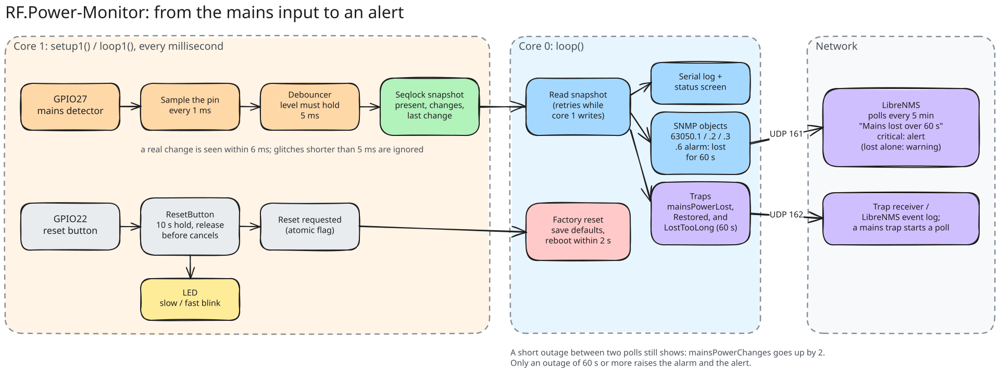
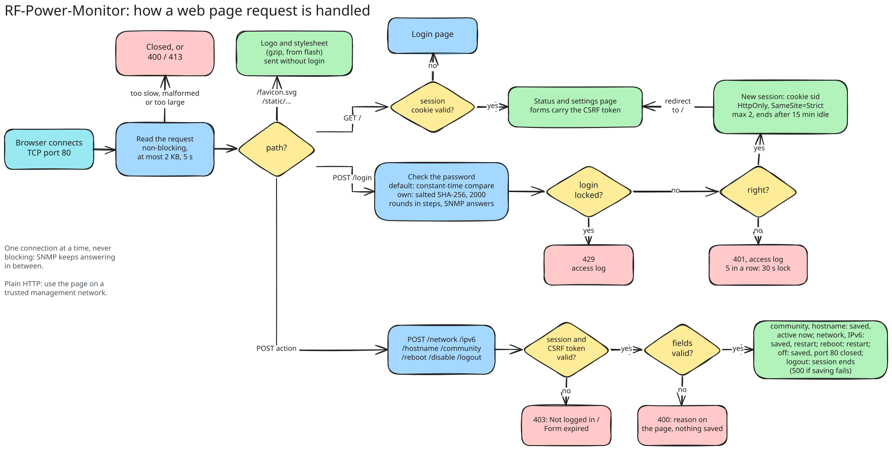
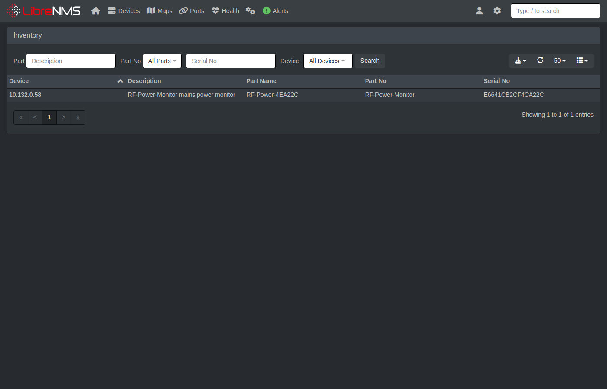
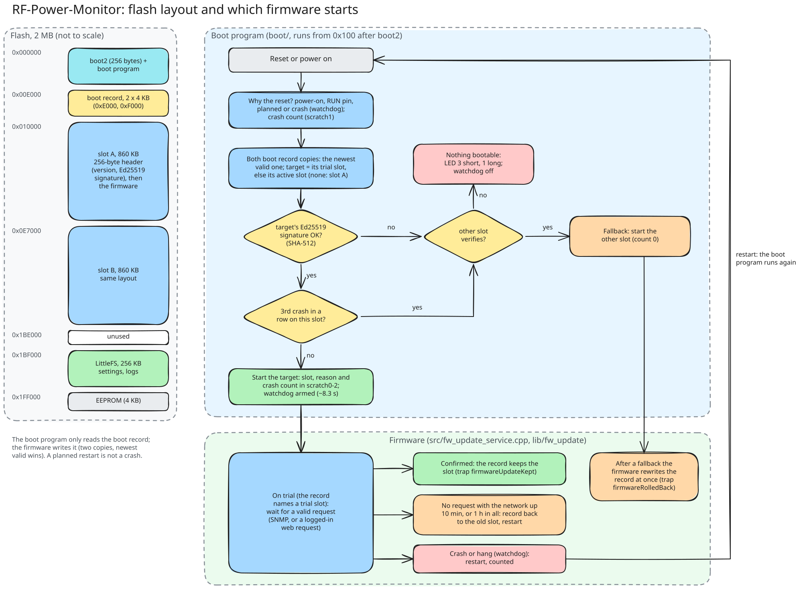
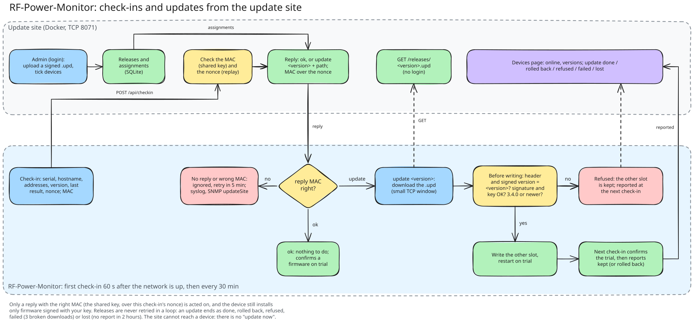

# RF-Power-Monitor: user manual

The RF-Power-Monitor watches one mains supply and tells your monitoring system (LibreNMS or another SNMP manager) when it goes away. This manual is for day-to-day use: reading the device, reacting to an alarm, changing settings and solving problems. To install a new device, see the [setup manual](SETUP_MANUAL.md).

## How it works, in short

- The device checks the mains input every millisecond. A change is accepted after 5 ms, so short glitches are ignored.
- When mains goes away or comes back, it sends a **trap** (a message) to your monitoring system at once and counts the change.
- If mains stays away for **60 seconds**, it raises the **mains alarm** and sends one more trap, *mainsPowerLostTooLong*. In LibreNMS this opens the alert. A shorter outage is logged, but does not alert.
- When mains comes back, the alarm clears and the alert recovers.



## Where to look

### The LEDs

| LED | Meaning |
|---|---|
| Green LED on the carrier | Mains present (hardware, works even without the firmware) |
| Red LED on the carrier | Mains absent |
| Onboard LED on the module, off | Normal operation |
| Onboard LED blinking slowly (2 Hz) | The factory reset button is being held |
| Onboard LED blinking fast | Factory reset triggered, the device restarts |
| Onboard LED blinking steadily, device not answering | The internal flash could not be read at start-up; see Troubleshooting |
| Onboard LED: 3 short blinks, 1 long, repeating | The boot program found no firmware slot with a good signature; install a `-usb.uf2` over USB (see Updating the firmware) |

### The label

A board set up with the bench tool has a 40 x 40 mm label (white on black):

| On the label | What it is |
|---|---|
| Hostname, e.g. `RF-Power-A1B2C3` | The device's name in DHCP, mDNS (`RF-Power-A1B2C3.local`) and SNMP sysName |
| MAC | The Ethernet address, e.g. for a DHCP reservation |
| User / PW | The web page login: `admin` and the device's default password |
| S/N, FW, date | Serial number, the firmware it was shipped with, and when it was set up |
| QR code | Hostname, MAC, serial number and firmware (not the password), for scanning into an inventory |

The password on the label stays valid: a factory reset and firmware updates keep it, and menu option 7 cannot replace it while it is locked (see option 7). If the status screen ever says `Default web password LOST: label is wrong, relabel at the bench`, the device had to make a new password: the label is wrong until the board is labelled again.

### The web page

Open **http://&lt;device address&gt;/** (port 80) or **http://&lt;hostname&gt;.local/** (mDNS, see [Hostname](REFERENCE.md#hostname)), over IPv6 **http://[&lt;IPv6 address&gt;]/**, and log in as `admin`. The page shows:

- **Mains power** (green or red badge) and how often it changed since the device started
- **Mains alarm**: *none*, or *lost over 60 s*
- Uptime, CPU and ambient temperature, the Ethernet link
- **Time**: the local time from NTP, or *not synced*; **Syslog**: where the device sends its events (the same text as on the status screen)
- **Switch**: the switch and port the device is plugged into (if the switch speaks LLDP)
- Hostname and `.local` name, IP address, IPv6 address and link-local address (when the device has them), MAC address, network mode, static IPv6 address (when set); the firmware version in the top bar. With DHCP the Network card's boxes show the address, subnet mask and gateway the DHCP server gave (and the DNS server below them); choosing Static and saving keeps that address.


From the page you can change the network settings, the name, the SNMP community and the NTP and syslog servers (card *Time and syslog*), update or switch the firmware (the **Firmware** page, see Updating the firmware), restart the device, turn the page off, and log out. Everything on the page can also be done in the serial menu. The cards:

- **Device name:** the hostname (also SNMP sysName and mDNS name), sysContact and sysLocation (0-63 printable characters each, may be empty), active immediately. A page still open from older firmware, without those two fields, leaves them as they are.
- **Network:** DHCP or static IP (address, mask and gateway are checked as in the serial menu). Saving restarts the device; the page tells you the new address.
- **IPv6:** static IPv6 address and gateway, checked as in the serial menu (option 9); empty fields remove them. Saving restarts the device.
- **SNMP community:** active immediately, no restart.
- **Time and syslog:** the NTP server and the syslog server, the same values as menu option 11; active immediately, no restart.
- **Restart device** and **Log out** buttons.
- **Web interface: Turn off…** asks for confirmation, then turns the web page off. Only serial menu option 8 (or a factory reset) turns it on again.

**Login.** User `admin`. Until you set your own password, the password is the device's **default password**: 10 random characters generated on first boot, different for every device, and shown only on the serial status screen (menu option 1): `Web login: user admin, default password "k7wqz3mtd9"`, and on the label of a board set up at the bench. A factory reset does not change it; menu option 7 replaces it with a new random one, except on a board set up with the bench tool, where it is printed on the label and locked.

**Own password.** Serial menu option 6 sets one, or `-` goes back to the device default. Changing it logs every browser out. The password is stored as a salted SHA-256 hash (2000 rounds), never as text; checking it takes about half a second, done in small steps so SNMP keeps answering meanwhile. It can only be changed from the serial menu, so someone who learns it cannot lock you out.

**Security.**

- Five wrong logins in a row lock the login for 30 seconds, from any address. Failed logins and lockouts appear in the access log (menu option 5) as `web login failed` / `web locked out`.
- A session ends after 15 minutes without a request, on Log out, after a restart, or when the password changes. At most two browsers are logged in at once.
- The session cookie is `HttpOnly` and `SameSite=Strict`, every form carries a per-session token (CSRF protection), and the page sends a strict Content-Security-Policy (no scripts, except the Firmware page's own upload script, allowed by its hash) and forbids framing.
- **Plain HTTP:** the password and the session cookie cross the network unencrypted, like the SNMP community. Use the page on a trusted management network.
- Settings changed on the page are saved to flash like those from the serial menu, and are written to the serial log (`Web: network settings saved ...`).
- The server handles one connection at a time without ever blocking: requests are read as they arrive (at most 2 KB), responses are written as fast as the network takes them, a request that has not arrived within 5 seconds is dropped, and a response not sent within 10 seconds of connecting is cut off. SNMP keeps answering in between.



**Look.** The page carries the RF logo (`logo/RF-canopy-RGB-Orange.svg`) in the top bar and on the login card, and as the browser tab icon (`/favicon.svg`). It is styled with [Bootstrap](https://getbootstrap.com/) 5.3.3, which is built into the firmware: the device serves its CSS from flash (31 KB, gzip-compressed, cached by the browser for a year), so the page looks the same on a management network without internet access. It works on phones too. `scripts/embed_bootstrap.py` downloads a pinned version, checks it against Bootstrap's official integrity hash and regenerates `lib/web_ui/src/bootstrap_css.cpp`.

**For scripts** (e.g. `curl` with a cookie jar): every POST except `/login` needs the session cookie `sid` and the form field `csrf` with the token from the page (`name="csrf" value="..."`); forms are `application/x-www-form-urlencoded`.

| Path | Method | Fields | Does |
|---|---|---|---|
| `/` | GET | | Login form, or the status and settings page when logged in |
| `/login` | POST | `user`, `password` | Logs in; sets the `sid` cookie and redirects to `/` |
| `/logout` | POST | | Ends the session |
| `/network` | POST | `mode` (`dhcp` or `static`), `ip`, `mask`, `gateway` | Saves IPv4 settings and restarts |
| `/ipv6` | POST | `ipv6`, `ipv6gw` (empty = none) | Saves the static IPv6 address and gateway and restarts |
| `/hostname` | POST | `hostname`, `contact`, `location` (contact or location left out: kept) | Saves the hostname (sysName, DHCP, mDNS), sysContact and sysLocation, active immediately |
| `/community` | POST | `community` | Saves the SNMP community, active immediately |
| `/timelog` | POST | `ntp`, `syslog` (as in menu option 11) | Saves the NTP and syslog servers, active immediately |
| `/reboot` | POST | | Restarts the device |
| `/disable` | POST | `confirm=yes` (without it: the confirmation page) | Turns the web interface off |
| `/firmware` | GET | | The Firmware page (slots, last update, key id, update server) |
| `/firmware/status` | GET | | The same as `key=value` lines, for `tools/fw_update.py` |
| `/firmware/upload` | POST | the `.upd` file as the body (`application/octet-stream`), CSRF token in the header `X-CSRF-Token` | Writes the other slot and restarts on trial |
| `/firmware/switch` | POST | | Restarts into the other slot, on trial |
| `/updateserver` | POST | `url`, `key`, `fromdhcp`, `clearkey` (as menu option 10) | Saves the update server settings |
| `/favicon.svg` | GET | | The logo, no login |
| `/static/bootstrap-5.3.3.min.css` | GET | | The stylesheet (gzip), no login |

Responses: `400` with the reason on the page for an invalid value (nothing is saved), `403` without a valid session or CSRF token, `401` for a wrong user or password, `429` while logins are locked, `413` for a request over 2 KB, `404`/`405` for an unknown path or wrong method, `500` if saving to flash fails (nothing changed).

### The serial menu

Connect a USB cable and open a terminal (PuTTY: Serial, the device's COM port, 115200 baud), then press Enter. Option **1** shows the status screen with everything the device knows, including the default web password and the last restart cause. Option **5** shows the access log: rejected SNMP requests and failed web logins.

### LibreNMS

The device page shows the sensors *Mains power* (OK / warning), *Mains lost over 60 s* (OK / critical), *CPU* and *Ambient* temperature and *Mains power changes since boot*, the Ethernet port with its traffic, and in the **Switch** box the switch and port the device is plugged into (from LLDP, updated at each discovery; the box needs the RF-Power-Monitor plugin on the LibreNMS server). Since firmware 3.1.0 it also shows the device's location and contact (set them on the web page), the load of both processor cores and the memory in use (overview graphs *CPU* and *Memory*), the settings flash as storage, the IPv4 and IPv6 addresses on the port, the serial number, an **Inventory** entry, and IP/ICMP/TCP/UDP/SNMP traffic graphs under **Graphs → Netstats** (firmware 3.2.0, contact replaced by a placeholder):


From firmware 3.3.0 the sensors *Firmware* (normal or trial) and *Firmware last update* show the state of the last update; a rollback or fallback is critical and alerts. From firmware 3.6.0 the sensors *Update site check-in* (ok, failed, never, off) and *Minutes since update site check-in* show whether the device reaches its update site; the second warns after an hour without a good check-in. If the device's syslog server is LibreNMS (option 11, see [docs/LIBRENMS.md](LIBRENMS.md#syslog)), its messages are under **Logs → Syslog**.

Under **Logs → Event Log** you see what happened: the traps the device sent (mains lost and restored, restarts, wrong community), and changes LibreNMS noticed such as a new firmware version:


The **Neighbours** tab shows the switch and port the device is plugged into (from LLDP):


The **Inventory** (top menu, or the device's Inventory tab) lists the device with its model and serial number:



## When the alarm comes

*"Mains lost over 60 s"* in LibreNMS (or `Mains alarm: lost over 60 s` on the device) means the supply the device watches has been off for at least a minute.

1. **Check the supply itself**: the breaker, the fuse, the socket, upstream equipment. The red LED on the carrier confirms the device sees no mains.
2. **Check whether it is the device**: if the supply is fine but the red LED is lit, the device's mains connection (J1, or its fuse F1) may be the problem. That is work for a qualified electrician.
3. **When mains returns**, the alarm clears by itself and the alert recovers. Nothing needs resetting on the device.

The device keeps working without mains: it is powered over PoE (or USB), not from the mains it watches.

## Changing settings

Everything can be done in the serial menu; most things on the web page too.

| What | Serial menu | Web page | Takes effect |
|---|---|---|---|
| DHCP or static IPv4 | 2 / 3 | Network | after a restart (automatic) |
| Static IPv6 address | 9 | IPv6 | after a restart (automatic) |
| Name (hostname / sysName), contact, location | 4 | Device name | at once |
| SNMP community | 4 | SNMP community | at once |
| Trap destination and version | 4 | | at once |
| Web password | 6 (`-` = back to the default) | | at once, logs browsers out |
| New random default web password | 7 | | at once |
| Web page on/off | 8 | Turn off… (only the menu turns it on again) | at once |
| NTP server and syslog server | 11 | Time and syslog | at once |

The device checks every value before it uses it and tells you what is wrong. Nothing changes until you confirm. Settings are kept across restarts, power cuts and firmware updates: they are stored twice, so a power cut while saving cannot lose them.

## The serial menu

The serial menu can do everything the device offers. It works even when the network does not, so it is the way in when nothing else is.

### Connecting

1. Connect a USB cable from the module (USB-C) to a PC. It appears as a COM port (Windows Device Manager → Ports).
2. Open PuTTY: **Serial**, that COM port, speed **115200**, 8N1. Other terminals work too, as long as they set DTR (PuTTY does).
3. Press **Enter**. The menu appears; `?` and Enter shows it again at any time. It is there right after boot, without waiting for the network; a `Network up after ... ms` message follows when the address is obtained.

```
=== RF-Power-Monitor Menu ===
1. Show status
2. Use DHCP
3. Set static IP
4. SNMP settings
5. Access log
6. Web password
7. New default web password
8. Web interface on/off
9. Static IPv6
10. Update server
11. Time and syslog
?. Show this menu
>
```

Type the number and Enter. Questions show the current value in brackets: **Enter** keeps it, **`-`** clears it (where clearing makes sense). Every value is checked; a wrong one is explained and asked for again. Nothing is changed until you answer **`y`** to the final question; **`n`** cancels and changes nothing. A line longer than the device accepts is ignored (`Input too long`).

Only one program can use the COM port at a time: close PuTTY before you update the firmware. The device also prints messages by itself, for example `Mains power LOST at ...` or `Network up after ... ms`; they can appear in the middle of the menu and do no harm.

### 1. Show status

Shows everything the device knows. An example (with example addresses):

```
Mains power: present (22 changes, last change 1053 s ago)
Mains alarm: none
SNMP: 802 packets, 802 responses (get 437, getnext 0, set 0), bad community 0, bad version 0, malformed 0
SNMP v2c: 792 requests, 365 getbulk
CPU temperature: 40.4 C
Ambient temperature: 27.1 C
Ethernet: link up, 100 Mbit/s, in 184054263 bytes / 1351415 packets, out 149671 bytes / 1002 packets
Ethernet drops: 0 discarded (no buffer), 0 errors, 211829 unknown protocol, 0 send errors
SNMP security: 0 rate limited, 0 access log events
SNMP community: "public"
sysName: "RF-Power-4EA22C"
sysContact: ""
sysLocation: ""
Trap destination: "192.0.2.65" (4 sent, 0 failed)
Trap destination source: fixed (menu option 4)
Trap version: v2c
Hostname: RF-Power-4EA22C (DHCP, mDNS RF-Power-4EA22C.local)
Switch: core-sw1, port ge-0/0/9.0
Web interface: on (TCP port 80)
Web login: user admin, default password "k7wqz3mtd9" (change with option 6)
Default web password: locked (on the label)
Core 0 stack: 6272 bytes never used
CPU load: core 0 0 %, core 1 1 % (last minute)
RAM used: 133444 of 262144 bytes
LittleFS used: 32768 of 262144 bytes
Serial number: E6641CB2CF4CA22C
Last restart: reboot (0 watchdog restarts since power-on)
Firmware: slot A, 3.6.1, kept
Other slot: B, 3.5.1
Last update: installed 3.6.1
Firmware key: 0123456789abcdef
Update server: http://192.0.2.45:8071 (fixed), key set, last check-in 4 min ago: ok
Time: 2026-11-07 19:42:10 CET (NTP pool.ntp.org, synced 3 min ago)
Syslog: 192.0.2.65:514 (typed), 12 sent, 0 waiting
Mode: DHCP
Stored static IP: 192.168.1.100 / 255.255.255.0, gateway 192.168.1.1
Stored static IPv6: none (option 9)
DHCPv6: off (no router asked for it)
Live interface:
State: connected
MAC: 02:00:00:12:34:56
IP: 192.0.2.53
Subnet: 255.255.255.0
Gateway: 192.0.2.1
IPv6: FE80::FF:FE12:3456
IPv6: 2001:DB8:0:1:0:FF:FE12:3456
DNS: 192.0.2.10
```

| Line | Meaning |
|---|---|
| Mains power | `present` or `LOST`, how many changes since start-up and how long ago the last one was. `unknown (monitor not running)` means the mains monitor on core 1 is not running: restart the device, and report it if it stays. |
| Mains alarm | `none`, or `lost over 60 s` while mains has been gone for 60 s or more. |
| SNMP, SNMP v2c | Requests the device answered, and those it dropped (wrong community, wrong SNMP version, broken packets). |
| CPU / Ambient temperature | The chip temperature, and the room sensor on the carrier (`no sensor` without the carrier). |
| Ethernet | Link and speed, and traffic counters since start-up. |
| Ethernet drops | Frames the device could not take or does not use. `unknown protocol` grows on a normal network (for example spanning tree) and is no fault. |
| SNMP security | Requests rejected by the rate limit, and entries in the access log (option 5). |
| SNMP community … Trap version | The SNMP settings (option 4); `Trap destination` also counts sent and failed traps. `Trap destination source` says whether the destination is fixed or comes from DHCP. |
| Hostname | The device's name, as used for DHCP and mDNS. |
| Switch | The switch and port the device is plugged into (LLDP), with the switch's management address in brackets when the switch sends one (`Switch: core-sw1, port ge-0/0/9.0 (10.10.0.2)`), or `none seen`. |
| Web interface, Web login | Whether the web page is on, and its login: the **default password** is shown here until you set your own. |
| Default web password | `locked (on the label)` on a board set up at the bench (option 7 refuses), otherwise `unlocked`. A `Default web password LOST: label is wrong, relabel at the bench` line follows if the device had to make a new one (see option 7). |
| Core 0 stack | A health figure for the firmware; it should stay well above 0. |
| CPU load, RAM used, LittleFS used, Serial number | The load of both cores over the last minute, the memory and settings flash in use, and the serial number (the flash chip's unique ID). |
| Last restart | Why the device last started: `power-on`, `reset pin`, `reboot` or `watchdog` (the firmware hung and was restarted), and how many watchdog restarts happened since power was applied. |
| Firmware, Other slot, Last update, Firmware key | The running slot and version, `kept` or `trial`; the version in the other slot (or why it is not usable, e.g. `empty`); the last update's result; the fingerprint of the key the device trusts (see [Updating the firmware](#updating-the-firmware)). |
| Update server, Update server default | The update site (option 10) and the last check-in, or `off (option 10)`; the second line only on a board with a bench default. |
| Time | The local time (CET/CEST) and the NTP server, or `not synced (NTP DHCP, none offered)` when the DHCP server names none, `not synced (NTP off)` when it is off (option 11). |
| Syslog | The syslog server, `(typed)` or `(from DHCP)`, with messages sent and waiting; `off`; or `DHCP, none offered (N waiting)`. |
| Mode, Stored static IP, Stored static IPv6 | The configured network mode and the stored static settings (used only in static mode, or when set). |
| DHCPv6 | `off` unless the IPv6 router asks for DHCPv6; then the leased address. |
| State | `connected`; `link up, waiting for DHCP lease` (keeps trying); `no Ethernet link, check cable`; or `W5500 not detected, check wiring`. |
| MAC … DNS | The addresses in use right now. IPv6 addresses are marked `(static)` or `(dhcpv6)` when they come from those, or `(DUPLICATE: another host uses it, not in use)`. With a static IPv6 address an `IPv6 gateway:` line follows (`from router advertisements` without a gateway of its own). |

### 2. Use DHCP

Switches the network to DHCP (the default). Confirm with `y`; the device saves and restarts. The stored static address is kept for later.

### 3. Set static IP

Asks for the IP address, subnet mask and gateway in turn (the setup manual, [step 3](SETUP_MANUAL.md#3-network), shows an example), and checks each: four numbers 0-255 (`10.10.6.250`); a contiguous mask (`255.255.252.0` is fine, `255.0.255.0` is not); the IP not the network or broadcast address of the subnet; the gateway in the same subnet and not the IP itself. A rejected value is asked for again. Confirm with `y`; the device saves and restarts with the new address, `n` cancels.

### 4. SNMP settings

Asks in turn:

| Question | Accepted | Note |
|---|---|---|
| Community | 1-31 printable ASCII characters | The SNMP "password". After saving, the old one gets no answer. |
| Hostname (sysName) | 1-32 letters, digits and `-`, not starting or ending with `-` | Also the DHCP name and `<name>.local` (see [Hostname](REFERENCE.md#hostname)); active at once for DHCP and mDNS too. `-` goes back to the default name `RF-Power-<MAC tail>`. |
| sysContact, sysLocation | 0-63 printable ASCII characters | `-` clears. |
| Trap destination | an IPv4 or IPv6 address that receives traps on UDP 162, `dhcp`, or `-` for no traps | `dhcp` takes the destination from the DHCP server (option 224, see [MIB.md](MIB.md#trap-destination-from-dhcp)); the fixed address is kept for switching back. An IPv6 destination must be a global or ULA address, not link-local (`fe80::`), and is stored in its short form (`2001:db8::162`). |
| Trap version | `1` (SNMPv1 Trap-PDU) or `2c` (SNMPv2-Trap, default) | `2c` is recommended. An IPv6 destination needs `2c`: a v1 trap carries the device's address in an IPv4-only field, so the menu refuses `1` with an IPv6 destination. |

```
> 4
Press Enter to keep the value in brackets, '-' to clear it.
Community [public]: s3cret
Hostname (sysName) [RF-Power-4EA22C]: ups-rack4
sysContact []: ops@example.com
sysLocation []: Server room, rack 4
Trap destination IP or dhcp []: 10.10.6.65
Trap version (1/2c) [2c]:

New SNMP settings: community "s3cret", sysName "ups-rack4", sysContact "ops@example.com", sysLocation "Server room, rack 4", trap destination "10.10.6.65", trap version v2c
Save? (y/n): y
SNMP settings saved and active
```

Confirm with `y`. The new settings are saved to flash and work at once; no restart. A factory reset restores `public`, the default name `RF-Power-<MAC tail>`, empty contact and location, no trap destination and v2c traps.

### 5. Access log

The latest rejected requests and failed web logins, newest first. A repeat of the newest entry (same source, same reason) is counted on that line instead of adding a new one. Each new entry is also printed on the serial port when it happens (`SNMP access: bad community from 10.10.6.80`), and sent to the syslog server (option 11). Once the device has the time from NTP, each line ends with the local time, e.g. `last 2 s ago (2026-11-07 19:42:08 CET)`.

```
Access log: 3 entries, 128 events since boot
  192.0.2.65      rate limited   x104    last 2 s ago
  192.0.2.65      bad version    x1      last 40 s ago
  192.0.2.80      bad community  x23     last 61 s ago
```

| Entry | Meaning |
|---|---|
| `bad community` | An SNMP request with the wrong community: a manager with an old setting, or someone guessing. |
| `bad version` | SNMPv3 or another version the device does not speak. |
| `malformed` | A broken or oversized SNMP packet. |
| `rate limited` | Too many requests from one source (more than 50 per second). |
| `set rejected` | Someone tried to change a value over SNMP; the device is read-only. |
| `web login failed`, `web locked out` | A wrong web password; five in a row lock the login for 30 s. |
| `web upload refused` | A firmware upload without a login or CSRF token, or signed with a key this device does not trust. |

### 6. Web password

Sets your own password for the web page: 8-32 characters, no spaces, typed twice (shown as `*`). `-` goes back to the default password. Every browser is logged out. The password can only be set here, not on the web page (see [The web page](#the-web-page) for how it is stored).

### 7. New default web password

Replaces the default web password with a new random one after `y`, and shows it. Use it if the default password became known to someone else; the old one stops working at once (browsers logged in with it are logged out), and the new one is kept across restarts. An own password from option 6 stays in use.

On a board with a label the default password is **locked** (status screen `Default web password: locked (on the label)`), and option 7 refuses: `The default web password is locked because it is printed on the device label. Unlock it at the bench first.` If the default password must change on such a board, set your own with option 6 instead, or take it to the bench, where it is unlocked with the hidden command `pwunlock`, replaced and labelled again (setup manual, [Bench setup of a new board](SETUP_MANUAL.md#bench-setup-of-a-new-board)). The lock, like the password, survives a factory reset and firmware updates. Firmware older than 3.5.0 (after a rollback) does not know the lock; if its option 7 is used, 3.5.0 and later notice at the next start (the two password copies differ) and report `Default web password LOST: label is wrong, relabel at the bench`.

### 8. Web interface on/off

Turns the web page off or on after `y`. Off closes TCP port 80, logs every browser out and stops announcing the page over mDNS; SNMP and the serial menu keep working. The setting is kept across restarts; a factory reset turns the web interface on again. Turning it on takes effect at once; the status screen shows `Web interface: on (TCP port 80)`.

### 9. Static IPv6

Asks for a static IPv6 address and an optional IPv6 gateway. Enter keeps the value in brackets, `-` removes a value. The address is always a /64, added next to the link-local and SLAAC addresses; it is independent of DHCP/static IPv4.

```
> 9
The address is used as a /64 next to the automatic (SLAAC) address.
Press Enter to keep the value in brackets.
Static IPv6 address, '-' for none []: fd16:d833:4f0e:3ece::249
IPv6 gateway, '-' for routers that announce themselves []:

New static IPv6: fd16:d833:4f0e:3ece::249/64, gateway from router advertisements
Save and reboot? (y/n): y
Settings saved. Rebooting...
```

- Address: a global (`2001:db8:...`) or ULA (`fd..`) unicast address, written without `/64`; not link-local (`fe80::`, made automatically), multicast, `::1`, IPv4-mapped, or with an all-zero interface id (`prefix::`). It is stored in the short form (`FD16:0:0:0:0:0:0:249` becomes `fd16::249`).
- Gateway: optional. Empty: the device uses the routers that announce themselves (router advertisements). Set: every off-link IPv6 destination goes through it; it must be link-local (`fe80::1`, usual for routers) or in the address's /64.
- Saved to flash after `y`; the device restarts to apply it. A factory reset removes it. More on IPv6 in the [reference](REFERENCE.md#ipv6).

If a wrong network setting makes the device unreachable, use option 2 (DHCP) or 1 to see what it uses, or do a factory reset.

### 10. Update server

Connects the device to the update site (see [Updating the firmware](#from-the-update-site)). It asks for two things; Enter keeps the value in brackets:

| Prompt | What to enter |
|---|---|
| Update server URL | `http://<pc>:8071` (the site's address), `dhcp` to take it from DHCP option 225, or `none` for no check-ins. Only `http://host[:port][/path]`, at most 127 characters. |
| Shared key | The 64 hex characters from the site's admin page. Typed as `*` and never shown again (status: `key set`). `clear` removes it. |

The settings are saved at once and the first check-in follows within a minute. The status screen shows them on one line, e.g. `Update server: http://10.132.0.45:8071 (fixed), key set, last check-in 4 min ago: ok`, or `Update server: off (option 10)`. The same settings are on the web page's **Firmware** page (card *Update server*). A factory reset sets them back to the update site the board got at the bench (hidden command `updatedefault`, see [Bench setup of a new board](SETUP_MANUAL.md#bench-setup-of-a-new-board); status screen `Update server default: <url>, key set (a factory reset restores it)`), or removes them on a board without one. More about the site: [update-server/README.md](../update-server/README.md). Firmware older than 3.4.0 does not know these settings: a device rolled back to such firmware and factory-reset there gets its old URL and key back after its next update to 3.4.0 or newer. Clear them with option 10 (`none`, then `clear`) if that matters.

### 11. Time and syslog

Sets where the device gets its time and where it sends its events. It asks for two things; Enter keeps the value in brackets, `none` or `-` turns it off:

| Prompt | What to enter |
|---|---|
| NTP server | An IPv4 or IPv6 address or a DNS name (`pool.ntp.org`), `dhcp` to take it from the DHCP server (option 42, or DHCPv6 option 31), or `none`. |
| Syslog server | An address with an optional port (`192.0.2.65`, `192.0.2.65:5140`; IPv6 as `2001:db8::65`, or `[2001:db8::65]:5140` with a port), `dhcp` to take it from the DHCP server (option 7), or `none`. Port 514 unless given; no names. No link-local IPv6 (`fe80::`) for either server. On the web page both fields must hold a value (`dhcp`, `none` or a server). |

```
> 11
Press Enter to keep the value in brackets.
NTP server: address, name, dhcp or none [dhcp]: pool.ntp.org
Syslog server: address[:port], dhcp or none [dhcp]: 192.0.2.65
Time and syslog settings saved and active
Time: not synced (NTP pool.ntp.org)
Syslog: 192.0.2.65:514 (typed), 0 sent, 1 waiting
```

A wrong value is explained and asked for again. The settings are saved and work at once; no restart. Both are `dhcp` from new and after a factory reset. The device has no NTP server of its own choosing: with `dhcp` and no server from DHCP it has no time and never contacts the internet. Without the time it works as before; times are then given as "N s ago".

Times are shown in Danish local time (CET, CEST in summer, switched automatically). The device sends to the syslog server: mains lost, restored and the 60 s alarm, each start (with why it restarted), firmware updates kept or rolled back, web logins and failed logins, rejected SNMP requests (at most 5 a minute, the rest counted), settings changes (never passwords, keys or the community), the link and the IPv4 address, the switch from LLDP, and update site check-ins that fail and work again. Ordinary SNMP polls are not logged. Messages wait (up to 16) until the device has a network, a server and the time, and then carry the time they happened. The reference's [Time and syslog](REFERENCE.md#time-and-syslog) section has the details.

## Factory reset

Use this if you can no longer reach the device (wrong static address, unknown community) and have no USB access, or to hand the device on.

1. Press and hold the button **SW1** on the carrier (under the module). The onboard LED blinks slowly.
2. Keep holding for **10 seconds**, until the LED blinks fast. Then let go.
3. The device restarts with the defaults: DHCP (the stored static IP back to `192.168.1.100`), community `public`, name `RF-Power-<last 6 MAC hex digits>`, no contact, location or trap destination, no static IPv6, web page on and back on its default password. The update server goes back to the one set at the bench (or off without one). The NTP and syslog servers go back to `dhcp`.

Letting go before 10 s cancels the reset. The device keeps working while you hold the button. The default web password itself is not changed by a reset; it is still the one on the label and on the status screen. After a reset, set the community, name and trap destination again (setup manual, step 4). The reset in detail: [reference](REFERENCE.md#factory-reset).

## Updating the firmware



From firmware 3.3.0 the device updates itself over the network, from its web page or from a script. Settings are kept. Only firmware **signed with your firmware key** is accepted (see the [setup manual](SETUP_MANUAL.md#firmware-signing-key)), so the web password alone cannot install anything. If a new firmware does not work, the device goes back to the old one by itself.

### How it works

The flash holds two firmware **slots**, A and B, and a small boot program that checks the signature of a slot before it starts it. An update is always written to the slot that is **not** running; the running firmware is never touched. After the upload the device restarts into the new slot **on trial**:

| State | Meaning |
|---|---|
| **Kept** | The running firmware is confirmed. The other slot holds the previous version as a fallback. |
| **On trial** | The firmware is new and not yet confirmed. It becomes *kept* as soon as it has answered one valid request: an SNMP request with the right community (LibreNMS polling does this within seconds) or an authenticated web request (logging in to the page). |
| **Rolled back** | The trial failed and the device is back on the previous firmware: it crashed or hung (the watchdog restarted it three times in a row), or the network was up for 10 minutes without a valid request, or 60 minutes passed on trial whatever the network did. The Firmware page, the status screen and SNMP say why (`rolled back (crash)` or `rolled back (unreachable)`), and the device sends the *firmwareRolledBack* trap. The release that failed is then **erased from the other slot** (*Other slot* reads `empty`), so the device can never go back to it later. |

Only a restart by the watchdog counts as a crash. Power cuts, PoE restarts and planned restarts (menu, web page, factory reset, the restart after an update) never do. The 10 minutes count only while the Ethernet link is up and the device has an address, so a switch that is down does not throw away a good release.

If a **kept** firmware later crashes three times in a row (a bug that only shows after days), the boot program starts the other slot, if its signature is good, and the device reports a **fallback**: *Last update* reads `fallback (crash)` and the trap *firmwareRolledBack* is sent. The same text is used when the boot program finds that the active slot fails its signature check at start-up (damaged flash): that case is recorded with the crash result. A fallback only ever reaches the previous kept release: a release that was rolled back has been erased, so after a rollback the other slot is `empty` and a fallback is not possible until the next update is kept. The crashing firmware then keeps restarting, as it would without a second slot.

Downgrades are allowed: any file signed with your key installs, an older version too.

### From the web page

1. Open the device's web page and click **Firmware** in the top bar. It shows the running slot and version, whether it is *kept* or *on trial*, the version in the other slot, the last update result and the **key id** the device trusts.
2. Under **Upload an update**, choose the `rf-power-monitor-<version>.upd` file (about 0.9 MB) and press **Upload**. The page shows the progress. The device checks the signature while it receives the file, then answers `verified` and restarts. The page reloads after 20 seconds.
3. The page shows **on trial** and then **kept** once the device has been reached (a few seconds with LibreNMS polling it, or when you log in again). Allow about 30 seconds from the upload to *kept*.
4. **Switch firmware** restarts the device into the other slot, on trial, if that slot holds a good firmware and the running one is *kept*. Use it as a manual way back when a release works but you do not want it.

Things to know while updating:

- **The device is busy during an upload.** Each flash write takes tens of milliseconds and pauses the whole device, so SNMP answers can be slow or missed and the web page is slow. **Mains detection can be late by up to one flash erase (tens of milliseconds) while an upload is running.** The upload itself takes under half a minute: do not update during a mains test where the exact time matters.
- **Uploads are refused while the firmware is on trial** (`on trial`), while another upload is running, and while a restart is pending. Wait until the page says *kept*, or until the trial has rolled back.
- **A rejected upload empties the other slot** until the next good upload: the device starts writing the other slot as soon as the file's header checks out, so a file that then fails (bad signature, truncated, connection lost) leaves that slot unusable. The running firmware is not affected. The page then reads *Other slot: not usable* and *Last update: rejected: ...*, for example `bad signature`, `truncated`, `different key` (signed with a key this device does not trust, HTTP 403) or `on trial`. Upload again with a good file.
- An upload without a login (`401`) or with a bad CSRF token (`403`) is refused and logged in the access log (`web upload refused`); its body is read and dropped for at most 20 s, so such a client cannot hold the web page for long.
- Update **one device at a time** if you do it by hand: a device on trial that nobody asks for 10 minutes rolls back.

### From the update site

From firmware 3.4.0 a device can check in with the **update site**, a small website in Docker (setup manual, [step 8](SETUP_MANUAL.md#8-update-site-optional)). Every 30 minutes it reports its serial number, hostname, IPv4 and IPv6 addresses and firmware. The site's **Devices** page lists them (no login needed) and shows a device as *offline* after 65 minutes without a check-in.



To update devices from the site:

1. Log in to the site's **Admin** page and upload the release's `rf-power-monitor-<version>.upd`. The site refuses files older than 3.4.0 (they could never report back), a version it already has, and a file whose signed firmware is another version than its header says.
2. Tick the devices, pick the release and press **Update ticked devices**.
3. At its next check-in (within 30 minutes) each ticked device downloads the file and installs it exactly as an upload from the web page: the signature is checked, the other slot is written, the device restarts on trial and rolls back if the new firmware does not work. A check-in that the site answers confirms the trial, so no LibreNMS polling or login is needed.
4. The Devices page follows each update: *waiting*, *told*, *on trial*, then **done**, **rolled back**, **refused** (bad signature, another signing key, on trial...), **failed** (three broken downloads) or **lost** (no report within 2 hours). A failed or refused release is not tried again until you assign it again.

Only the site holding the **shared key** can tell a device to update: every check-in and every answer carries a keyed BLAKE2b code, and a device ignores an answer without the right one. A device without the key does not check in at all. Even with the key, a device installs only firmware signed with your firmware key. Check-ins are not encrypted: the hostname, addresses and versions they carry are readable on the network. There is no "update now": the site can only answer check-ins.

While a device downloads from the site it serves SNMP and the web page as usual (the download is slower than the network allows, on purpose, so SNMP requests are never lost). The flash writes pause the device briefly, as for a web upload.

### With a script: `tools/fw_update.py`

For many devices, or to avoid the browser (Python 3, standard library only; it needs `tools/fw_release.py` beside it):

```powershell
$env:RFPOWER_WEB_PASSWORD = "<the web password>"   # or leave it out and the script asks
python tools/fw_update.py release/rf-power-monitor-3.3.0.upd 10.0.0.21 10.0.0.22
python tools/fw_update.py file.upd --hosts-file devices.txt --continue --timeout-min 15
```

For each device, one at a time, it logs in as `admin`, compares the file's key id with the device's (a device that trusts another key is refused before anything is uploaded), uploads, waits for the restart and polls until the new version runs **in the other slot** and is **kept** (so a rebuilt file of the version already running is not reported before the device has restarted into it). It prints one line per device: `updated`, `rejected: <reason>`, `rolled back: <last result>`, `not installed: ...` (the device restarted on its old firmware without a rollback), `unreachable` or `timeout`. `rejected: no reply (<reason>)` means the device refused the file but its answer was lost on the way. It **stops at the first device that is not updated**, so a bad release does not reach the whole fleet; `--continue` carries on. The exit code is 0 only when every device was updated. The password is never an argument and never printed.

### Over USB (first install, or a device that cannot start)

The network update replaces only the two firmware slots. The boot program and the flash layout change only over USB. A device with firmware older than 3.3.0 needs this once, and so does a device whose slots both fail their check (the onboard LED then blinks 3 short and 1 long, forever).

1. Get the release's `rf-power-monitor-<version>-usb.uf2` (see the [setup manual](SETUP_MANUAL.md#installing-or-recovering-over-usb)).
2. Unplug USB, hold the **BOOTSEL** button on the module and plug USB in again. A drive called `RPI-RP2` appears.
3. Copy the `-usb.uf2` file to that drive. The device restarts with the new firmware in slot A and nothing in slot B. Settings are kept.

**Use only the release's `-usb.uf2` (or a build's `firmware_full.uf2`) on the BOOTSEL drive.** The plain `firmware.uf2` that PlatformIO also writes holds only the firmware image, without the boot program: copied to the drive it leaves a device that does not start, and the way back is to copy a `-usb.uf2` file the same way. With PlatformIO installed, `pio run -e pico -t upload` sends the right file over the USB cable (close PuTTY first).

The boot program verifies the active slot at every start, which adds about a second to the start-up.

## Troubleshooting

| Problem | What to do |
|---|---|
| No alert although mains is off | Is the device reachable (LibreNMS shows it up)? The alert needs 60 s without mains. Check the trap destination (status screen `Trap destination: ... (N sent, ...)`) and the firewall on the LibreNMS server (UDP 162). Without traps, LibreNMS notices at its next poll (every 5 minutes). |
| No traps arrive | A trap destination must be set (the status screen shows it and "N sent"); the firewall on the receiving PC must allow inbound UDP 162. |
| Traps go nowhere with trap destination `dhcp` | Status screen `Trap destination source`: the DHCP server must have option 224 configured ([MIB.md](MIB.md#trap-destination-from-dhcp)). |
| Device has no address | Status screen `State:` says why: `no Ethernet link, check cable`, `W5500 not detected, check wiring`, or `link up, waiting for DHCP lease` (it keeps retrying; check the DHCP server or the switch port). |
| Unreachable after setting a static address | Serial menu: option 1 shows the address in use; option 2 goes back to DHCP. Or factory reset. |
| LibreNMS gets no answers | The community must match (status screen `SNMP community`). Polling very hard is rate limited (50 requests per second per source): the access log (option 5) shows `rate limited` or `bad community`. |
| Web page does not load, or the connection is refused | Use `http://`, not https; the status screen shows the device IP. Status screen `Web interface:` must say `on`; option 8 turns it on. |
| Device restarts after saving on the web page | Network and IPv6 settings need a restart; it is expected. Find the new address on the status screen if it changed. |
| Forgot the web password | Serial menu option 6, enter `-`: the default password from the status screen works again. |
| "Too many failed logins" | Five wrong passwords in a row lock the login for 30 s. Wait, then log in with the right password: the default from the status screen, or your own from option 6. |
| "Form expired" or "Not logged in" | The session ended (15 minutes idle, restart, password change, or a third browser logged in) or the page was old. Reload and log in. |
| Someone else knows the default web password | Set your own with option 6. On a board without a label, option 7 makes a new random one; on a labelled board it is locked (take it to the bench: `pwunlock`, then relabel). |
| Status screen: `Default web password LOST: label is wrong` | Both stored copies of the password were damaged and the device made a new one (shown on the status screen), or firmware older than 3.5.0 replaced a locked password. Take it to the bench: `tools/bench_provision.py --no-flash` locks the new one and prints a new label. |
| The device restarted by itself | Status screen `Last restart:` says why. `watchdog` means the firmware hung and the 8 s watchdog restarted it; settings are kept. If it repeats, report it. |
| Onboard LED blinks steadily, no network, no menu | The internal flash could not be read at start-up. Unplug and plug in again; if it stays, reinstall the firmware (see Updating). |
| LED blinks 3 short, 1 long, no network, no menu | Neither firmware slot has a good signature. Install a `-usb.uf2` over USB (see Updating). |
| Upload says `on trial`, `different key`, `bad signature` or `truncated` | `on trial`: wait until the Firmware page says *kept*. `different key`: the file is signed with a key this device does not trust (compare the key ids). `bad signature`, `truncated`: the file is damaged, get it again. |
| `Last update:` says `rolled back` | The new firmware crashed or could not be reached, and the device went back by itself. The bad version is erased from the other slot (`Other slot: ..., empty`), so *Switch firmware* is not possible and a fallback cannot reach it. Upload a fixed release. |
| The BOOTSEL drive took `firmware.uf2` and the device does not start | That file has no boot program. Copy a `-usb.uf2` file to the drive the same way. |
| No text in PuTTY | PuTTY must be set to Serial, the right COM port, 115200. Press Enter. Only one program can use the COM port at a time. Another terminal must set DTR (PuTTY does); if it still prints nothing, reset the board. |
| `pio run -e pico -t upload` fails with "Access denied" | Close PuTTY or the serial monitor. |
| Upload fails with "unable to connect" in BOOTSEL | Install the WinUSB driver with Zadig ([TESTING.md](TESTING.md#usb-driver-for-flashing)). |
| Status screen `Time: not synced` | `NTP DHCP, none offered`: the DHCP server names no NTP server (option 42); add one there, or type one in option 11. With a typed name: is DNS working (status screen `DNS:`)? |
| No syslog messages | Status screen `Syslog:` says why: `off`, `DHCP, none offered` (the DHCP server has no option 7), or messages `waiting` (no network or no time yet; after 2 minutes they go out without the time). Check that the server's firewall lets UDP in on the port. |
| LibreNMS warns *Minutes since update site check-in* | The device has not reached its update site for an hour: status screen `Update server:` shows the last result. |
| Temperature seems high | The ambient sensor sits on the board and warms with it; a few degrees above the room is normal. |

More detail: the [reference](REFERENCE.md) (network, hostname, IPv6, time and syslog, mains monitoring, watchdog, factory reset, settings storage), [docs/MIB.md](MIB.md) (all SNMP objects and traps) and [docs/LIBRENMS.md](LIBRENMS.md).
