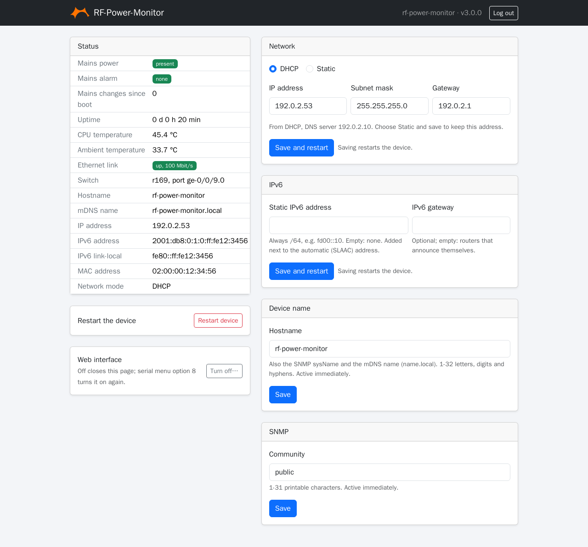
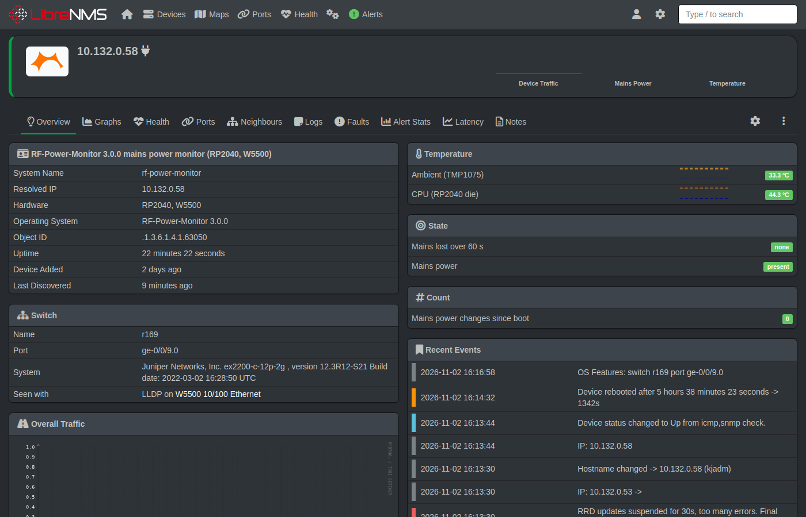
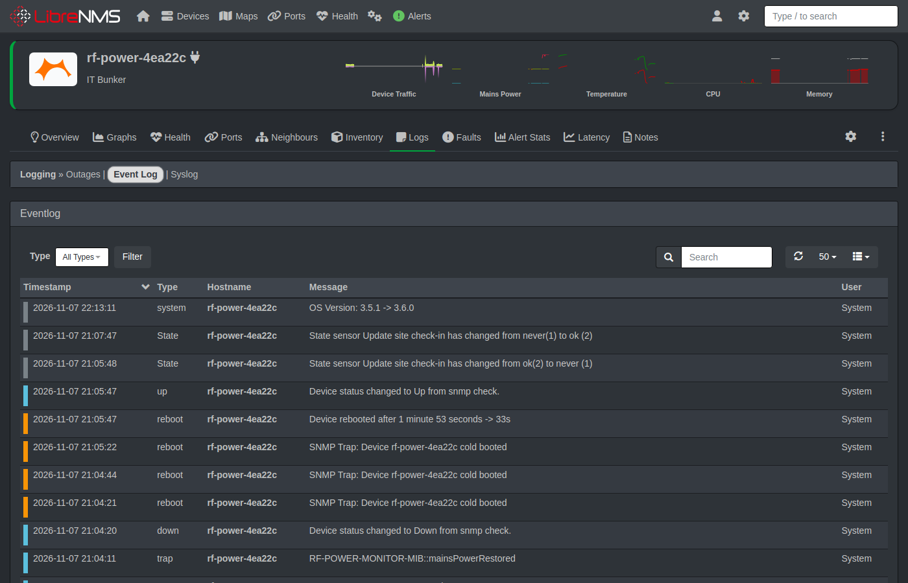
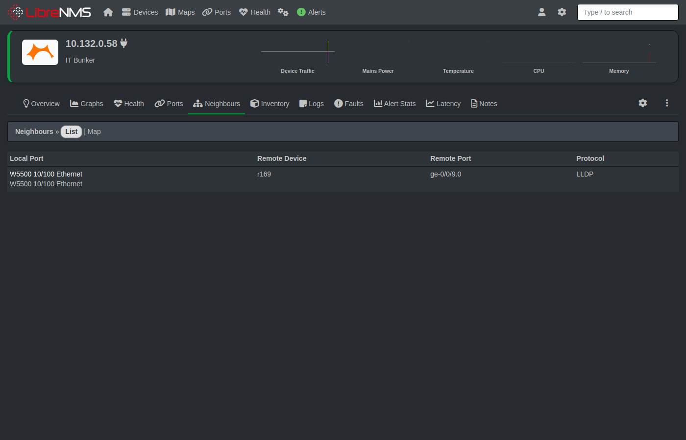

# RF-Power-Monitor: user manual

The RF-Power-Monitor watches one mains supply and tells your monitoring system (LibreNMS or another SNMP manager) when it goes away. This manual is for day-to-day use: reading the device, reacting to an alarm, changing settings and solving problems. To install a new device, see the [setup manual](SETUP_MANUAL.md).

## How it works, in short

- The device checks the mains input every millisecond. A change is accepted after 5 ms, so short glitches are ignored.
- When mains goes away or comes back, it sends a **trap** (a message) to your monitoring system at once and counts the change.
- If mains stays away for **60 seconds**, it raises the **mains alarm** and sends one more trap, *mainsPowerLostTooLong*. In LibreNMS this opens the alert. A shorter outage is logged, but does not alert.
- When mains comes back, the alarm clears and the alert recovers.


## Where to look

### The LEDs

| LED | Meaning |
|---|---|
| Green LED on the carrier | Mains present (hardware, works even without the firmware) |
| Red LED on the carrier | Mains absent |
| Onboard LED on the module, off | Normal operation |
| Onboard LED blinking slowly (2 Hz) | The factory reset button is being held |
| Onboard LED blinking fast | Factory reset triggered, the device restarts |
| Onboard LED blinking steadily, device not answering | The internal flash could not be read at start-up; see Troubleshooting |

### The web page

Open **http://&lt;device address&gt;/** or **http://&lt;hostname&gt;.local/** and log in as `admin`. The page shows:

- **Mains power** (green or red badge) and how often it changed since the device started
- **Mains alarm**: *none*, or *lost over 60 s*
- Uptime, CPU and ambient temperature, the Ethernet link
- **Switch**: the switch and port the device is plugged into (if the switch speaks LLDP)
- Name, addresses, MAC address and network mode; the firmware version in the top bar



From the page you can change the network settings, the name and the SNMP community, restart the device, and log out. A session ends after 15 minutes without use.

### The serial menu

Connect a USB cable and open a terminal (PuTTY: Serial, the device's COM port, 115200 baud), then press Enter. Option **1** shows the status screen with everything the device knows, including the default web password and the last restart cause. Option **5** shows the access log: rejected SNMP requests and failed web logins.

### LibreNMS

The device page shows the sensors *Mains power* (OK / warning), *Mains lost over 60 s* (OK / critical), *CPU* and *Ambient* temperature and *Mains power changes since boot*, the Ethernet port with its traffic, and in the **Switch** box the switch and port the device is plugged into (from LLDP, updated at each discovery; the box needs the RF-Power-Monitor plugin on the LibreNMS server):



Under **Logs → Event Log** you see what happened: the traps the device sent (mains lost and restored, restarts, wrong community), and changes LibreNMS noticed such as a new firmware version:



The **Neighbours** tab shows the switch and port the device is plugged into (from LLDP):



## When the alarm comes

*"Mains lost over 60 s"* in LibreNMS (or `Mains alarm: lost over 60 s` on the device) means the supply the device watches has been off for at least a minute.

1. **Check the supply itself**: the breaker, the fuse, the socket, upstream equipment. The red LED on the carrier confirms the device sees no mains.
2. **Check whether it is the device**: if the supply is fine but the red LED is lit, the device's mains connection (J1, or its fuse F1) may be the problem. That is work for a qualified electrician.
3. **When mains returns**, the alarm clears by itself and the alert recovers. Nothing needs resetting on the device.

The device keeps working without mains: it is powered over PoE (or USB), not from the mains it watches.

## Changing settings

Everything can be done in the serial menu; most things on the web page too.

| What | Serial menu | Web page | Takes effect |
|---|---|---|---|
| DHCP or static IPv4 | 2 / 3 | Network | after a restart (automatic) |
| Static IPv6 address | 9 | IPv6 | after a restart (automatic) |
| Name (hostname / sysName) | 4 | Device name | at once |
| SNMP community | 4 | SNMP community | at once |
| Contact, location, trap destination and version | 4 | | at once |
| Web password | 6 (`-` = back to the default) | | at once, logs browsers out |
| New random default web password | 7 | | at once |
| Web page on/off | 8 | Turn off… (only the menu turns it on again) | at once |

The device checks every value before it uses it and tells you what is wrong. Nothing changes until you confirm. Settings are kept across restarts, power cuts and firmware updates: they are stored twice, so a power cut while saving cannot lose them.

## The serial menu

The serial menu can do everything the device offers. It works even when the network does not, so it is the way in when nothing else is.

### Connecting

1. Connect a USB cable from the module (USB-C) to a PC. It appears as a COM port (Windows Device Manager → Ports).
2. Open PuTTY: **Serial**, that COM port, speed **115200**. Other terminals work too, as long as they set DTR (PuTTY does).
3. Press **Enter**. The menu appears; `?` and Enter shows it again at any time.

```
=== RF-Power-Monitor Menu ===
1. Show status
2. Use DHCP
3. Set static IP
4. SNMP settings
5. Access log
6. Web password
7. New default web password
8. Web interface on/off
9. Static IPv6
?. Show this menu
>
```

Type the number and Enter. Questions show the current value in brackets: **Enter** keeps it, **`-`** clears it (where clearing makes sense). Every value is checked; a wrong one is explained and asked for again. Nothing is changed until you answer **`y`** to the final question; **`n`** cancels and changes nothing. A line longer than the device accepts is ignored (`Input too long`).

Only one program can use the COM port at a time: close PuTTY before you update the firmware. The device also prints messages by itself, for example `Mains power LOST at ...` or `Network up after ... ms`; they can appear in the middle of the menu and do no harm.

### 1. Show status

Shows everything the device knows. An example (with example addresses):

```
Mains power: present (22 changes, last change 1053 s ago)
Mains alarm: none
SNMP: 802 packets, 802 responses (get 437, getnext 0, set 0), bad community 0, bad version 0, malformed 0
SNMP v2c: 792 requests, 365 getbulk
CPU temperature: 40.4 C
Ambient temperature: 27.1 C
Ethernet: link up, 100 Mbit/s, in 184054263 bytes / 1351415 packets, out 149671 bytes / 1002 packets
Ethernet drops: 0 discarded (no buffer), 0 errors, 211829 unknown protocol, 0 send errors
SNMP security: 0 rate limited, 0 access log events
SNMP community: "public"
sysName: "rf-power-monitor"
sysContact: ""
sysLocation: ""
Trap destination: "192.0.2.65" (4 sent, 0 failed)
Trap destination source: fixed (menu option 4)
Trap version: v2c
Hostname: rf-power-monitor (DHCP, mDNS rf-power-monitor.local)
Switch: core-sw1, port ge-0/0/9.0
Web interface: on (TCP port 80)
Web login: user admin, default password "k7wqz3mtd9" (change with option 6)
Core 0 stack: 6272 bytes never used
Last restart: reboot (0 watchdog restarts since power-on)
Mode: DHCP
Stored static IP: 192.168.1.100 / 255.255.255.0, gateway 192.168.1.1
Stored static IPv6: none (option 9)
DHCPv6: off (no router asked for it)
Live interface:
State: connected
MAC: 02:00:00:12:34:56
IP: 192.0.2.53
Subnet: 255.255.255.0
Gateway: 192.0.2.1
IPv6: FE80::FF:FE12:3456
IPv6: 2001:DB8:0:1:0:FF:FE12:3456
DNS: 192.0.2.10
```

| Line | Meaning |
|---|---|
| Mains power | `present` or `LOST`, how many changes since start-up and how long ago the last one was. `unknown (monitor not running)` means the mains monitor on core 1 is not running: restart the device, and report it if it stays. |
| Mains alarm | `none`, or `lost over 60 s` while mains has been gone for 60 s or more. |
| SNMP, SNMP v2c | Requests the device answered, and those it dropped (wrong community, wrong SNMP version, broken packets). |
| CPU / Ambient temperature | The chip temperature, and the room sensor on the carrier (`no sensor` without the carrier). |
| Ethernet | Link and speed, and traffic counters since start-up. |
| Ethernet drops | Frames the device could not take or does not use. `unknown protocol` grows on a normal network (for example spanning tree) and is no fault. |
| SNMP security | Requests rejected by the rate limit, and entries in the access log (option 5). |
| SNMP community … Trap version | The SNMP settings (option 4); `Trap destination` also counts sent and failed traps. `Trap destination source` says whether the destination is fixed or comes from DHCP. |
| Hostname | The device's name, as used for DHCP and mDNS. |
| Switch | The switch and port the device is plugged into (LLDP), or `none seen`. |
| Web interface, Web login | Whether the web page is on, and its login: the **default password** is shown here until you set your own. |
| Core 0 stack | A health figure for the firmware; it should stay well above 0. |
| Last restart | Why the device last started: `power-on`, `reset pin`, `reboot` or `watchdog` (the firmware hung and was restarted), and how many watchdog restarts happened since power was applied. |
| Mode, Stored static IP, Stored static IPv6 | The configured network mode and the stored static settings (used only in static mode, or when set). |
| DHCPv6 | `off` unless the IPv6 router asks for DHCPv6; then the leased address. |
| State | `connected`; `link up, waiting for DHCP lease` (keeps trying); `no Ethernet link, check cable`; or `W5500 not detected, check wiring`. |
| MAC … DNS | The addresses in use right now. IPv6 addresses are marked `(static)` or `(dhcpv6)` when they come from those. |

### 2. Use DHCP

Switches the network to DHCP (the default). Confirm with `y`; the device saves and restarts. The stored static address is kept for later.

### 3. Set static IP

Asks for the IP address, subnet mask and gateway in turn, and checks each: four numbers 0-255; a contiguous mask (`255.255.252.0` is fine, `255.0.255.0` is not); not the network or broadcast address; the gateway in the same subnet. Confirm with `y`; the device saves and restarts with the new address.

### 4. SNMP settings

Asks in turn:

| Question | Accepted | Note |
|---|---|---|
| Community | 1-31 printable characters | The SNMP "password". After saving, the old one gets no answer. |
| Hostname (sysName) | 1-32 letters, digits and `-`, not starting or ending with `-` | Also the DHCP name and `<name>.local`. |
| sysContact, sysLocation | 0-63 printable characters | `-` clears. |
| Trap destination | an IPv4 or IPv6 address, `dhcp`, or `-` for no traps | `dhcp` takes the destination from the DHCP server (option 224). An IPv6 destination must be a global address, not `fe80::`. |
| Trap version | `1` or `2c` | `2c` is recommended; an IPv6 destination needs `2c`. |

Confirm with `y`. The new settings work at once; no restart.

### 5. Access log

The latest rejected requests and failed web logins, newest first. A repeat of the newest entry (same source, same reason) is counted on that line instead of adding a new one. Each new entry is also printed when it happens.

```
Access log: 3 entries, 128 events since boot
  192.0.2.65      rate limited   x104    last 2 s ago
  192.0.2.65      bad version    x1      last 40 s ago
  192.0.2.80      bad community  x23     last 61 s ago
```

| Entry | Meaning |
|---|---|
| `bad community` | An SNMP request with the wrong community: a manager with an old setting, or someone guessing. |
| `bad version` | SNMPv3 or another version the device does not speak. |
| `malformed` | A broken or oversized SNMP packet. |
| `rate limited` | Too many requests from one source (more than 50 per second). |
| `set rejected` | Someone tried to change a value over SNMP; the device is read-only. |
| `web login failed`, `web locked out` | A wrong web password; five in a row lock the login for 30 s. |

### 6. Web password

Sets your own password for the web page: 8-32 characters, no spaces, typed twice (shown as `*`). `-` goes back to the default password. Every browser is logged out. The password can only be set here, not on the web page.

### 7. New default web password

Replaces the default web password with a new random one after `y`, and shows it. Use it if the default password became known; the old one stops working at once. An own password from option 6 stays in use.

### 8. Web interface on/off

Turns the web page off or on after `y`. Off closes the web port and logs every browser out; SNMP and the serial menu keep working. The setting is kept across restarts.

### 9. Static IPv6

Asks for a static IPv6 address and an optional IPv6 gateway. The address is used as a /64 next to the automatic ones; it must be a global (`2001:...`) or local (`fd..`) address, not `fe80::`. Leave the gateway empty to use the routers that announce themselves. `-` removes a value. Confirm with `y`; the device saves and restarts.

If a wrong network setting makes the device unreachable, use option 2 (DHCP) or 1 to see what it uses, or do a factory reset.

## Factory reset

Use this if you can no longer reach the device (wrong static address, unknown community) and have no USB access, or to hand the device on.

1. Press and hold the button **SW1** on the carrier (under the module). The onboard LED blinks slowly.
2. Keep holding for **10 seconds**, until the LED blinks fast. Then let go.
3. The device restarts with the defaults: DHCP, community `public`, name `rf-power-monitor`, no contact, location or trap destination, no static IPv6, web page on and back on its default password.

Letting go before 10 s cancels the reset. The device keeps working while you hold the button. The default web password itself is not changed by a reset; it is still on the status screen. After a reset, set the community, name and trap destination again (setup manual, step 4).

## Updating the firmware

Settings are kept across firmware updates.

1. Get the new `firmware.uf2` (built from this repository with PlatformIO, see the README's [Building and flashing](../README.md#building-and-flashing)).
2. Unplug USB, hold the **BOOTSEL** button on the module and plug USB in again. A drive called `RPI-RP2` appears.
3. Copy `firmware.uf2` to that drive. The device restarts with the new firmware.
4. Check the version in the web page's top bar or in LibreNMS (it picks up the new version at its next discovery, or at once with Rediscover).

With PlatformIO installed, `pio run -e pico -t upload` does the same over the USB cable. Close PuTTY first.

## Troubleshooting

| Problem | What to do |
|---|---|
| No alert although mains is off | Is the device reachable (LibreNMS shows it up)? The alert needs 60 s without mains. Check the trap destination (status screen `Trap destination: ... (N sent, ...)`) and the firewall on the LibreNMS server (UDP 162). Without traps, LibreNMS notices at its next poll (every 5 minutes). |
| Device has no address | Status screen `State:` says why: `no Ethernet link, check cable`, or `link up, waiting for DHCP lease` (it keeps retrying; check the DHCP server or the switch port). |
| Unreachable after setting a static address | Serial menu: option 1 shows the address in use; option 2 goes back to DHCP. Or factory reset. |
| LibreNMS gets no answers | The community must match (status screen `SNMP community`). Polling very hard is rate limited: the access log (option 5) shows `rate limited` or `bad community`. |
| Web page does not load | Use `http://`, not https. Status screen `Web interface:` must say `on`; option 8 turns it on. |
| Forgot the web password | Serial menu option 6, enter `-`: the default password from the status screen works again. |
| "Too many failed logins" | Five wrong passwords lock the login for 30 s. Wait, then log in with the right password. |
| "Form expired" or "Not logged in" | The session ended (15 minutes idle, restart, password change, or a third browser). Reload and log in. |
| Someone else knows the default web password | Serial menu option 7 makes a new random one; or set your own with option 6. |
| The device restarted by itself | Status screen `Last restart:` says why. `watchdog` means the firmware hung and the 8 s watchdog restarted it; settings are kept. If it repeats, report it. |
| Onboard LED blinks steadily, no network, no menu | The internal flash could not be read at start-up. Unplug and plug in again; if it stays, reinstall the firmware (see Updating). |
| No text in PuTTY | PuTTY must be set to Serial, the right COM port, 115200. Press Enter. Only one program can use the COM port at a time. |
| Temperature seems high | The ambient sensor sits on the board and warms with it; a few degrees above the room is normal. |

More detail: the [README](../README.md) (every menu option, the web page, network and IPv6), [docs/MIB.md](MIB.md) (all SNMP objects and traps) and [docs/LIBRENMS.md](LIBRENMS.md).
