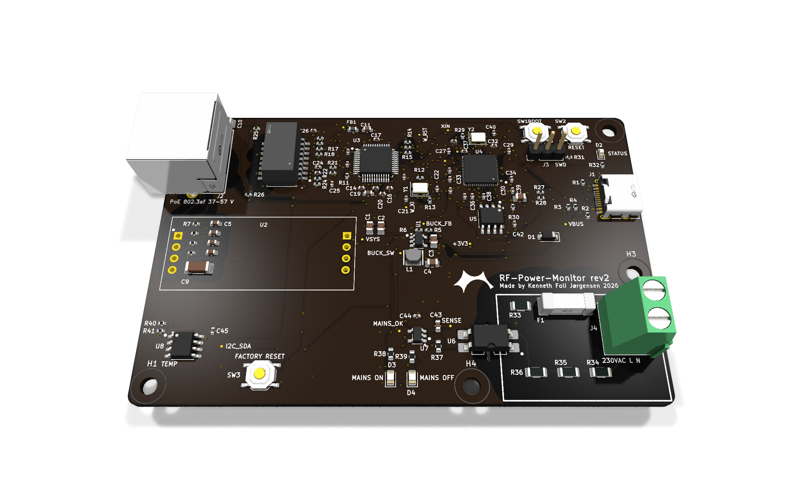
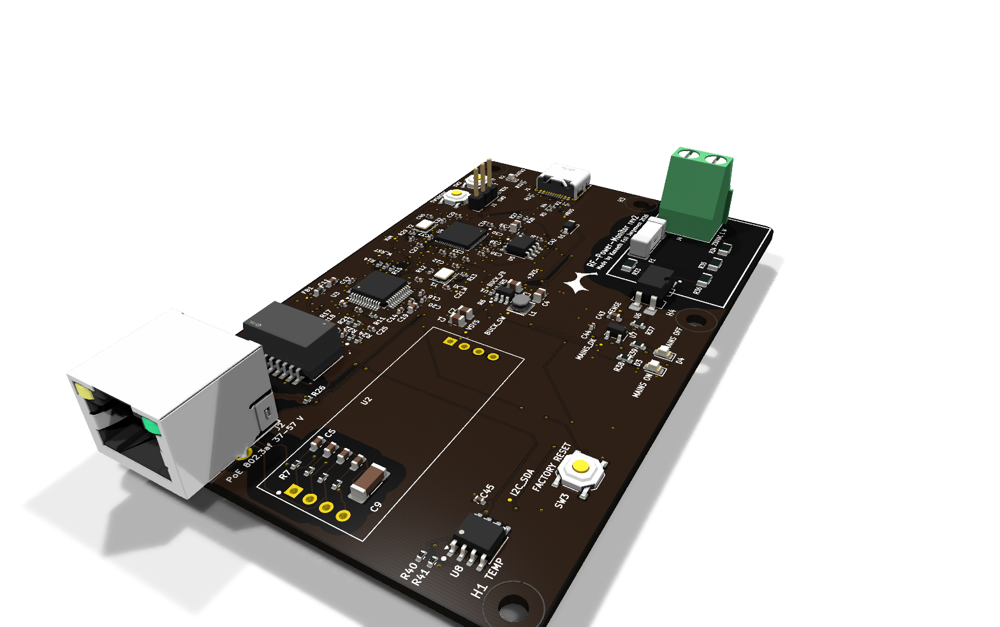
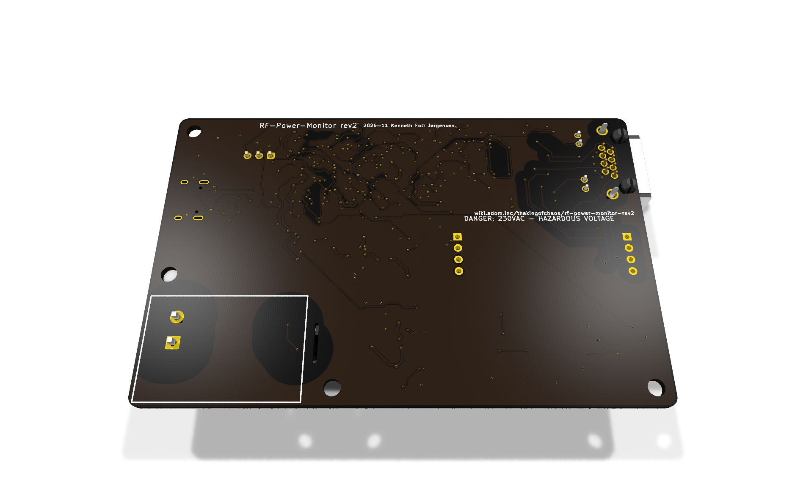

# RF-Power-Monitor rev2

> **Status: ordered 2026-11-07, not built yet.** Every value below is a design limit, a calculation or a simulation. No rev2 board has been assembled or measured yet. The boards in use are still [rev 1.1](../pico-poe-mains-carrier/README.md).

Rev 1 is a carrier for the WIZnet W5500-EVB-Pico-PoE module. Rev 2 puts everything from that module on one board, except the PoE power stage, which stays the plug-in WIZnet WIZPoE-P1:

- RP2040 with 2 MB QSPI flash (W25Q16JV) and a 12 MHz crystal, copied from the Raspberry Pi Pico, so **the firmware runs unchanged** (Arduino-Pico board `pico`, same pin map)
- W5500 Ethernet controller, 25 MHz crystal, HanRun HR601680 magnetics and a shielded RJ45 with link/activity LEDs
- WIZPoE-P1 isolated IEEE 802.3af PD module (5 V), fed from the transformer centre taps (mode A) and the spare pairs (mode B), plugged into two 1x4 2.54 mm sockets or soldered
- TLV62569 1.5 MHz buck from VSYS (5 V) to 3.3 V; USB-C for the serial menu, flashing and bench power (VBUS to VSYS through a B5819W, as on the Pico)
- The rev 1 mains detector, TMP1075 and factory reset button, unchanged in function

100 x 64 mm, 2 layers, 1.6 mm, black solder mask, ENIG, assembled by JLCPCB (109 placed parts, 55 BOM lines, all with LCSC numbers). Designed with Adom AI Flow in KiCad 10 (brief: [design/brief.md](design/brief.md)). A full datasheet is in [design/datasheet/](design/datasheet/rf-power-monitor-rev2-datasheet.pdf).

| Top | Bottom |
|---|---|
|  |  |

## Rev 1 against rev 2

| | Rev 1.1 (carrier) | Rev 2 |
|---|---|---|
| MCU and Ethernet | On the W5500-EVB-Pico-PoE module | On the board (U4 RP2040, U3 W5500) |
| PoE | On the module | WIZPoE-P1 plug-in module (U2), fitted by hand |
| Size | 80 x 51.5 mm, plus the module | 100 x 64 mm, one board |
| Mains terminal | J1 | J4 |
| Mains ON / OFF LEDs | D1 green / D2 red | D3 green / D4 red |
| Factory reset button | SW1 | SW3 |
| BOOTSEL / RUN | On the module | SW1 / SW2 |
| Status LED (GP25) | On the module | D2, blue |
| SWD | On the module | J3, 1x3 2.54 mm, not fitted |
| Case | `hardware/Case` | Does not fit; a new case is still to be made |

## Firmware

The firmware is the same: the pins match [include/pins.h](../../include/pins.h).

| GPIO | Function | GPIO | Function |
|---|---|---|---|
| GP16 | W5500 MISO (SPI0) | GP4 / GP5 | I2C0 SDA / SCL, TMP1075 at 0x48 |
| GP17 | W5500 CS | GP22 | Factory reset (SW3 to GND, hold 10 s) |
| GP18 | W5500 SCK | GP24 | VBUS sense (as on the Pico) |
| GP19 | W5500 MOSI | GP25 | Status LED (D2) |
| GP20 | W5500 RST | GP27 | MAINS_OK, HIGH = mains present |
| GP21 | W5500 INT | | |

GP29 (ADC3) is not connected: the Pico's VSYS/3 divider was left out. The firmware does not read it. The datasheet's pin table still lists GP29 as VSYS/3; that entry is wrong.

The firmware reports `HARDWARE_REVISION` (entPhysicalHardwareRev) from [include/version.h](../../include/version.h), which still names rev 1.1. It needs a change when rev 2 boards are in use (TODO.md section 19).

Flash it like a Pico: hold BOOTSEL (SW1) while plugging in USB-C, or let `pio run -e pico -t upload` reset it into the bootloader.

## Connectors

Positions are in mm from the board's top-left corner.

| Ref | Connector | Position | Signals |
|---|---|---|---|
| J2 | RJ45 8P8C, shielded, LEDs (Kinghelm KH-RJ45-56-8P8C-D) | 7.9, 11.5, left edge | 10/100 Ethernet, PoE mode A and B. Its front sticks out 3.1 mm past the edge, to pass through the case wall |
| J1 | USB-C (HRO TYPE-C-31-M-12), USB 2.0 device | 95.6, 21.0, right edge | VBUS, D+, D-, CC1/CC2 5.1 k |
| J4 | 2-pole screw terminal, 5.08 mm, 250 VAC | 93.5, 52.0, right edge | 230 VAC L, N (mains sense only) |
| J3 | SWD, 1x3 2.54 mm, not fitted | 78.8, 10.0 | 1 SWCLK, 2 GND, 3 SWDIO (Pico order) |
| U2 | WIZPoE-P1 sockets, 2 x 1x4 2.54 mm | 21.5, 33.5 | VC1+/- (centre taps), VC2+/- (spare pairs), 5 V, GND |

Mounting: 4x M3 (3.2 mm) at (3.5, 60.5), (36.0, 60.5), (96.5, 3.5) and (96.5, 38.0). The tallest parts are J2, J4 and the WIZPoE-P1 on its sockets.

## Isolation

| Boundary | Clearance | Creepage | How |
|---|---|---|---|
| 230 VAC mains sense to everything else | 6.5 mm | 6.4 mm | Rev 1 rules, as DRC rules in `kicad/rf-power-monitor-rev2.kicad_dru`; 5 kVrms optocoupler (U6 LTV-814S); routed slot under U6; no copper pour in the mains area; silkscreen frame with a hazardous-voltage warning |
| Ethernet line side and PoE to logic | 2.0 mm | | 1500 Vrms (802.3, HR601680 hipot rating); Bob Smith termination to chassis |

The mains loop is fused (F1, T 1 A 250 VAC) and carries about 1.2 mA. Wiring to mains must be done by a qualified person, the board must sit in a closed enclosure, and the supply must be fused upstream. The mains section has not been hipot tested.

## Known limits

From the design checks (details in the datasheet, section 9):

- **WIZPoE-P1 minimum load:** the module specifies 150 mA minimum on 5 V; the board draws about 134 mA. Check that the module does not cycle at this load; if it does, add a bleed load.
- **HR601680 is not a PoE-rated transformer.** Its centre taps carry about 19 mA DC here (802.3af allows 350 mA per pair): low risk, but outside its rating.
- No TVS diodes on the Ethernet, USB or mains connectors; no EMC or safety testing.
- The RP2040's exposed pad has 3 thermal vias (AI Flow asks for 6); the thermal check passed at about 0.1 W.
- 19 small passives carry their reference on the fabrication layer only; 7 test points are unlabelled.

## Design checks

- ERC: 0 violations.
- DRC (KiCad 10, re-run 2026-11-03 on the saved board): 0 errors, 0 unconnected; 2 silkscreen warnings at U6.
- Schematic parity: 124 warnings, none of them a wrong connection. 85 are a schematic field ("Note") that the footprints do not carry. 39 are pins the schematic marks unconnected that have no net on the board (spare RP2040 GPIOs, W5500 reserved pins, NC pins).
- Calculations in `design/calcs.json` (`design/calcs.py`), buck simulation in `design/sim/` (ngspice, 4.7 mV ripple at 0.3 A).
- Bring-up measurements to take on the first board (rails, crystals, W5500 reset and SPI, mains sense, LEDs): `design/tests.json`.

## Files

| Path | Contents |
|---|---|
| `kicad/` | KiCad 10 project: `rf-power-monitor-rev2.kicad_pro`, `.kicad_sch`, `.kicad_pcb`, `.kicad_dru` |
| `kicad/lib/` | Project symbols and footprints (`RFPM_Rev2`) and the board's parts library (`pcm/`, copy of the AI Flow wiki package, with 3D models) |
| `kicad/tools/` | `gen_sch.py` (schematic from `design/netlist.json`), `gen_pcb.py` (placement and outline; routing is AI Flow's), `fab.sh` (fab files), helpers |
| `design/` | Brief, requirements, netlist, BOM with LCSC numbers and stock (2026-11-02), calculations, simulation, bring-up tests, schematic PDF, datasheet |
| `out/fab/` | Gerbers (zip), JLCPCB BOM and CPL, schematic PDF: see its [README](out/fab/README.md) for the order settings |
| `out/3d/` | 3D model as GLB, and the STEP zipped (`rf-power-monitor-rev2-step.zip`, the STEP itself is about 60 MB) |
| `out/img/` | Renders: top, bottom, isometric, schematic, layout and field-solve pictures |
| `aiflow/` | AI Flow spec and placement moves |

The schematic is generated: change `design/netlist.json` and run `python3 kicad/tools/gen_sch.py`, not the `.kicad_sch` by hand. The routed board is edited in KiCad. After any change to the board, save it and run `bash kicad/tools/fab.sh` from this folder (needs `kicad-cli` and `zip`, e.g. in WSL) to regenerate `out/fab/`.

AI Flow's working files (`aiflow-run/`, board iterations, field solves, logs) and the vendor datasheets stay out of git; see `.gitignore`.

## Ordering

Upload `out/fab/rf-power-monitor-rev2-gerbers.zip` to JLCPCB with 2 layers, 1.6 mm, 1 oz, black mask, white silkscreen, ENIG, and the BOM and CPL for assembly. U2 (WIZPoE-P1) and J3 (SWD) are not assembled: order the WIZPoE-P1 separately with two 1x4 2.54 mm female sockets. Check the rotation of J1 (USB-C) and J2 (RJ45) in JLCPCB's placement preview.
