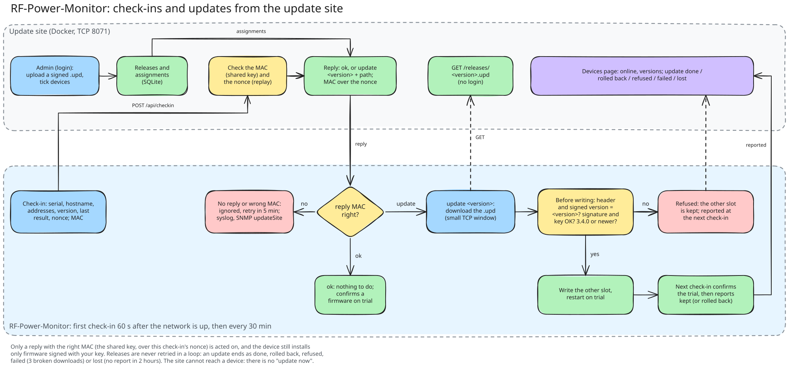

# RF-Power-Monitor update site

A small website that every RF-Power-Monitor (firmware 3.4.0 or newer) checks in with
every 30 minutes, and that installs a firmware release on the devices you choose.

- **Devices** (`/`, no login): hostname, serial number, IPv4 and IPv6 addresses,
  firmware version and slot, last check-in, online/offline (offline after 65
  minutes without a check-in) and the state of an update.
- **Admin** (`/admin`, login): upload a signed release (`release/rf-power-monitor-<version>.upd`
  from `tools/fw_release.py`), tick devices and pick a release, and make the shared key.

The site never holds the signing key: each device checks the release's Ed25519
signature itself, writes it to its other slot and starts it on trial (rollback if
it is not reachable). Each check-in and each reply is authenticated with the
shared key (keyed BLAKE2b), so only this site can tell a device to update.



Python 3.11+ standard library only; SQLite and the release files live in the data
directory.

## Run it in Docker (next to LibreNMS)

```sh
cd update-server
# once: the admin password, in compose.override.yml (gitignored)
cat > compose.override.yml <<'EOF'
services:
  rfupdate:
    environment:
      RFUPDATE_ADMIN_PASSWORD: "a long password"
EOF
docker compose up -d --build
```

The site listens on TCP **8071** (LibreNMS uses 8070). If 8071 is taken on the PC, set another host port in `update-server/.env` (gitignored), e.g. `RFUPDATE_PORT=8074`, and use that port in the devices' URL. Devices on the LAN need to
reach it: on Windows with WSL in mirrored mode, add the same kind of firewall rules
as for LibreNMS (a Hyper-V firewall rule and a Windows rule for TCP 8071).

Data is in the named volume `rfupdate-data` and survives `docker compose down` and
rebuilds (not `down -v`).

## First use

1. Log in at `http://<pc>:8071/admin` and press **Generate new key**. Copy the key: it is
   shown only once.
2. On each device, serial menu option 10 (or the device's Firmware page, card
   "Update server"): URL `http://<pc>:8071` and the key. Or set the URL by DHCP
   option 225 (text) and choose `dhcp`; the key is always entered on the device.
3. Within a minute the device appears on the Devices page.
4. Upload a release, tick devices, pick the release and press **Update ticked devices**.
   They download it at their next check-in (within 30 minutes).

An update ends as **done** (the device runs it, kept), **rolled back** (the device
went back to its old firmware), **refused** (bad signature, wrong key, on trial...),
**failed** (three broken downloads) or **lost** (no report within 2 hours).

## Without Docker

```sh
RFUPDATE_ADMIN_PASSWORD=... python -m rfupdate --port 8071 --data ./data
```

## Tests

```sh
python -m unittest discover -s update-server/tests -v
```

`tests/vectors.json` holds MAC test vectors shared with the firmware's
`test/native/test_update_protocol`.
